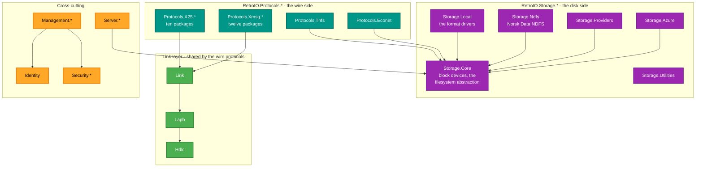
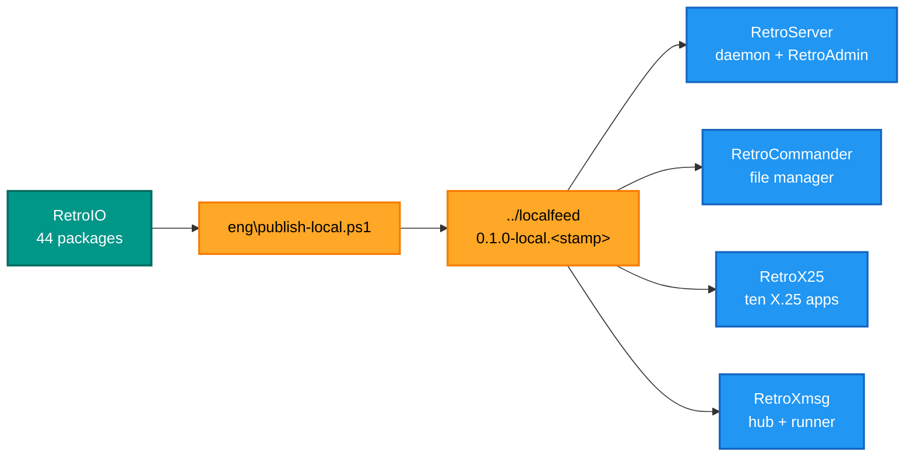

# RetroIO

**Storage, filesystems and communications for retro computing** — the library half of
[RetroCore Labs](https://github.com/RetroCoreLabs). Forty-four NuGet packages that read and write
the disk formats, and speak the network protocols, of machines built between roughly 1975 and 1995.

## Why it exists

Retro hardware is reachable in two ways: through its **storage** and through its **wire**. A
Norsk Data ND-100 keeps its files in NDFS; a Commodore 64 in D64; a BBC Micro talks Econet; an
ND machine talks X.25 and XMSG. Every one of those formats and protocols is documented somewhere,
implemented nowhere you can install, and subtly different from what the documentation says.

RetroIO exists so that work is done **once**. Before it, the same NDFS reader existed three times
in three projects, each with different bugs, and the X.25 stack could not be used by anything but
the program it was written inside. Now a file manager, a server daemon, a switch and a diagnostic
tool all use the same packages — so a fix to the XMSG codec reaches all of them, and a disagreement
between two of them is a test failure rather than a mystery.

It is also the deliberate split between **library and application**. Nothing in `src/` has a
`Main`. That is what lets an X.25 conformance test drive the packet layer with no sockets, and what
lets the same code run in a desktop app, a Windows service and a console tool.

## What you can use it for

- **Read and write vintage disk images** — NDFS, D64/T64/TAP/CRT/PRG/P00, DragonDOS, FAT12/16/32,
  V7, FFS, ADFS and more — without knowing their on-disk layouts.
- **Serve files to a real 8-bit machine** over **TNFS**, or to a BBC Micro over **Econet/AUN**.
- **Build an X.25 network**: packet layer, LAPB, XOT, a switching engine, routing, monitoring.
- **Talk to a SINTRAN machine** with **XMSG** — file access, chat, the XROUT name service, the
  request/response library, and the kernel API a SINTRAN task would have called.
- **Put a management API on any of it** — REST plus SignalR push, with users, groups and a firewall.
- **Write a tool in an afternoon**: the four in `tools/` are each a few hundred lines on top of
  these packages.

---

## Prerequisites

| # | Requirement | Needed for | How to check |
|---|---|---|---|
| P1 | .NET SDK as pinned in `global.json` | Everything | `dotnet --info` |
| P2 | PowerShell 7+ | `build.ps1` and the `eng\` scripts | `$PSVersionTable.PSVersion` |
| P3 | Nothing else | Building the libraries | There are no native dependencies |
| P4 | `eng\setup-test-data.ps1` run once | The tests that open real disk images | `dir demo\test-images` |
| P5 | The image corpus at `Documents\RetroFS\test-images` (under your user profile) | The Dragon and PC image tests | `dir` it — those images exist only there |
| P6 | Python 3 | `eng\gen-*.py` (the code generators in this repository), and `eng\check-docs.py` (the documentation checker) | `python --version` - on Windows here the command is `python`; `python3` does not exist |
| P7 | A real machine or emulator | Only the lab tests | See the app repos' manual test documents |

```powershell
# from the repository root
.\build.ps1                                # build, test, publish the four tools
powershell -File eng\publish-local.ps1     # pack to ../localfeed as 0.1.0-local.<stamp>
```

`build.ps1` runs the tests and **stops before publishing if any fail**. Useful switches:
`-SkipTests` when you know why, `-Clean`, `-FrameworkDependent` for small exes that need .NET
installed, `-Runtime linux-x64`.

Every `dotnet` call it makes passes `-nodeReuse:false`. Do the same by hand: node reuse leaves
MSBuild workers behind that lock DLLs, and the next build then quietly keeps the old binary while
the tests report green against stale code.

---

## Repository layout

| Folder | What is in it |
|---|---|
| `src/` | One folder per published package; inside each, `src/` is the code and `tests/` its own tests |
| `tests/` | Test projects that span several packages and so belong to none of them |
| `tools/` | Dev-only applications, never shipped as packages |
| `eng/` | Shared MSBuild files (`eng/build/`), the package icon, and the dev scripts |
| `DOC` | Junction to the NDInsight XMSG research notes the protocol code cites — not RetroIO's own docs |
| `demo/test-images` | Junction to the disk-image test corpus |

Both junctions are created by `eng/setup-test-data.ps1` and are in `.gitignore`.

---

## The package families

Two sides of I/O, which is what the product is named for: **Storage** and **Protocols**. Everything
else supports them.



### Storage — the disk side

| Package | What it is | README |
|---|---|---|
| `RetroIO.Storage.Core` | The abstractions: block devices, volumes, directories, files. Everything else implements these | [README](src/RetroIO.Storage.Core/README.md) |
| `RetroIO.Storage.Local` | The format drivers — the largest package here, and the one that knows D64 from DragonDOS | [README](src/RetroIO.Storage.Local/README.md) |
| `RetroIO.Storage.Ndfs` | Norsk Data NDFS: the filesystem an ND-100 boots from | [README](src/RetroIO.Storage.Ndfs/README.md) |
| `RetroIO.Storage.Providers` | Mounting and provider resolution | [README](src/RetroIO.Storage.Providers/README.md) |
| `RetroIO.Storage.Azure` | Blob-backed storage, for serving images that are not on this machine | [README](src/RetroIO.Storage.Azure/README.md) |
| `RetroIO.Storage.Utilities` | Shared helpers the storage packages need | [README](src/RetroIO.Storage.Utilities/README.md) |

### Protocols — the wire side

| Package | What it is | README |
|---|---|---|
| `RetroIO.Protocols.Tnfs` | TNFS: filesystem-over-UDP, what an 8-bit machine with a network adapter speaks | [README](src/RetroIO.Protocols.Tnfs/README.md) |
| `RetroIO.Protocols.Econet` | Acorn Econet over AUN, including a Level-3 file server and its `*` commands | [README](src/RetroIO.Protocols.Econet/README.md) |
| **X.25 — ten packages** | Packet layer, client, switch, routing, monitor, NMC, SINTRAN, runtime | [family index](src/RetroIO.Protocols.X25/README.md) |
| **XMSG — twelve packages** | The ND messaging system: codec, kernel API, file access, chat, sync, Ethernet, node | [family index](src/RetroIO.Protocols.Xmsg/README.md) |

### Link layer

| Package | What it is | README |
|---|---|---|
| `RetroIO.Hdlc` | HDLC framing: flags, transparency, frame check sequence | [README](src/RetroIO.Hdlc/README.md) |
| `RetroIO.Lapb` | LAPB, the X.25 data link layer, with both dialects | [README](src/RetroIO.Lapb/README.md) |
| `RetroIO.Link` | Links as a concept: serial, TCP-LAPB and XOT behind one interface | [README](src/RetroIO.Link/README.md) |

### Cross-cutting

| Package | What it is | README |
|---|---|---|
| `RetroIO.Identity` | RetroIDP: GUID-based users, groups and external identity mapping | [README](src/RetroIO.Identity/README.md) |
| `RetroIO.Security` | The security abstractions | [README](src/RetroIO.Security/README.md) |
| `RetroIO.Security.Implementation` | Their concrete implementation | [README](src/RetroIO.Security.Implementation/README.md) |
| `RetroIO.Security.Firewall` | Rule-based access control for the protocol servers | [README](src/RetroIO.Security.Firewall/README.md) |
| `RetroIO.Management.Contracts` | The API's DTOs, depending on nothing | [README](src/RetroIO.Management.Contracts/README.md) |
| `RetroIO.Management.Api` | The REST API and the SignalR hub | [README](src/RetroIO.Management.Api/README.md) |
| `RetroIO.Management.Client` | A typed client for both of those | [README](src/RetroIO.Management.Client/README.md) |
| `RetroIO.Server`, `.Server.Core`, `.Server.Hosting` | Hosting a protocol server as a service | [Core](src/RetroIO.Server.Core/README.md) |
| `RetroIO.X25` | The clean X.25 codec: parse and build packets, no transport | [README](src/RetroIO.X25/README.md) |

---

## The four tools

Dev-only applications in `tools/`, published by `build.ps1` to `publish\win-x64\`. Each has its own
README.

| Tool | What it is for |
|---|---|
| [ndfs-analyzer](tools/RetroIO.Tools.NdfsAnalyzer/README.md) | Inspect, verify and repair a Norsk Data NDFS image |
| [ndfs-password](tools/RetroIO.Tools.NdfsPassword/README.md) | Read, set and clear the passwords inside an NDFS image |
| [tnfs-stress](tools/RetroIO.Tools.TnfsStress/README.md) | Load and soak a TNFS server |
| [retroio-demo](tools/RetroIO.Demo/README.md) | A worked example of the library surface |

---

## How the apps consume it

Nothing references RetroIO by project. The app repos take it as **packages**, which is what keeps
the library honest: if an app needs a type that is not public, the package is wrong, not the app.



Until the packages are on nuget.org they come from the local feed, so a fresh CI run is red until
the first publish. That is expected and is not a broken build.

---

## How it is tested

Fourteen test projects. Most live beside the package they test, in `src/<Package>/tests/`; the ones
that span packages live in `tests/`.

| Project | Covers |
|---|---|
| `src/RetroIO.Storage.Local/tests` | The format drivers, against real disk images |
| `src/RetroIO.Management.Api/tests` | The REST API and the hub |
| `src/RetroIO.Protocols.Xmsg/tests` and eight more `Xmsg.*` | The XMSG codec, kernel API, chat, Ethernet, live, NDFS, node, sync |
| `tests/RetroIO.Protocols.X25.Tests` | The X.25 stack across packages |
| `tests/RetroIO.Tests` | Everything that belongs to no single package |
| `tests/RetroIO.Protocols.Xmsg.TestSupport` | Shared fixtures, not a test project itself |

### One file, two implementations

`tests/x25-vectors/x25-vectors.json` holds the **shared X.25 conformance vectors**. The same file
is read by this stack *and* by the C emulator in `x25emu` (`tests/unit/test_vectors.c`). A
disagreement between the two therefore shows up as a failing test on both sides, rather than as a
mystery on a trunk between them.

That is the most useful thing in the test tree, and the reason to add a vector rather than a
one-sided unit test whenever the two stacks have to agree about bytes on a wire.

---

## Conventions

- **Naming** is governed by `NAMING.md` in the workspace root, one level above this repository (so a path, not a link): package id = root namespace = folder
  name; `RetroIO.Storage.*` and `RetroIO.Protocols.*` are the two sides; nothing sits directly
  under `RetroIO.` unless it belongs to neither.
- **Diagrams** follow `MERMAID_COLOR_STANDARDS.md`, also in the workspace root. `python eng/check-docs.py` checks every link and diagram here.
- **The org is RetroCoreLabs.** `HackerCorpLabs` is retired and must not appear in anything new.
- Packages ship with **SourceLink** enabled through the shared `eng/build` props. Never disable it
  in an individual csproj.
