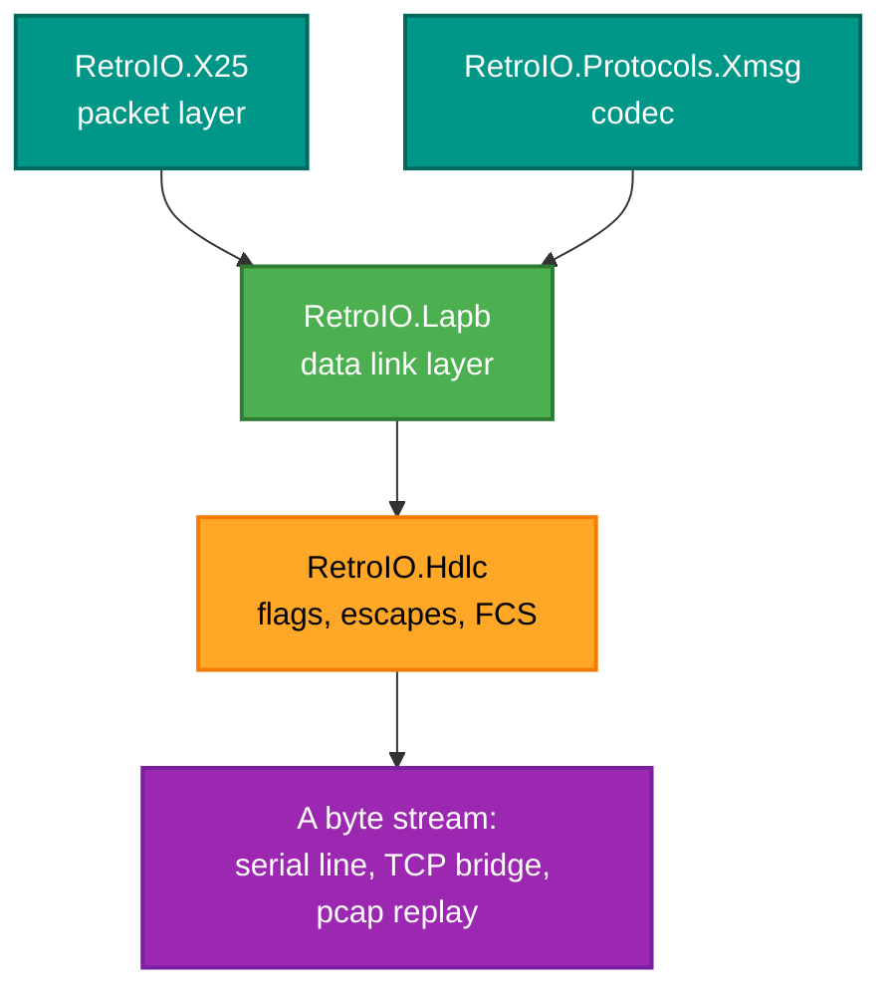

# RetroIO.Hdlc

## What it is

HDLC framing: the layer that turns a **stream of bytes** into **discrete frames** and back. A flag
octet (`0x7E`) marks the boundaries, an escape octet (`0x7D`) keeps that flag from appearing inside
the data, and a frame check sequence says whether what arrived is what was sent.

## Why you need it

TCP and a serial line both deliver bytes with no marks in them. Every frame-oriented protocol above
— LAPB, and through it X.25 and XMSG — needs to know where one frame stops and the next begins, and
needs to detect a frame that was corrupted on the way. Over a real serial line both of those happen
constantly.

## What you can use it for

- Framing and unframing any byte stream to or from a real ND machine, a serial line, or a TCP bridge.
- Computing or checking an FCS-16 on its own.
- Decoding a capture: the streaming decoder takes arbitrary chunks and yields whole frames, so it
  works on a pcap replay as happily as on a live socket.
- Matching a **specific** peer's escaping rules — which is the whole point of `SendAccm` below, and
  the reason this package exists rather than one hard-coded framer.

## Prerequisites

| Requirement | Notes |
|---|---|
| .NET SDK as pinned in `global.json` | |
| **No dependencies** | Not on other RetroIO packages, not on anything external |

## Where it sits

---

One HDLC framing implementation, shared by the X.25 and the SINTRAN/XMSG stacks.

It replaced five separate framers that had drifted apart: two of them lost a frame after a shared
flag, two had no maximum frame length at all, one treated end of buffer as a frame terminator, and
the two FCS helpers had methods of the same name whose results differed by a final complement.

## What is in it

| Type | Role |
|---|---|
| `HdlcFcs` | FCS-16 arithmetic: poly x16+x12+x5+1 reflected, init all ones, complemented on transmit, residue `0xF0B8` |
| `HdlcFramerOptions` | Per-link policy: transparency, transmit ACCM, min and max frame length, whether the framer owns the FCS |
| `HdlcEncoder` | Pure, stateless encode |
| `HdlcDecoder` | Streaming decode, one instance per link direction, zero allocation per frame |

## The one thing to get right

`HdlcFramerOptions.SendAccm` decides how much is escaped on transmit, and the two stacks genuinely
differ:

- `HdlcFramerOptions.X25` escapes every octet below `0x20`, the RFC 1662 section 7.1 default.
- `HdlcFramerOptions.Xmsg` escapes only the flag and the control escape, the ITU-T X.25
  clause 2.2.2.2 minimum. This is what the real ND machines do - across the whole capture corpus
  the only octets ever following `0x7D` are `0x5D` and `0x5E`.

Receive needs no such option: unescaping is a blind XOR `0x20`, so a decoder reads either.

## References

ITU-T X.25 (10/96) clause 2, ITU-T Q.921 (09/97), RFC 1662. Clause numbers are cited in the XML
docs at each decision they justify.
