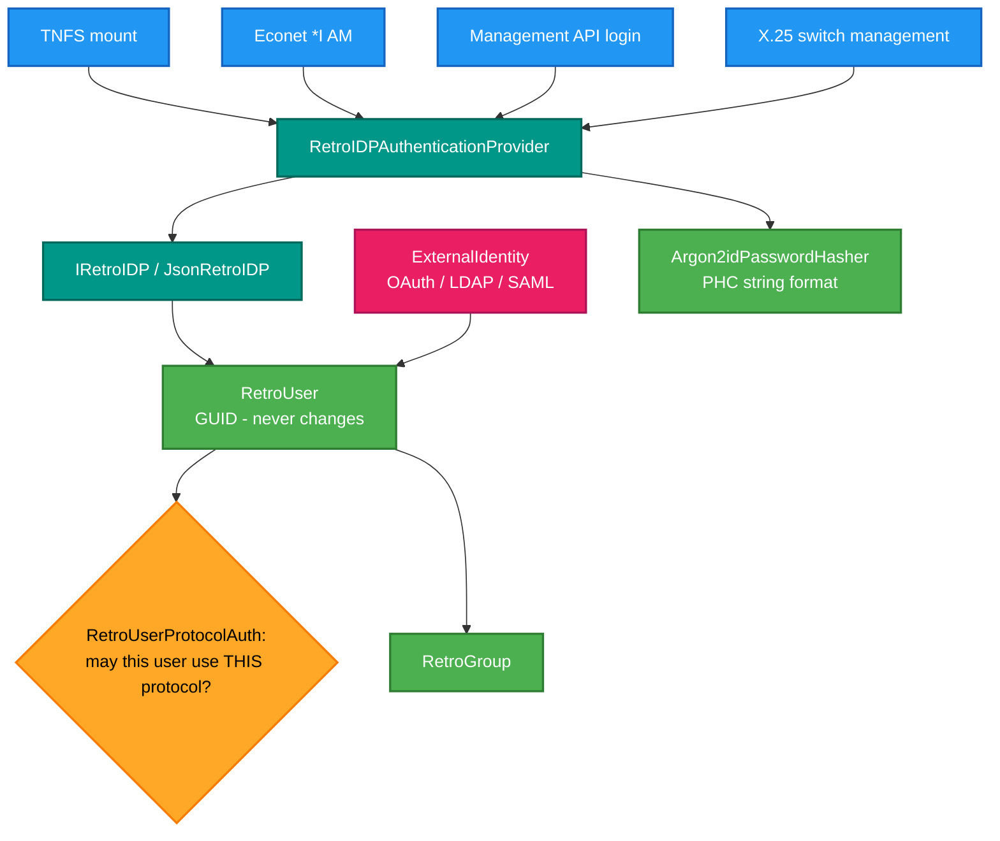
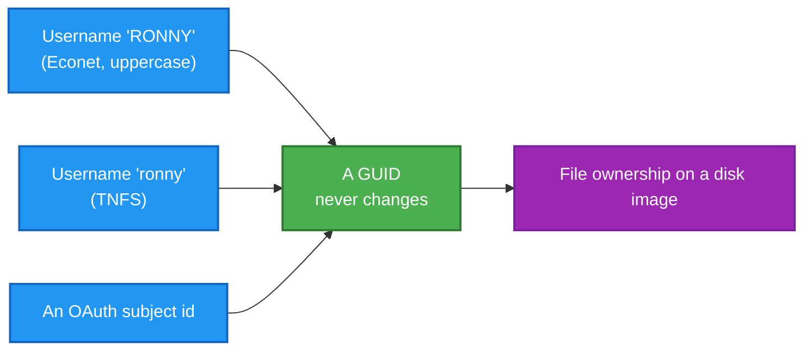

# RetroIO.Identity

## What it is

**RetroIDP** — the identity provider. GUID-based users and groups, Argon2id password hashing, per-protocol
login policy, and mapping from external identities (OAuth, LDAP, SAML) onto internal users.

## Why you need it

Because RetroIO serves **several protocols at once**, and they each have their own idea of a login. TNFS sends a
user and password on mount; Econet does `*I AM`; the X.25 switch has management users; the management API
issues bearer tokens. Without one identity system, each of those grows its own user list, and then a password
change means four places.

The **GUID** is the key decision, and the reason is stated in the code: the internal identity never changes and
is globally unique. A username can be renamed, a protocol can use a different spelling of it, an external
provider can change its own identifier — and none of that moves the underlying user. File ownership on a disk
image survives all of it.

`RetroUserProtocolAuth` exists because "may this user log in?" is genuinely per-protocol: an account allowed to
mount over TNFS is not necessarily allowed to administer the server. `RetroFsProtocol` and
`ProtocolAuthResult` make that explicit rather than implied.

Argon2id is the hash, in PHC string format — the current recommendation, chosen rather than inherited.

## What you can use it for

- One user list for every protocol in RetroIO.
- **Econet logins**: `*I AM` resolves against RetroIDP, case-insensitively, and carries an Acorn profile.
- TNFS mount authentication, and management API tokens.
- Groups, and well-known system principals (`WellKnownPrincipals`).
- **Mapping an external identity** — OAuth, LDAP or SAML — onto an internal user, so a modern sign-in can own
  files on a 1980s filesystem.
- Storing it all as JSON on disk (`JsonRetroIDP`), with no database.

## Prerequisites

| Requirement | Needed for | Notes |
|---|---|---|
| .NET SDK as pinned in `global.json` | Everything | |
| A writable directory | `JsonRetroIDP` | Users and groups are JSON files |
| An external provider | External identity mapping only | Optional |
| No database | — | Deliberately |

## Who asks, and what they get

## Why a GUID rather than a username

Rename the user, change the provider, add a protocol — the GUID and therefore the ownership stay put.

## Contents

| Type | Role |
|---|---|
| `IRetroIDP`, `JsonRetroIDP` | The provider, and a JSON-on-disk implementation |
| `RetroUser` | The internal identity: a GUID that never changes |
| `RetroGroup` | A group, also GUID-based |
| `RetroUserProtocolAuth` | Per-protocol login policy and audit timestamps |
| `RetroFsProtocol`, `ProtocolAuthResult` | Which protocol is asking, and the answer |
| `RetroIDPAuthenticationProvider`, `AuthenticationResult` | The simple interface servers use |
| `Argon2idPasswordHasher` | Argon2id, PHC string format |
| `ExternalIdentity` | OAuth / LDAP / SAML mapped to an internal GUID |
| `WellKnownPrincipals` | System principals |

## Related

- [`RetroIO.Security`](../RetroIO.Security/README.md) — authorisation, auditing and rate limiting, which take
  an authenticated principal from here.
- `EconetUserDirectory` in [`RetroIO.Protocols.Econet`](../RetroIO.Protocols.Econet/README.md) — the Acorn
  profile over a RetroIDP user.
