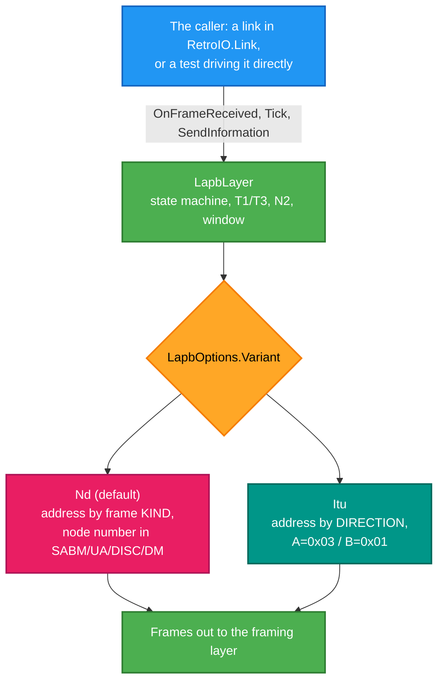
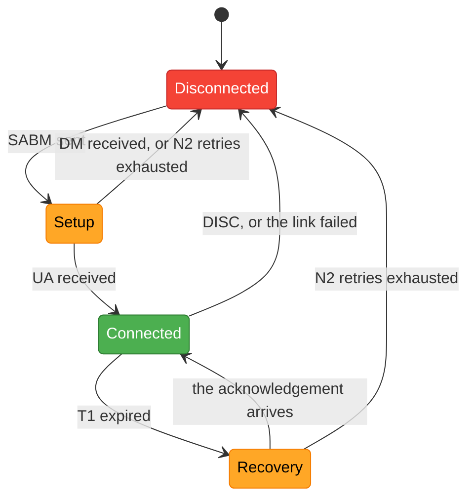

# RetroIO.Lapb

## What it is

LAPB — Link Access Procedure, Balanced — is X.25's layer 2. It takes a line that loses and corrupts
bytes and turns it into a **reliable, ordered frame pipe** between two stations, using HDLC in
Asynchronous Balanced Mode.

## Why you need it

The packet layer above assumes delivery is reliable and in order: it numbers packets, not frames,
and has no way to recover a dropped octet. LAPB is what makes that assumption safe — sequence
numbers, acknowledgements, retransmission on a timer, and a frame check sequence.

It is also **the** place the two dialects differ. Norsk Data equipment does not speak textbook
ITU-T LAPB, and the differences are small enough to look like bugs and large enough to stop a link
coming up. Having one engine with a `Variant` switch means the difference is documented in one place
instead of being rediscovered.

**It is deliberately absent for XOT**, where RFC 1613 puts the X.25 packet straight onto TCP — TCP
already provides what LAPB provides, and running both means two retransmission schemes arguing.

## What you can use it for

- Bringing up a link to a real ND machine over a serial line or a TCP bridge.
- Running X.25 over TCP *with* LAPB, to test a serial trunk without a cable.
- Driving a whole link failure and recovery **in microseconds** in a unit test — the engine owns no
  clock and starts no threads, so the test supplies time.
- Decoding LAPB out of a capture: `LapbFrame` and `LapbControl` are usable on their own.

## Prerequisites

| Requirement | Notes |
|---|---|
| .NET SDK as pinned in `global.json` | |
| **Zero dependencies** | Including on `RetroIO.Hdlc` — framing is the caller's business |

## Where it sits, and the two dialects

Link set-up, which is the same in both dialects:

---

The one LAPB data link layer for every RetroIO link. Zero dependencies.

`LapbLayer` decodes and emits frames, runs the ITU-T X.25 (10/96) clause 2 state machine with its
T1/T3 timers, N2 retries, go-back-N window, reject condition and FRMR reporting, and speaks either
of two dialects, chosen by `LapbOptions.Variant`:

- **`LapbVariant.Nd`** (the default) - the Norsk Data dialect the bench machines speak: address
  `0x01` on link management and `0x09` on data transfer, with `0x80` set when the information field
  has an odd byte count (the ND-100's word DMA needs to know), and the sender's two-octet node
  number carried in SABM, UA, DISC, DM and the supervisory frames.
- **`LapbVariant.Itu`** - address A (`0x03`) on commands from the DCE and responses from the DTE,
  address B (`0x01`) on commands from the DTE and responses from the DCE (2.4.2); no information
  field on anything but I and FRMR (2.3.4); the C/R bit in the FRMR diagnostic (2.3.4.10).
  `LapbOptions.IsDte` says which side this station is.

The engine is driven by its caller: `OnFrameReceived` for each frame, `Tick(now)` for time,
`SendInformation` to send. It starts no threads and owns no clock, so a test can drive a whole
link failure and recovery in microseconds.

`LapbFrame` and `LapbControl` (the frame decode and the control-byte constants) live here too;
the pcap tooling in `RetroIO.Protocols.Xmsg.Hdlc` reads them from here.

## Namespaces

The types keep the namespaces they had before the move (`RetroIO.Protocols.Xmsg.Live` for the
engine, `RetroIO.Protocols.Xmsg.Hdlc` for the frame types), so no consumer had to change. They
are historical, not a statement about ownership: this project belongs to the link layer, not to
XMSG. Renaming them is a separate cosmetic step whenever it is wanted.

## Specification and tests

Text: the specification set kept outside the repository (X.25 10/96 clause 2 for ITU; `DOC\LAPB-REQUIREMENTS.md` and the
capture corpus for the ND dialect). Tests live in
`src/RetroIO.Protocols.Xmsg.Live/tests` (`LapbLayerTests`, `LapbTimerTests`, `LapbFrmrTests`,
`LapbConformanceVectorsTests`, `LapbItuVariantSeamTests`, ...) until they follow the code here.

Created 2026-09-06 as Phase D2 of the X.25 one-stack plan in the migration notes. The second LAPB
implementation it replaced, `LapbInstance`, was deleted in Phase D3; `LapbStation` in
`src/RetroIO.Link/src/Links/Lapb` is the event surface the links use over this engine.
