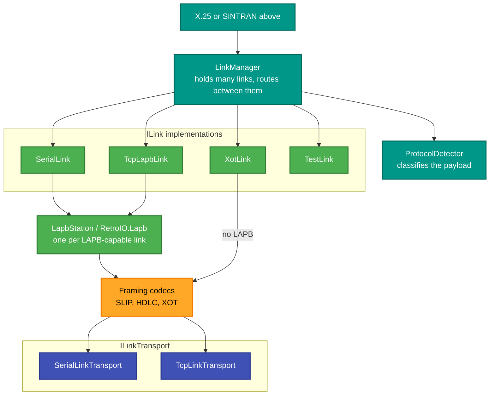

# RetroIO.Link

## What it is

A **link** is an established connection that carries opaque payloads. This package is the idea of a
link, plus every concrete kind RetroIO has: a serial port, TCP with LAPB, and XOT — all behind one
`ILink` interface.

It also owns the framing codecs (SLIP, HDLC, XOT), the transports underneath them, a link manager
that holds several at once, and the protocol detector that decides whether what arrived is X.25 or
SINTRAN.

## Why you need it

Because "connect to the machine" means four different things depending on the machine, and nothing
above should care which. A switch port, a PAD client and a diagnostic tool all want the same thing:
hand me the payloads, tell me when the link goes up or down, and take payloads I give you.

The second reason is that **each link needs its own independent LAPB state machine**. An earlier
design shared one, which works until you have two links — and then a timer expiring on one resets
the other. `SerialLink` and `TcpLapbLink` each own theirs.

The third is the XOT exception, and it is a real interoperability matter: XOT has **no LAPB**, by
RFC 1613. But Cisco equipment can be configured to put a whole LAPB frame inside the XOT envelope,
so `XotLinkConfig` has both modes and you must pick the one the peer uses.

## What you can use it for

- Opening a link to a machine without writing socket or serial code.
- Holding **many** links at once and routing between them (`LinkManager`).
- Deciding what a payload is: `ProtocolDetector` identifies SINTRAN frames by the `0x21 0x13`
  marker. It classifies; it does not parse.
- Testing without hardware: `TestLink` processes frames entirely in memory, and `Serial` has a mock
  mode.
- Choosing a framing independently of a transport — `CodecLink` is any codec over any byte stream.

## Prerequisites

| Requirement | Needed for | Notes |
|---|---|---|
| .NET SDK as pinned in `global.json` | Everything | |
| `RetroIO.Lapb` | The LAPB-capable links | The engine lives there, the event surface here |
| A serial port or USB-serial adapter | `SerialLink` only | Use `TestLink` or mock mode otherwise |
| A reachable TCP peer | `TcpLapbLink`, `XotLink` | |

## The link kinds

| Kind | Framing | LAPB? | Transport | Use for |
|---|---|---|---|---|
| `SerialLink` | HDLC byte stuffing | **yes**, its own | A real UART | A cable to vintage hardware |
| `TcpLapbLink` | HDLC byte stuffing | **yes**, its own | TCP | A trunk over TCP; testing a serial link without a cable |
| `XotLink` | XOT length header | **no** (RFC 1613) | TCP | Cisco and DTE interop. One connection per circuit |
| `XotLink` with `UseLapbFraming` | XOT header + a whole LAPB frame | inside the envelope | TCP | A Cisco configured that way |
| `CodecLink` | SLIP or HDLC, your choice | yes | any byte transport | Anything that does not fit the above |
| `TestLink` | none | no | none | Unit tests, frame injection |

## How it fits together

## Key types

| Type | Role |
|---|---|
| `ILink` | The seam: opaque payload up, opaque payload down. Knows nothing about X.25 or SINTRAN |
| `ILapbCapable` | Implemented by the links that have a LAPB state machine. `XotLink` does not |
| `ILinkTransport` | The raw byte stream beneath a codec: a socket or a serial port |
| `IFrameCodec` | SLIP, HDLC or XOT framing, selectable |
| `LinkManager` | Several links at once, with combined statistics |
| `ProtocolDetector` | X.25 or SINTRAN, by the `0x21 0x13` marker |
| `CodecLinkBridge` | Joins a codec below to a LAPB instance above, owning the frame check sequence |

## A note on `ILink` and classification

`ILink` deliberately delivers an **opaque** payload and does not say what it is. Protocol
discrimination happens above it, because a link that decided for you could not carry anything new
without being edited. `LinkBinding` in `RetroIO.Protocols.Xmsg.Node` is the same idea on the XMSG
side, and its documentation says so explicitly.
