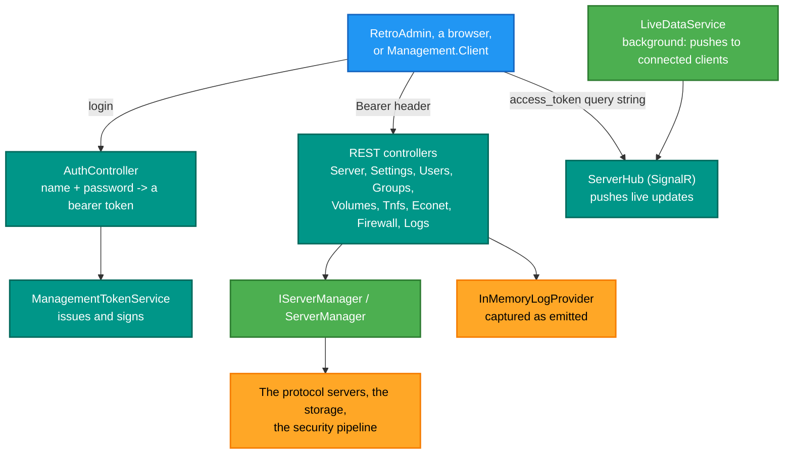
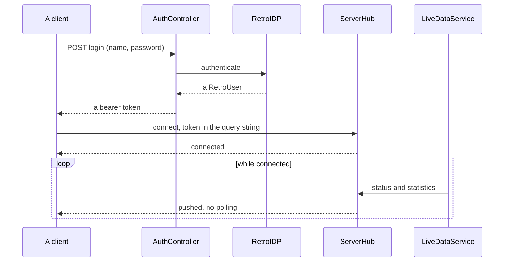

# RetroIO.Management.Api

## What it is

The management **server**: a REST API over every part of a RetroIO server — status, settings, users, groups,
volumes, TNFS, Econet, the firewall and the logs — plus a **SignalR hub** that pushes live updates, and bearer
tokens to authenticate both.

## Why you need it

A running server needs to be looked at and changed without restarting it. Polling a REST endpoint gets you the
first; the second needs push, or a dashboard is always a few seconds stale and a burst of activity is invisible
between polls. Hence both surfaces over the same API.

`InMemoryLogProvider` is the detail that makes the logs endpoint possible at all: log entries are captured in
memory as they are emitted, so they can be served and filtered. Reading a log **file** back to serve it would
mean parsing your own output, and would miss anything not yet flushed.

`TnfsServerStatistics` is worth singling out because its own documentation records what it replaced: the
statistics endpoint used to return **hardcoded zeroes**. It is now real live counters, shared as a DI singleton
between the protocol server and the API — which is the only way the number the API reports is the number the
server has.

## What you can use it for

- Driving `RetroAdmin`, or any dashboard, over HTTP.
- Watching activity **live** rather than by polling.
- Managing users and groups, mounting and browsing volumes, editing TNFS and Econet settings.
- Managing firewall rules, including **testing a rule** before enabling it.
- Reading and filtering the server's logs remotely.
- Starting and stopping protocol servers (`ServerController`, `IServerManager`).

## Prerequisites

| Requirement | Needed for | Notes |
|---|---|---|
| .NET SDK as pinned in `global.json` | Everything | |
| `RetroIO.Management.Contracts` | The DTOs | |
| `RetroIO.Identity` | Authentication | Logins are RetroIDP users |
| `RetroIO.Security`, `.Firewall` | Authorisation and rules | |
| A signing key for tokens | Issuing them | `ManagementTokenService` owns it |
| An HTTP port | Anything | REST and the hub share it |
| HTTPS in anything exposed | Safety | A bearer token in clear is a credential in clear |

## The two surfaces

**Note the two different ways the token travels.** REST takes it in an `Authorization: Bearer` header; the
SignalR connection takes it as an `access_token` query parameter, because a WebSocket handshake cannot carry a
custom header. Getting that wrong produces a REST client that works and a hub that silently never connects.

## Logging in, then watching

## Contents

| Area | Types |
|---|---|
| Tokens | `ManagementTokenService`, `AuthController` |
| Controllers | `ServerController`, `SettingsController`, `UsersController`, `GroupsController`, `VolumesController`, `TnfsController`, `EconetController`, `FirewallController`, `LogsController` |
| Live push | `ServerHub`, `LiveDataService` |
| Server control | `IServerManager`, `ServerManager` |
| Logs | `InMemoryLogProvider`, `InMemoryLogger` |
| Hosting | `ManagementApiExtensions` — `AddManagementApi`-style registration |

## Tests

`src/RetroIO.Management.Api/tests`.

## Related

- [`RetroIO.Management.Client`](../RetroIO.Management.Client/README.md) — a typed client for both surfaces.
- [`RetroIO.Management.Contracts`](../RetroIO.Management.Contracts/README.md) — the DTOs, which depend on
  nothing.
- `RetroAdmin.Desktop` in the RetroServer repo — the app that drives this.
