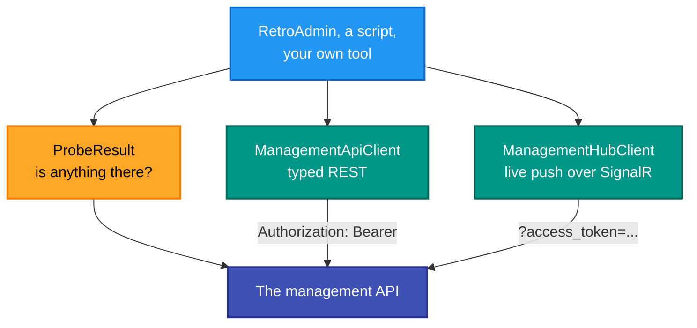
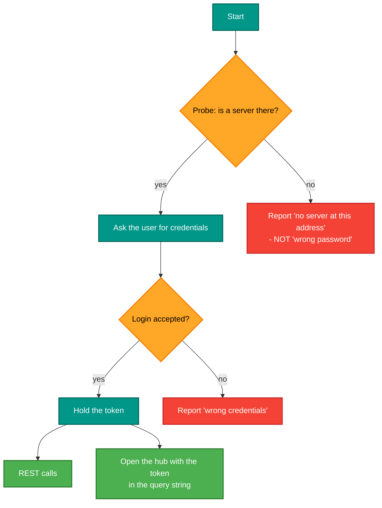

# RetroIO.Management.Client

## What it is

A typed client for the management API — both halves. `ManagementApiClient` for the REST calls,
`ManagementHubClient` for the SignalR push channel.

## Why you need it

So a client application contains no HTTP plumbing, no string URLs and no hand-written SignalR subscriptions —
and, more importantly, so it does **not reference the server**. Together with
[`RetroIO.Management.Contracts`](../RetroIO.Management.Contracts/README.md), which depends on nothing, a desktop
admin app can talk to a RetroIO server without shipping the protocol stack it is administering.

`ProbeResult` is the small thing that matters in practice. A client needs to answer "is there a server at this
address, and can I reach it?" **before** asking the user for credentials — otherwise a wrong port and a wrong
password look the same.

It also puts the token in the right place on both surfaces. The REST calls use an `Authorization: Bearer`
header; the hub connection puts the token in the `access_token` query string, because a WebSocket handshake
cannot carry a custom header. Doing that by hand is the classic way to end up with working REST and a hub that
never connects.

## What you can use it for

- Writing an admin tool, a dashboard or a script against typed methods.
- **Probing** an endpoint before logging in.
- Receiving live status and statistics without writing SignalR code.
- Reconnecting: the hub client owns that, so the application does not have to.

## Prerequisites

| Requirement | Needed for | Notes |
|---|---|---|
| .NET SDK as pinned in `global.json` | Everything | |
| `RetroIO.Management.Contracts` | The DTOs | |
| A reachable management API | Anything | |
| Credentials | Anything past probing | A RetroIDP user |
| HTTPS where it is not local | Safety | The token is a credential |

## Both surfaces, one client

## The order to do things in

Probing first is what lets the two failures be reported differently — and "no server at this address" is a much
more useful message than "login failed".

## Contents

| Type | Role |
|---|---|
| `ManagementApiClient` | Typed HTTP client for the REST API |
| `ProbeResult` | Whether a server is reachable at an endpoint |
| `ManagementHubClient` | The live push channel over SignalR |
