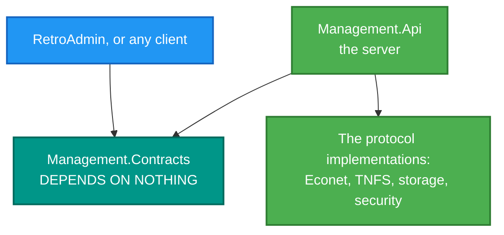

# RetroIO.Management.Contracts

## What it is

The management API's **data contracts**: every request, response and DTO, plus the names of the messages the
server pushes. No logic, no behaviour.

## Why you need it

So a client can talk to the server without referencing the server.

That is the entire point, and it is enforced rather than hoped for: **this assembly depends on nothing.** The
consequence is visible in the code — `EconetCommandEntryDto` carries a comment saying it mirrors
`EconetCommandEntry` in `RetroIO.Protocols.Econet` and is **copied rather than shared**, because a client that
referenced the protocol assembly would drag the whole protocol stack in with it.

That is a real trade, stated honestly: two types that must be kept in step, in exchange for a desktop admin app
that does not ship the Econet implementation it is only ever displaying.

`ServerHubMethods` exists for a mechanical reason worth knowing: SignalR's `HubConnection.On` overloads take a
**method name as a string**, not a method group, so the wire names have to exist as constants somewhere or they
get typed by hand at every subscription.

## What you can use it for

- Writing a client — `RetroAdmin`, a script, anything — against typed requests and responses.
- Subscribing to pushes by name, without guessing the strings.
- Knowing the shape of every management operation in one place.

## Prerequisites

| Requirement | Notes |
|---|---|
| .NET SDK as pinned in `global.json` | |
| **Nothing else** | Deliberately, and checked: this assembly must stay dependency-free |

## The three parties

There is **no arrow** from the contracts to the implementations. That missing arrow is the design.

## What is covered

| Area | Types |
|---|---|
| Envelope | `ApiResponse<T>`, `ApiError` |
| Authentication | `LoginRequest`, `LoginResponse`, `ManagementAuth` |
| Server | `ServerStatusResponse`, `ServerActionResponse`, `ServerSettingsDto`, `UpdateServerSettingsRequest` |
| Live push | `IServerHubClient`, `ServerHubMethods`, `ServerStatusUpdate`, `TnfsStatsUpdate`, `EconetStatsUpdate` |
| TNFS | `TnfsSettingsDto`, `UpdateTnfsSettingsRequest`, `TnfsStatisticsResponse`, `TnfsSessionsResponse`, `TnfsSessionInfo`, `TnfsHistoryResponse`, `TnfsDataPoint` |
| Econet | `EconetSettingsDto`, `UpdateEconetSettingsRequest`, `EconetStatisticsResponse`, `EconetSessionsResponse`, `EconetSessionInfo`, `EconetActivityResponse`, `EconetCommandEntryDto`, `EconetFileTransferEntryDto` |
| Users and groups | `UserListResponse`, `UserDto`, `CreateUserRequest`, `UpdateUserRequest`, `ChangePasswordRequest`, `GroupListResponse`, `GroupDto`, `CreateGroupRequest` |
| Volumes | `VolumeListResponse`, `VolumeDto`, `VolumeContentsRequest`, `VolumeContentsResponse`, `VolumeEntryDto` |
| Firewall | `FirewallConfigDto`, `FirewallRulesResponse`, `FirewallRuleDto`, `CreateFirewallRuleRequest`, `UpdateFirewallRuleRequest`, `SetFirewallEnabledRequest`, `SetFirewallPolicyRequest`, `TestFirewallRequest`, `FirewallTestResult`, `FirewallCacheStats` |
| Logs | `LogListResponse`, `LogEntryDto`, `LogFilterRequest` |

## How the token is used

`LoginResponse`'s own documentation records the part that is easy to get wrong: the token goes in an
`Authorization: Bearer` header on every REST call, **and in the `access_token` query string** when opening the
SignalR connection — because the WebSocket handshake cannot carry a custom header.
