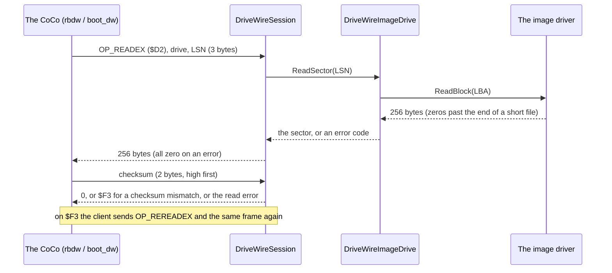

# RetroIO.Protocols.DriveWire

## What it is

A **DriveWire 4 server**. DriveWire is the protocol a Tandy Color Computer (and a Dragon running NitrOS-9) uses to
reach disk images held on another computer, one 256-byte sector at a time. This package serves Dragon and CoCo disk
images as DriveWire drives over TCP, which is how an emulator's **Becker port** connects.

It is written from the published specification, "DriveWire Protocol Version 4.0.0"
([DriveWire Specification.md](https://github.com/DrPitre/DriveWire/blob/main/DriveWire%20Specification.md)), and
checked against what the NitrOS-9 client drivers actually send.

## Why you need it

NitrOS-9 builds a set of `_becker` disks that boot and run entirely from DriveWire. An emulated CoCo or Dragon with a
Becker port can boot them only if something on the other end of the TCP connection answers the DriveWire
transactions. This is that something, and it reads the images through the same RetroIO drivers that list and extract
their files, so what the machine boots from is exactly what RetroIO shows.

## What you can use it for

- Booting a NitrOS-9 `_becker` disk in an emulator with a Becker port.
- Serving up to 256 drives, each an image file with its own read-only flag.
- Writing back: a sector the machine writes goes through the image driver to the file.
- Testing a DriveWire client: `DriveWireSession` runs on any `Stream`, so a test can drive it over a loopback socket.
- Later, a real machine on a serial cable: the session does not care where its stream comes from.

## Prerequisites

| Requirement | Needed for | Notes |
|---|---|---|
| .NET SDK as pinned in `global.json` | Everything | |
| `RetroIO.Storage.Local` | Reading and writing the images | `DragonDskDriver`, `DragonVdkDriver`, `DragonDmkDriver` |
| A free TCP port | Serving | 65504 is the Becker port default |
| An emulator with a Becker port | A real boot | The tests use a client written from the specification |

## How a sector read goes

## The operations

Taken from the specification's Appendix C and confirmed against the NitrOS-9 drivers `rbdw.asm`, `boot_dw.asm`,
`dwio.asm`, `clock2_dw.asm`, `scdwv.asm` and `scdwp.asm` (NitrOS-9 source, `level1/modules`).

| Code | Name | Used by NitrOS-9 | Server does |
|---|---|---|---|
| $D2, $F2 | READEX, REREADEX | rbdw, boot_dw | Sector out, checksum in, status out |
| $57, $77 | WRITE, REWRITE | rbdw | Sector and checksum in, status out |
| $52, $72 | READ, REREAD | no (DriveWire 3 form) | Status, checksum and sector out |
| $5A | DWINIT | dwio | Answers 4, so dwio installs its poller |
| $23 | TIME | clock2_dw | Six bytes of local time |
| $24 | SETTIME | clock2_dw (not in the specification) | Takes six bytes, changes no clock |
| $49, $54 | INIT, TERM | rbdw | Nothing |
| $47, $53 | GETSTAT, SETSTAT | rbdw | Logged |
| $43, $63 | SERREAD, SERREADM | dwio poller | Virtual serial input |
| $C3, $80-$8F, $64 | SERWRITE, FASTWRITE, SERWRITEM | scdwv | Virtual serial output |
| $44, $C4, $45, $C5 | SERGETSTAT, SERSETSTAT, SERINIT, SERTERM | scdwv | Channel open and close |
| $50, $46 | PRINT, PRINTFLUSH | scdwp | Print job to an event and a folder |
| $01, $02 | NAMEOBJ_MOUNT, NAMEOBJ_CREATE | no | Mount from a folder; create always fails |
| $00, $FF, $FE, $F8 | NOP, RESET | | Reset clears the per-drive counters |

Left out, with the reason:

- **The virtual modem** (Hayes AT commands, the `dw` command set, TCP connect and listen through a channel). The
  channels themselves are here; what a channel connects to is the host's business through `DriveWireVirtualSerial`.
- **Virtual window channels** (128 to 142). The specification gives the poll answer's mode bits for them as `10`,
  while `dwio.asm` tests `01`; with the two disagreeing there is no safe answer to give.
- **WireBug** (server-initiated debugging). The specification itself says it is not implemented anywhere.
- **The 230k rate switch** ($E6, $FD) and **FujiNet** ($E2, $E3). Serial-line and FujiNet matters, not TCP.

Any other byte where an operation code is expected is counted, logged and skipped; the specification gives no length
for it, so the next byte is read as an operation code.

## Defaults

| Setting | Default | Where it comes from |
|---|---|---|
| TCP port | 65504 | The Becker port default of the XRoar manual (section 6.4) and of MAME; the specification names no port |
| Listen address | 127.0.0.1 | DriveWire has no log-in, so the server is reachable from other machines only when asked |
| Byte time limit inside a transaction | 250 ms | Specification, "Low Level Protocol" and "The Write Transaction" |
| Wait for the next operation code | none | |
| Drives | 256 numbers (0 to 255), none mounted | The drive number is one byte; NitrOS-9's rbdw uses 0 to 3 |
| Serial line (for a later serial transport) | 8-N-1, 57,600 bit/s CoCo 2, 115,200 or 230,400 bit/s CoCo 3 | Specification, "Low Level Protocol" |
| Virtual serial channels | 15 (0 to 14) | The poll answer can name only these |

## The end of a volume

- The volume is as long as the driver says. For a headerless OS-9 volume that is **DD.TOT** from sector 0, also when
  the file is shorter: the NitrOS-9 DriveWire disks are formatted without Toolshed's `-e`, so the file stops after the
  last sector written.
- A read below DD.TOT but past the end of the file answers **zeros** and status 0.
- A read at or past DD.TOT answers 256 zero bytes and **E$Read ($F4)**; a write there answers **E$Write ($F5)**.
- A write to a read-only drive answers **E$WP ($F2)**; to an empty drive number **E$NotRdy ($F6)**.
- A write goes to the driver, which decides how the file grows. Writing past the end of a short OS-9 file needs the
  driver to write back only the changed sectors; until it does, `DragonDskDriver` mounts such a file read-only and the
  write is answered E$WP.

## Checksum

The 16-bit sum of all 256 sector bytes, sent high byte first. The specification's sample C routine
(Appendix B) adds only 255 bytes; the client adds all 256 (`dwcheck.asm` DoCSum, `dwread_becker.asm`), so this does too.

## Contents

| Area | Types |
|---|---|
| Server | `DriveWireServerService`, `DriveWireServerOptions`, `DriveWireDriveOptions`, `DriveWireServerExtensions`, `DriveWireServerStatistics` |
| Protocol | `DriveWireSession`, `DriveWireOpCode`, `DriveWireError`, `DriveWireChecksum` |
| Drives | `IDriveWireDrive`, `DriveWireImageDrive`, `DriveWireDriveTable`, `DriveWireDriveCounters` |
| Virtual serial | `DriveWireVirtualSerial` |

## Connecting a Becker port

A Becker port is a byte pipe: the CoCo polls a status register (bit 1 set means a byte is waiting) and reads or writes
a data register. NitrOS-9 puts it at **$FF41** (status) and **$FF42** (data) (`dwread_becker.asm`,
`dwwrite_becker.asm`); the XRoar manual gives **$FF49/$FF4A** for a Dragon with DragonDOS. The emulator opens one TCP
connection to the server, sends every byte the CoCo writes to the data register, and makes every byte the server sends
readable there, in order. Nothing else is framed or added.

## Related

- [`RetroIO.Storage.Local`](../RetroIO.Storage.Local/README.md) - the image drivers.
- [`RetroIO.Server`](../RetroIO.Server/README.md) - hosts this server next to TNFS and Econet.
