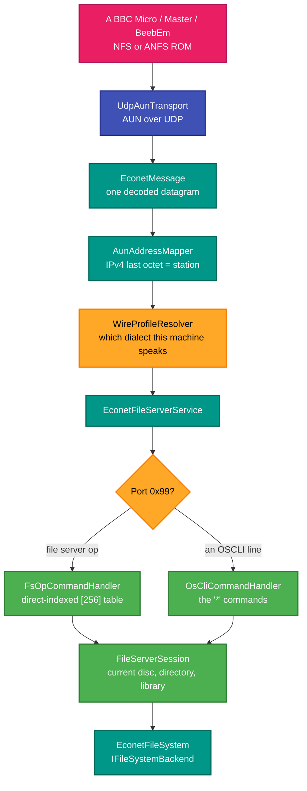
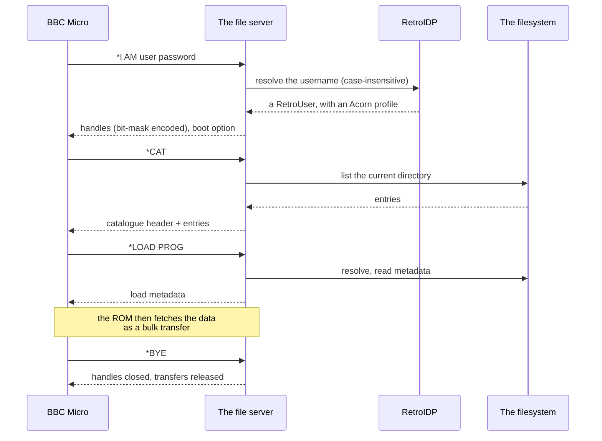

# RetroIO.Protocols.Econet

## What it is

**Acorn Econet over AUN** — a complete Level-3 file server, plus the client side. AUN carries Econet over
UDP, so a BBC Micro, a Master or an emulator with the NFS/ANFS ROM can log in with `*I AM`, catalogue a
directory, load and save files, and be told the time.

## Why you need it

A BBC Micro's ROM speaks one file protocol, and this is it. No amount of SMB or FTP will make `*CAT`
work; the machine issues a Level-3 file-server operation and expects a Level-3 reply, down to the exact
status byte. Serving that is what lets real hardware — or BeebEm — use files kept on a modern machine.

The implementation aims at being **compatible rather than reasonable**, and that distinction matters. The
Acorn file server has behaviour nobody would design today: the same command spelled four ways
(`*I AM`, `*IAM`, `*LOGIN`, `*LOGON`), metadata in the property bag of each object (extended attribute mechanism, `.xat` file as the fallback), bulk transfers that repurpose
bytes 2–4 of the packet instead of the documented fields, and `*INFO` with several MDFS sub-forms. All of
that is implemented as it is, with PiFS and the PiEconetBridge sources cited at the decisions, because a
cleaner version would simply not work with the ROM.

One more thing that pushed the design: machines differ on the wire. `WireProfileResolver` picks a profile
per client station, with per-machine overrides, so one server can serve a BBC B on DNFS and a Master on
ANFS at once.

## What you can use it for

- **Serving files to real Acorn hardware** or an emulator, as a Level-3 file server.
- Logging users in against **RetroIDP** — `*I AM` resolves to a `RetroUser`, so Econet shares the identity
  system with everything else.
- Serving **several discs**, including a mix of local directories, disk images and remote mounts, through
  `CompositeVfsFileSystemBackend`.
- Controlling which discs a user can see (`*DISCMASK`), and System-user operations like setting another
  user's password or the server clock.
- **Being a client**: `AunFileServerClient` does `*I AM`, examine and load against somebody else's
  Level-3 server.
- Mounting a remote Econet server as a volume, through `EconetVolumeProvider`.
- **Analysing interop**: `EconetProtocolDiagnostics` traces requests and replies, and
  `EconetServerJsonLog` writes structured JSONL — which is how `*CAT` differences against BeebEm/DNFS were
  found.
- Watching activity: `EconetActivityLog` is a fixed-size ring of recent commands and transfers, which the
  management API exposes.

## Prerequisites

| Requirement | Needed for | Notes |
|---|---|---|
| .NET SDK as pinned in `global.json` | Everything | |
| `RetroIO.Storage.Core` | Serving files | |
| `RetroIO.Identity` | `*I AM` | Logins are RetroIDP users |
| A free UDP port | Serving | AUN is UDP |
| `econet-config.json` | Defining discs | See `RetroIO.Server.Hosting` |
| **A BBC Micro, a Master, or BeebEm** | Any real end-to-end test | **Nothing of ours speaks AUN as a client of a full session** — this is the one honest gap, and it is recorded as such in the manual test documents |

## How a request arrives

## Logging in and cataloguing

## The two dispatch tables

Operations and commands are each **one class per file**, placed into a table by the composition root.
That is deliberate: a 256-entry direct-indexed array for fsops means dispatch is an array index rather
than a switch that grows, and adding an operation does not edit a giant method.

| Table | Keyed by | Interface | Where |
|---|---|---|---|
| `FsOperationTable` | the fsop byte, `[256]` direct-indexed | `IFileServerOperation` | `FileServer/Operations/` |
| `OsCliCommandTable` | matched in order | `IOsCliCommand` | `FileServer/Commands/` |

### The OSCLI commands implemented

`*I AM` / `*IAM` / `*LOGIN` / `*LOGON`, `*BYE`, `*CAT` (and `*.`), `*CDIR`, `*COPY`, `*DIR` (and `*DIR^`),
`*LIB`, `*LOAD`, `*SAVE`, `*RENAME`, `*PASS`, `*SETPASS`, `*SDISC`, `*DISCMASK` / `*DISKMASK`, `*FSLIST`,
`*ACCESS`, `*PRIV`, `*FLOG`, plus `SetHome` and `SetLib`.

### A sample of the fsops

| fsop | Operation | What it does |
|---|---|---|
| `0x04` | `CatHeader` | The catalogue header for a directory; missing is `0xD6 Not found` |
| `0x08` / `0x09` | `GetByte` / `PutByte` | One byte, honouring the AUN retransmit sequence bit |
| `0x0A` / `0x0B` | `GetBytes` / `PutBytes` | The bulk halves of `*LOAD` and `*SAVE` / OSGBPB |
| `0x0C` / `0x0D` | Get/SetRandomAccessInfo | Cursor and extent, 24-bit little-endian |
| `0x0F` | `ReadLoggedOnUsers` | Who is logged on, from a caller-supplied index |
| `0x10` / `0x1C` | `ReadTime` / `SetRtc` | The server clock; setting it is System-only |
| `0x11` | `EndOfFile` | `0x80` at or past EOF |
| `0x12` / `0x13` | Get/SetObjectInfo | The metadata behind `*INFO`, `*EX` and `*CAT`; writes go to the property bag |
| `0x15` | `ReadUserEnv` | Current disc, directory and library |
| `0x16` | `SetBootOpt` | The `*OPT 4` value; above 7 is `0xBD Bad option` |
| `0x18` | `ReadUserInfo` | Where a named user is logged on |
| `0x1A` / `0x1E` / `0x1F` | Free space | `fs_free`, the user stub, and setting a quota (System-only) |
| `0x20` | `ReadClientId` | The caller's own username, raw ASCII, `0x0D`-terminated, **no status bytes** |
| `0x40` / `0x41` | SJ opcodes | PiFS compatibility stubs |
| `0x60` | PiBridge | PiFS extensions |

## Bulk transfers

A Level-3 bulk opcode **repurposes bytes 2–4** of the request instead of using the URD/CWD/LIB fields —
`FileServerBulkPacketLayout` is where that is written down, matching PiFS and Acorn DFS. Transfers are
managed by `BulkTransferManager` with `OutboundLoadTransfer` and `InboundSaveTransfer`, and AUN's
unreliability is handled by `AunOutboundRetryQueue` and `AunReplyRetransmitter`.

## Privacy in the logs

`EconetLogRedaction` removes private details from file-server bytes **before** they reach any log. A
protocol trace of a login otherwise contains a password in clear, and a diagnostic feature that leaks
credentials is a defect rather than a feature.

## Contents, by area

| Area | Types |
|---|---|
| Service and transport | `EconetFileServerService`, `EconetFileServerOptions`, `ITransport`, `UdpAunTransport`, `InMemoryAunTransport` |
| AUN wire | `AunPacket`, `AunPacketType`, `AunAddressMapper`, `AunOutboundSequence`, `EconetPorts` |
| Dispatch | `FsOperationTable`, `IFileServerOperation`, `FsOpCall`, `OsCliCommandTable`, `IOsCliCommand`, `OsCliCall`, `OsCliCommandRegistry`, `OsCliCommandMatcher` |
| Sessions and handles | `FileServerSession`, `FileServerSessionManager`, `FileServerHandleManager`, `OpenFileHandle`, `AcornFileHandles` |
| Paths and discs | `AcornPath`, `PathResolver`, `AcornDirectoryNavigation`, `DiscCatalog`, `DiscEntry`, `DiscNameEntry` |
| Users | `EconetUserDirectory`, `EconetUserProfile`, `EconetUserBootstrap`, `EconetMetadataKeys` |
| Metadata | `AcornAttributeStore` (the property bags, `.xat` fallback), `EconetAccess` |
| Wire profiles | `WireProfile`, `WireProfileResolver`, `MachineOverride` |
| Bulk | `BulkTransferManager`, `BulkPacket`, `OutboundLoadTransfer`, `InboundSaveTransfer`, `FileServerBulkPacketLayout` |
| Errors | `FileServerErrors`, `FileServerErrorNames`, `FileServerOpcode`, `FileServerOpcodeNames` |
| Diagnostics | `EconetProtocolDiagnostics`, `EconetServerJsonLog`, `EconetActivityLog`, `EconetActivityRecorder`, `FileServerPacketFormatter`, `EconetLogRedaction` |
| Client | `AunFileServerClient`, `AunDirectoryEntry`, `EconetClientConstants` |
| Clock and config | `FileServerClock`, `FileServerConfiguration`, `EconetSampleCatalog`, `FileServerBootstrap` |

## Sources

PiFS / PiEconetBridge (`utilities/fs.c`, with line numbers cited at several operations), the Acorn DFS
and MDFS documentation, and the protocol analysis notes referenced by section. When extending this, match
the source rather than the reasonable behaviour — the ROM is the specification, and it cannot be changed.
