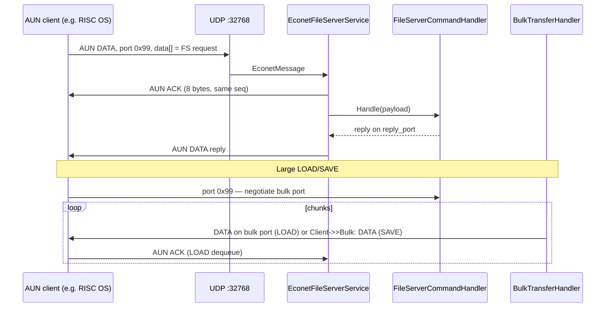
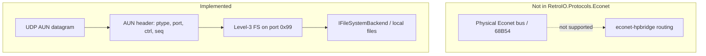
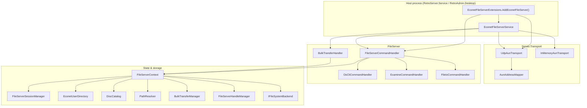
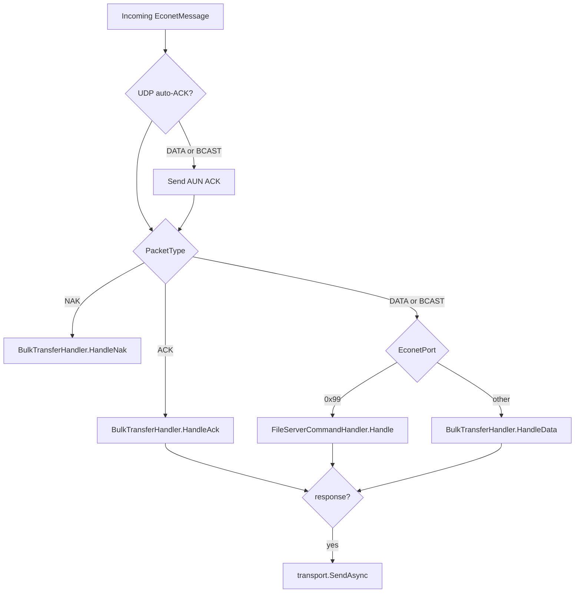
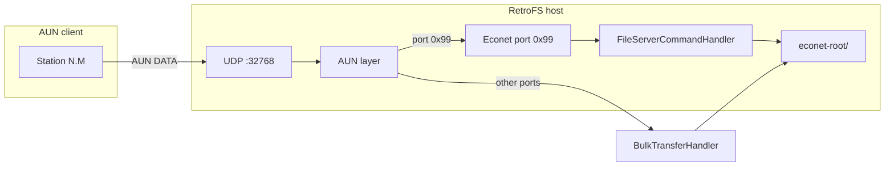

# RetroIO.Protocols.Econet

Acorn **Level-3 Econet file server** over **AUN (Acorn Universal Networking)** for RetroFS.

This library implements the file-server application protocol used by BBC Micro, Master, and RISC OS machines when they talk to an Econet file server on **Econet port `0x99`**. Traffic arrives over **UDP AUN** (default port **32768**), not over a physical Econet bus.

Design concepts and on-disk **disc layout** follow **PiFS / PiEconetBridge** (`0{DiscName}` directories). **User accounts** use **RetroIDP** (shared with TNFS), not a separate `Passwords` file. This is **not** a port of `fs.c` and **not** a drop-in replacement for PiEconetBridge.

**Clean-room spec:** `docs/econet/PiFS-Behavior-Spec.md` in the pre-migration RetroFS tree and
`docs/econet/Conformance-Matrix.md` there too. **Both still live in the pre-migration tree** - they
were not carried across with the code, so these are absolute paths rather than links. TLS transport is planned
for a later phase.

---

## 1. Purpose and Scope

### What this project is

| Role | Supported? |
|------|------------|
| **AUN UDP file server** (Level-3 FS on port `0x99`) | **Yes** |
| **BBC Econet protocol stack** (ADLC wire, four-way handshake) | **No** |
| **Econet bridge** (routing between wire networks / trunks) | **No** |
| **PiEconetBridge-compatible bridge** (`econet-hpbridge`) | **No** |
| **Physical BBC Micro-facing service** (direct bus attachment) | **No** |
| **LAN AUN client-facing service** (RISC OS, emulators, other AUN stacks) | **Yes** (UDP AUN) |
| **RetroFS storage backend** (`IFileSystemBackend`) | **Yes** |

`RetroIO.Protocols.Econet` is a **class library** (`net9.0`). It does not have its own executable. It is hosted by:

- `RetroServer.Service` - the console/service host; starts Econet automatically.
  `RetroServer/src/RetroServer.Service/Program.cs`
- `RetroAdmin.Desktop` - the Avalonia admin UI; start via **Start Server**.
  `RetroServer/src/RetroAdmin.Desktop/Services/ServerControl/ServerLifecycleControllers.cs`

Both live in the **RetroServer repository**, not here - RetroIO is consumed as NuGet packages. They are paths
rather than links because a relative link across repositories would 404 on GitHub. The former names were
`RetroServer` and `RetroServeUI`.

### What is implemented

- AUN packet encode/decode (`AunPacket`, `AunPacketType`)
- UDP AUN transport with optional IP firewall hooks
- In-memory AUN transport for unit tests
- Client `net.station` mapping from IPv4 (RISC OS-style last-octet convention)
- Inbound **auto-ACK** on UDP DATA/BCAST (before processing)
- Level-3 dispatch on Econet port **`0x99`**
- Bulk transfer on dynamic Econet ports (SAVE inbound, LOAD outbound with client ACK)
- PiFS-style disc layout bootstrap (`0{DiscName}/USER`)
- Login via `*I AM` / `LOGIN` / `LOGON` through **RetroIDP** (`EconetUserDirectory`)
- **AUN client** (`AunFileServerClient`) and **RetroVFS volume provider** (`EconetVolumeProvider` in `RetroIO.Storage.Providers`)
- Rate limiting and audit hooks on inbound AUN (when host registers `InMemoryRateLimiter` / `SecurityEventEmitter`)
- Core file ops: examine/catalogue, load, save, open, close, delete, mkdir, bye
- Disc catalogue (`0NAME` directories), read disc names, read version

### What is not implemented

- Physical Econet wire / GPIO / ADLC
- Bridge forwarding, `EXPOSE`, trunks, station maps beyond simple IP mapping
- Full outbound AUN DATA **retransmit** (basic retry queue on send failure only)
- Full PiFS permission model (`*ACCESS`, owner/other bits, wildcards)
- Admin OSCLI (`*NETCONF`, user management, `*SDISC`, `*COPY`, …)
- Real hardware interop testing in this repository

### Recently implemented (AUN / Level-3)

- Opcodes `0x04`–`0x20` via `MiscOpcodeHandler` (cat header, byte/block I/O, object info, logged-on users, time/RTC, EOF, user info/env, client ID, …)
- PiBridge `0x60` (`PiBridgeCommandHandler`) — version, config read/write, force logoff, server logout
- SJ ops `0x40`/`0x41` (success stubs)
- OSCLI: `*SAVE`, `*DELETE`, `*INFO`, `*EX`, `*CREATE`/`*BUILD`, `*ACCESS` (ack), `*REN`, `*FSLIST`, `*SDISC`
- Acorn `.inf` sidecar read/write (`AcornInfStore`)
- `FileServerConfiguration` (NETCONF-style bitmap)
- AUN **Immediate** echo reply (`0x05` → `0x06`)
- LOAD bulk queue keyed by **(net, station)** not station alone

---

## 2. BBC Econet Background

### Stations and networks

Every Econet machine has an address **`network.station`** (two 8-bit values, 0–255 each):

```
1.254  →  network 1, station 254  (typical file server)
1.1    →  network 1, station 1    (typical client)
```

This is **not** an IP address. On a real BBC network, stations share a serial bus. In **AUN**, the same logical addresses are used, but packets are carried inside **UDP datagrams**.

### Three “port” concepts

| Layer | Name | Example | Meaning in this code |
|-------|------|---------|----------------------|
| IP | **UDP port** | `32768` | `UdpAunTransport` bind port (`EconetFileServerOptions.UdpPort`) |
| AUN/Econet | **Econet port** | `0x99` | `EconetPorts.FileServer` — file server commands |
| Bulk | **Dynamic Econet port** | `42`, `120`, … | Allocated by `BulkTransferManager` for SAVE/LOAD data |

The file server **always** listens for commands on Econet port **`0x99`**. Large file bodies use a **second** Econet port negotiated per transfer.

### How a BBC talks to a file server (supported path)



On the BBC, the user types OS commands (`*I AM`, `*CAT`, …). The DFS/OS file server client translates those into **Level-3 opcodes** in the `data[]` payload. This implementation handles those opcodes (and a subset of OSCLI text) — not the user's typing directly over the wire.

### Physical wire vs AUN (this implementation)



**External reference:** the PiEconetBridge documentation (`docs/ECONET-AUN-FILESERVER-DEVELOPER.md` in that project) describes the full wire + bridge + AUN model. Only the **AUN UDP → port 0x99 → PiFS-style files** slice is implemented here.

---

## 3. Architecture of This C# Implementation

### Namespace map

| Namespace | Responsibility |
|-----------|----------------|
| `RetroIO.Protocols.Econet.Protocol.Aun` | AUN wire format, address mapping |
| `RetroIO.Protocols.Econet.Protocol` | `EconetPorts` constants |
| `RetroIO.Protocols.Econet.Protocol.FileServer` | Opcodes, errors, request/reply builders |
| `RetroIO.Protocols.Econet.Server` | Hosting, DI extensions, background service |
| `RetroIO.Protocols.Econet.Server.Transport` | UDP and in-memory transports |
| `RetroIO.Protocols.Econet.FileServer` | Bootstrap, context, command dispatcher |
| `RetroIO.Protocols.Econet.FileServer.Handlers` | OSCLI, examine, file I/O, bulk |
| `RetroIO.Protocols.Econet.FileServer.Sessions` | Login sessions per `net.station` |
| `RetroIO.Protocols.Econet.FileServer.Users` | RetroIDP-backed user profiles (`EconetUserDirectory`) |
| `RetroIO.Protocols.Econet.FileServer.Discs` | `0NAME` disc catalogue |
| `RetroIO.Protocols.Econet.FileServer.Paths` | Acorn → Unix path resolution |
| `RetroIO.Protocols.Econet.FileServer.Bulk` | Bulk port allocation, LOAD queues |
| `RetroIO.Protocols.Econet.FileServer.Handles` | Open file handles |
| `RetroIO.Protocols.Econet.Common` | `AcornPath` parsing |

There are **no bridge classes** in this project.

### Component diagram



### Major classes

| Class | Responsibility | Maps to |
|-------|----------------|---------|
| `AunPacket` | 8-byte AUN header + payload encode/decode | Acorn AUN UDP format |
| `AunAddressMapper` | IPv4 → `(Net, station)` | RISC OS AUNMap convention (station = IP octet) |
| `EconetMessage` | Decoded datagram + client UDP endpoint + `ClientNet`/`ClientStation` | Internal; Pi bridge `__econet_packet_aun` (partial) |
| `UdpAunTransport` | UDP recv/send, firewall check | Pi `EXPOSE` listener (subset) |
| `EconetFileServerService` | Route ACK/NAK/DATA/BCAST; auto-ACK | Pi `eb_process_incoming_aun` + `handle_fs_traffic` entry |
| `FileServerCommandHandler` | Opcode dispatch on port `0x99` | Pi `handle_fs_traffic` |
| `FileServerRequest` | Parse `reply_port`, `fsop`, URD/CWD/LIB, parameters | Level-3 request layout |
| `OsCliCommandHandler` | Text commands in opcode `0x00` | Pi `fs_login`, OSCLI subset |
| `ExamineCommandHandler` | Opcode `0x03` catalogue | Pi examine |
| `FileIoCommandHandler` | Load/save/open/close/delete/mkdir/bye | Pi file ops |
| `BulkTransferHandler` | Non-`0x99` ports + client ACK for LOAD | Pi `handle_fs_bulk_traffic` |
| `EconetUserDirectory` | RetroIDP auth + Acorn profile metadata | Replaces PiFS `Passwords` file |
| `DiscCatalog` | Scan `0{NAME}` directories | PiFS disc layout |
| `PathResolver` | Acorn paths → host paths | PiFS path logic (simplified) |
| `FileServerSessionManager` | Sessions keyed by `ClientNet.ClientStation` | Pi `active[server][slot]` |

---

## 4. Protocol Handling

### AUN UDP payload format

Implemented in `AunPacket` (`Protocol/Aun/AunPacket.cs`):

| Offset | Field | Notes |
|--------|-------|-------|
| 0 | `ptype` | `AunPacketType`: BCAST `0x01`, DATA `0x02`, ACK `0x03`, NAK `0x04`, IMM `0x05`–`0x07` |
| 1 | `port` | **Econet application port** (`0x99` = file server) |
| 2 | `ctrl` | Control byte; high bit set internally after decode |
| 3 | `pad` | Always `0` on encode |
| 4–7 | `seq` | `uint32` little-endian |
| 8+ | `data[]` | Payload (Level-3 FS bytes when `port == 0x99`) |

**Terminology note:** On the **physical Econet wire**, `ctrl` precedes `port`. In **AUN UDP**, `port` precedes `ctrl` — this code only implements the AUN UDP order.

### Source / destination addressing

| Concept | Wire Econet | This implementation |
|---------|-------------|---------------------|
| Destination `net.station` | In packet header | **Not** in UDP payload; implied by which server you contact |
| Source `net.station` | In packet header | `EconetMessage.ClientNet` / `ClientStation` from `AunAddressMapper` |
| IP return path | N/A | `ClientAddress` + `ClientPort` from UDP `recvfrom` |

`AunAddressMapper` sets `ClientStation` to the IPv4 octet at index `AunStationOctetIndex` (default **3** = last octet) and `ClientNet` to configured `Net`.

### Level-3 file server request (`data[]` when port = `0x99`)

Parsed by `FileServerRequest.TryParse`:

| Offset | Field | Property |
|--------|-------|----------|
| 0 | `reply_port` | `ReplyPort` |
| 1 | `fsop` | `Opcode` |
| 2 | URD | `Urd` |
| 3 | CWD | `Cwd` |
| 4 | LIB | `Lib` |
| 5+ | parameters | `Parameters` |

### Dispatch flow (`EconetFileServerService.OnMessageReceived`)



| Packet type | Handler | Notes |
|-------------|---------|-------|
| `Unicast` / `Broadcast` + port `0x99` | `FileServerCommandHandler` | BCAST handled same as DATA for FS |
| `Unicast` / `Broadcast` + other port | `BulkTransferHandler.HandleData` | SAVE payload |
| `Ack` | `BulkTransferHandler.HandleAck` | Dequeues next LOAD chunk |
| `Nak` | `BulkTransferHandler.HandleNak` | Aborts LOAD queue |
| `Immediate` / `ImmediateReply` / `ImmediateNak` | — | **Not handled** (no response) |

### Retries and timeouts

| Feature | Status |
|---------|--------|
| Inbound auto-ACK (UDP) | **Yes** — `EconetFileServerService.SendInboundAckAsync` |
| Outbound DATA retransmit | **No** |
| NAK tolerance / retry queue | **No** |
| SAVE close delay (20 ms) | **No** |

### Error handling

- Malformed FS request (`< 2` bytes): logged, **no reply** (`FileServerCommandHandler` returns `null`)
- Unknown opcode: `FileServerErrors.BadCommand` (`0xFE`)
- Opcode `≥ 64`: `FileServerErrors.Unsupported` (`0xFF`)
- Not logged in: `FileServerErrors.WhoAreYou` (`0xBF`) for protected opcodes

---

## 5. File Server Behavior

### Connection and login

1. Client sends UDP AUN to host IP, port **32768** (default).
2. Server ACKs DATA, then processes port **`0x99`** payload.
3. Client sends opcode **`0x00`** OSCLI with `I AM username password` (or `LOGIN` / `LOGON`).
4. `OsCliCommandHandler` → `EconetUserDirectory.TryAuthenticate` → `FileServerSessionManager.TryLogin`.
5. Success reply: `[0x05, 0, urd, cwd, lib, bootOpt]` via `FileServerReply.LoginSuccess`.

Default login on first **RetroServer** run:

- RetroIDP creates **`admin`** / **`retroadmin`** (change immediately).
- On the BBC: `*I AM admin retroadmin` (same RetroIDP username, case-insensitive).

Unit tests use a dedicated **`SYST`** RetroIDP user with `econet.allowEmptyPassword=true` (see `EconetTestUsers`).

### Session identity

Sessions are keyed by **`(ClientNet, ClientStation)`**, not username. One session per Econet station address.

### On-disk layout (PiFS-style)

```
{econet-root}/
  0{DiscName}/           # e.g. 0RetroFS/
    USER/                # default home directory after login
```

User accounts live in **RetroIDP** (`Documents/RetroFS/idp/users.json`), not under `econet-root`.

### BBC command mapping

| BBC command | Meaning | Server-side | Implemented? | Notes |
|-------------|---------|-------------|--------------|-------|
| `*I AM user pass` | Login | `OsCliCommandHandler.HandleLogin` | **Yes** | Also `IAM`, `LOGIN`, `LOGON` |
| `*LOGIN` / `*LOGON` | Login | same | **Yes** | |
| `*BYE` | Logout | `OsCliCommandHandler` / `FileIoCommandHandler` opcode `0x17` | **Yes** | |
| `*CAT` | Catalogue | `OsCliCommandHandler` → examine prelude; opcode `0x03` | **Yes** | OSCLI returns examine trigger, not full cat |
| `*DIR dir` | Change directory | `OsCliCommandHandler.HandleChangeDir` | **Yes** | Returns `0x07` + CSD handle; updates unix + Acorn CSD path (supports `^` parent). PiFS-aligned |
| `*LIB dir` | Set library | `OsCliCommandHandler.HandleChangeLib` | **Yes** | Returns `0x09` + library handle; updates library path. PiFS-aligned |
| `*LOAD file` | Load file | `OsCliCommandHandler.HandleLoadOsCli` (prelude); `FileIoCommandHandler` `0x02`/`0x05` (data) | **Yes** | FS load opcode carries real load/exec/access/date; ACK-paced bulk burst |
| `*SAVE file` | Save file | `FileIoCommandHandler` `0x01`/`0x1d` | **Yes** | FS save opcode + bulk; 21-byte FS3 close packet |
| `*RUN` | Run program | `FileIoCommandHandler` `0x05` | **Yes** | Load-as with library search (PiFS `loadas`) |
| `*EXEC` | Exec script | — | **No** | |
| `*DELETE` | Delete file | `FileIoCommandHandler` opcode `0x14` | **Partial** | Opcode only, not OSCLI text |
| `*RENAME` | Rename | `OsCliCommandHandler.HandleRename` | **Yes** | |
| `*ACCESS` | File attributes | `OsCliCommandHandler` | **Partial** | Accepted; catalogue perm from `.inf` or default `0x33` |
| `*INFO` | File info | `OsCliCommandHandler` → `GetObjectInfo` (`0x12`) | **Yes** | Redirects to object-info opcode |
| `*EX` | Ex directory | `OsCliCommandHandler` → `Examine` (`0x03`) | **Yes** | Redirects to examine opcode |
| `*OPT` | Options | — | **No** | |
| `*BOOT` | Boot option | `MiscOpcodeHandler` `SetBootOpt` (`0x16`) | **Yes** | Persisted to user record; `BootOpt` returned at login |
| `*FSLIST` / version | Server version | `FileServerCommandHandler` opcode `0x19` | **Yes** | Default string: `3 RetroFS Econet FS 1.0` |

### Level-3 opcode summary

| Opcode | Name | Handler | Implemented? |
|--------|------|---------|--------------|
| `0x00` | OSCLI | `OsCliCommandHandler` | **Partial** (subset) |
| `0x01` | Save | `FileIoCommandHandler` | **Yes** |
| `0x02` | Load | `FileIoCommandHandler` | **Yes** |
| `0x03` | Examine | `ExamineCommandHandler` | **Yes** (arg 0 machine + arg 3 text) |
| `0x04` | Cat header | `MiscOpcodeHandler` | **Yes** |
| `0x05` | Load as | `FileIoCommandHandler` | **Yes** (load with library search) |
| `0x06` | Open | `FileIoCommandHandler` | **Yes** |
| `0x07` | Close | `FileIoCommandHandler` | **Yes** |
| `0x08`–`0x0B` | Byte/block I/O | `MiscOpcodeHandler` | **Yes** |
| `0x0C`–`0x0D` | Random access | `MiscOpcodeHandler` | **Yes** |
| `0x0E` | Read disc names | `FileServerCommandHandler` | **Yes** |
| `0x0F` | Logged-on users | `MiscOpcodeHandler` | **Yes** |
| `0x10` | Read time | `MiscOpcodeHandler` | **Yes** |
| `0x11` | EOF | `MiscOpcodeHandler` | **Yes** |
| `0x12` | Object info | `MiscOpcodeHandler` | **Yes** (cmds 1–6 + canonical 96) |
| `0x13` | Set object info | `MiscOpcodeHandler` | **Yes** |
| `0x14` | Delete | `FileIoCommandHandler` | **Yes** |
| `0x15` | Read user env | `MiscOpcodeHandler` | **Yes** |
| `0x16` | Set boot opt | `MiscOpcodeHandler` | **Yes** (persisted) |
| `0x17` | Bye | `FileIoCommandHandler` | **Yes** |
| `0x18` | Read user info | `MiscOpcodeHandler` | **Yes** |
| `0x19` | Read version | `FileServerCommandHandler` | **Yes** |
| `0x1A` / `0x1E` | Free space | `FileServerCommandHandler` | **Stub** |
| `0x1B` | Create dir | `FileIoCommandHandler` | **Yes** |
| `0x1C` | Set RTC | `MiscOpcodeHandler` | **Yes** (SYST only) |
| `0x1D` | Create file | `FileIoCommandHandler` | **Yes** (5-byte create close) |
| `0x1F` | Set user free space | `MiscOpcodeHandler` | **Stub** (SYST success) |
| `0x20` | Read client ID | `MiscOpcodeHandler` | **Yes** |
| `0x60` | PiBridge | — | **No** (rejected: opcode `≥ 64`) |
| `≥ 0x40` | SJ extensions | — | **No** |

### Load / save bulk flow

**LOAD (outbound):**

1. Opcode `0x02`/`0x05` → metadata reply (`FileServerReply.LoadMetadata`).
2. File read into chunks (`BulkTransferManager.MaxChunkSize` = **1280**).
3. Chunks queued; each client **ACK** with matching `seq` dequeues next packet (`BulkTransferHandler.HandleAck`).

**SAVE (inbound):**

1. Opcode `0x01`/`0x1d` → bulk port allocated → `FileServerReply.SaveSetup`.
2. Client sends DATA on bulk port → `BulkTransferHandler.HandleData` writes to file.
3. On completion, success reply on `reply_port`.

---

## 6. User Accounts and Security

### User configuration

| Item | Location |
|------|----------|
| User database | **RetroIDP** — `{RetroFS}/idp/users.json` (shared with TNFS) |
| Econet profile | `RetroUser.Metadata` keys — see `EconetMetadataKeys` |
| Default account | `admin` / `retroadmin` |
| Bootstrap | `EconetUserBootstrap.EnsureProfilesAsync` — default `econet.*` metadata only |

### Econet metadata keys (`EconetMetadataKeys`)

| Key | Purpose |
|-----|---------|
| `econet.bootOpt` | Boot option byte returned at login |
| `econet.homeDisc` | Home disc index |
| `econet.discMask` | Visible discs bitmask |
| `econet.home` | Acorn home path (default `$`) |
| `econet.lib` | Library path (default `LIB:$.Library`) |
| `econet.allowEmptyPassword` | Allow `*I AM` with blank password |

### Authentication

- **Passwords:** RetroIDP password hashes via `IRetroIDP.VerifyPasswordAsync`
- **Username:** RetroIDP `Username` only (`*I AM` name must match, case-insensitive)
- **Empty password:** only if `econet.allowEmptyPassword=true` and no password hash set
- **Inactive users:** `RetroUser.IsActive == false` rejects login
- **Without login:** only opcodes `0x00` (OSCLI for `*I AM`), `0x0E`, `0x19`

#### Username and password case sensitivity

Acorn `*I AM` passes a **10-character space-padded** username and password (`AcornPath.PadUsername` / `PadPassword`). Trailing spaces are stripped from the password before verification.

| Field | RetroFS | PiFS (reference) |
|-------|---------|------------------|
| **Username** | **Case-insensitive** — RetroIDP `Username` (`AcornPath.UsernamesEqual`). | Case-insensitive (`strncasecmp`). |
| **Password** | **Case-sensitive** — Argon2id verifies exact bytes after trim. `secret` ≠ `SECRET`. | Case-insensitive (`strncasecmp`). |

**Examples (default RetroServer bootstrap):**

| Login command | Result |
|---------------|--------|
| `*I AM admin retroadmin` | OK |
| `*I AM ADMIN retroadmin` | OK (username case-insensitive) |
| `*I AM admin RETROADMIN` | **Fails** (password case) |

Passwords are intentionally stricter than PiFS for RetroIDP security. Usernames match PiFS client expectations.

### Authorization

- **Disc visibility:** `econet.discMask` metadata filters `ReadDiscNames`
- **File permissions:** **not enforced** on read/write/delete (catalogue entries use hard-coded `0x33`)
- **Path access:** `PathResolver` maps paths under user's disc tree
- **Admin:** `RetroUser.IsAdmin` → `FileServerSession.IsAdmin`; rate limiter skips limits for admins when configured

### RetroFS host security (when using RetroServer)

`UdpAunTransport` optionally applies `FirewallEngine` (IP allow/deny) and `SecurityEventEmitter` audit events. This is **IP firewall**, not Econet-level security.

### Security limitations (explicit)

| Risk | Detail |
|------|--------|
| Plaintext passwords | Stored in RetroIDP `users.json` (same store as TNFS) |
| No encryption | AUN over UDP is unencrypted |
| LAN trust model | Any host that can send UDP may attempt login |
| Station spoofing | `ClientNet.Station` derived from source IP last octet — can be wrong if routing/NAT is unusual |
| No wire authentication | Not applicable — no bus |
| Incomplete permissions | DFS `ACCESS` not implemented |
| TNFS RetroIDP | **Shared** — Econet login uses the same RetroIDP user store with Econet profile metadata |

---

## 7. Configuration

### `econet-config.json`

Written/read from the RetroFS data directory:

| OS | Path |
|----|------|
| Windows | `%USERPROFILE%\Documents\RetroFS\econet-config.json` (or OneDrive Documents) |
| Linux | `$XDG_DATA_HOME/retrofs/econet-config.json` or `~/.local/share/retrofs/` |

| Setting | Default | Meaning |
|---------|---------|---------|
| `RootDirectory` | `.../RetroFS/econet-root` | PiFS root |
| `DiscName` | `RetroFS` | Creates/scans `0RetroFS` |
| `VersionString` | `null` → built-in default | `*FSLIST` / opcode `0x19` |
| `UdpPort` | `32768` | AUN UDP listen port |
| `Net` | `1` | Econet network for clients + server identity |
| `Station` | `254` | File server station (informational in host banner; not enforced on bind) |
| `AunStationOctetIndex` | `3` | Which IPv4 octet maps to client station (0-based) |
| `EnableUdp` | `true` | Register `UdpAunTransport` |

Example:

```json
{
  "RootDirectory": "Documents\\RetroFS\\econet-root",
  "DiscName": "RetroFS",
  "VersionString": null,
  "UdpPort": 32768,
  "Net": 1,
  "Station": 254,
  "AunStationOctetIndex": 3,
  "EnableUdp": true
}
```

For RISC OS pseudo-network **140** (`AddMap 192.168.140.0 140`), set `"Net": 140` so clients on `192.168.140.x` map to `140.x`.

### `appsettings.json` overrides (RetroServer only)

| Key | Effect |
|-----|--------|
| `Econet:RootDirectory` | Overrides root path |
| `Econet:UdpPort` | Overrides UDP port |

Loaded in `RetroServer.Program.LoadEconetConfiguration`.

### Code-level options

`EconetFileServerOptions` in `EconetFileServerExtensions.cs` — same fields as JSON, passed to `AddEconetFileServer(options => { ... })`.

### Not configurable in current code

- Outbound AUN retry interval
- Per-station AUN remote table (Pi bridge `aun_remotes`)
- Bridge / `EXPOSE` / wire device paths
- Econet-level firewall (only IP firewall on UDP)

---

## 8. Running the Server

`RetroIO.Protocols.Econet` is a library. Build and run the host:

```powershell
# from the repository root
.\build.ps1
```

### Console host (recommended for headless AUN)

```powershell
cd ..\RetroServer\src\RetroServer.Service    # a sibling repository
dotnet run
```

Starts TNFS (16384) and Econet AUN (32768) together.

### Desktop UI

```powershell
cd ..\RetroServer\src\RetroAdmin.Desktop     # a sibling repository
dotnet run
```

Click **Start Server** in the UI.

### Unit tests

```powershell
# from the repository root
dotnet test --filter "FullyQualifiedName~RetroIO.Tests.Econet"
```

---

## 9. Connecting from a BBC Micro or Emulator

### What this code actually supports

**UDP AUN** clients that speak Level-3 file server protocol. Confirmed in tests: loopback UDP AUN (`UdpAunTransportTests`).

**Not confirmed from current code inspection:** direct attachment of a physical BBC with an Econet card (no wire driver).

### Client requirements (external knowledge)

- Machine must have **AUN** and **file server client** software (e.g. RISC OS AUN, or emulator with AUN support).
- Client must send to **UDP port 32768** (RISC OS default).
- Client must target file server at configured **`Net.Station`** (default **`1.254`**).

### RISC OS AUN setup (external reference)

See PiEconetBridge `docs/NETWORK-v2.1`: route pseudo-subnet, `AddMap` in AUNMap, station = last IP octet. Match `"Net"` in `econet-config.json`.

### PiEconetBridge compatibility

| Pi bridge feature | This project |
|-------------------|--------------|
| `EXPOSE HOST 1.254 PORT *:32768` | Similar: UDP listen on 32768 |
| `FILESERVER ON 1.254` | Similar: Level-3 FS at station 254 |
| Wire / bridge / trunk | **Not present** |
| Dynamic `aun_remotes` | **Not present** — IP octet mapping only |
| Full `fs.c` opcode set | **Not present** |

### Example session (supported commands only)

```text
*I AM admin retroadmin
*CAT
*DIR $
```

For load/save, the DFS client uses FS opcodes + bulk ports after login — not plain `*SAVE` OSCLI text.

`*RUN`, `*SAVE` as typed OSCLI, `*ACCESS`, `*INFO` — **not supported** in current OSCLI handler.

### Troubleshooting connection

| Symptom | Check |
|---------|-------|
| No UDP response | Server running? Firewall on 32768? `EnableUdp: true`? |
| Login fails | RetroIDP — `*I AM admin retroadmin` or set `econet.allowEmptyPassword` on user |
| `Who are you?` | Login required before opcode |
| Wrong station in logs | `AunStationOctetIndex` / `Net` vs client IP layout |

---

## 10. Implementation Status

| Area | Status | Evidence | Notes |
|------|--------|----------|-------|
| AUN packet parse/encode | **Done** | `AunPacketTests` | |
| UDP AUN transport | **Done** | `UdpAunTransport`, `UdpAunTransportTests` | Auto-ACK |
| In-memory transport | **Done** | `InMemoryAunTransport`, `EconetInMemoryTransportTests` | Tests only |
| IP → station mapping | **Done** | `AunAddressMapperTests` | Last octet default |
| FS login | **Done** | `FileServerCommandHandlerTests`, `OsCliCommandHandler` | |
| Catalogue / examine | **Done** | `ExamineCommandHandler`, tests | |
| Directory navigation | **Done** | `DirectoryNavigationTests` | `*DIR`/`*LIB` return `0x07`/`0x09` + handle; PiFS-aligned |
| Load (bulk) | **Done** | `BulkLoadTests`, `LoadHello…` | Real load/exec/access/date metadata; ACK-paced burst |
| Save (bulk) | **Done** | `BulkSaveReplyTests`, `BulkSaveUdpTests` | UDP round-trip; 5-byte create close + 21-byte FS3 close |
| Run / library search | **Done** | `RunAndInfoTests` | `*RUN` (`0x05`) falls back to library |
| Object info (`0x12`) | **Done** | `RunAndInfoTests`, `OsCliIamCatTests` | Cmds 1–6 field ordering matches PiFS |
| Delete / mkdir | **Implemented** | `FileIoCommandHandler` | No dedicated tests |
| Open / close | **Implemented** | `FileIoCommandHandler`, `FileServerHandleManager` | |
| Rename | **Implemented** | `OsCliCommandHandler.HandleRename` | |
| Permissions / ACCESS | **Partial** | `.inf` perms + default `0x33` | |
| Boot option (`0x16`) | **Done** | `BootOptionTests` | Persisted to user record; reported at login |
| Multi-user | **Partial** | RetroIDP users + 256 session slots | |
| AUN client library | **Done** | `AunFileServerClient`, `AunFileServerClientTests` | |
| RetroVFS volume provider | **Done** | `EconetVolumeProvider`, `EconetVolumeProviderTests` | |
| Rate limiting on AUN | **Done** | `EconetFileServerService` | When host wires `InMemoryRateLimiter` |
| Bridge | **Missing** | No bridge code | |
| Physical wire | **Missing** | No GPIO/ADLC | |
| Emulator interop | **Not tested** | — | UDP unit tests only |
| Outbound retry | **Missing** | — | |
| AUN Immediate | **Missing** | Not dispatched | |
| PiBridge op `0x60` | **Missing** | Rejected `≥64` | |
| Unit tests | **25 tests** | `tests/RetroIO.Tests/Econet/` | |

---

## 11. Known Limitations

- **Server-only** — no routing between Econet networks
- **AUN UDP only** — no physical bus, no TCP AUN
- **Subset of PiFS opcodes** — most `0x08`–`0x20` return `Bad command`
- **OSCLI subset** — `BYE`, `CAT`, `DIR`, `LOAD` prelude, `I AM` only
- **No `.inf` metadata** — load/exec addresses mostly zero/stub
- **No outbound AUN retransmit** — unreliable LAN may drop replies
- **LOAD queue keyed by station only** — `BulkTransferManager._loadTransfers[station]` ignores net in dequeue
- **Catalogue** — 27-byte entries, simplified dates/attributes
- **Passwords file** — removed; users are RetroIDP only
- **Station in config** — banner shows `Net.Station` but UDP bind is `*` on port, not per-station IP binding like Pi `EXPOSE` per address
- **RetroAdmin.Desktop** — Econet monitor tab and settings panel (`Views\EconetMonitorView.axaml`,

---

## 12. Development Guide

### Add a new Level-3 opcode

1. Add constant in `Protocol/FileServer/FileServerOpcodes.cs` if missing.
2. Add handler method in `FileIoCommandHandler` or new handler class.
3. Wire `case` in `FileServerCommandHandler.Handle` or `FileIoCommandHandler.Handle`.
4. Build reply bytes in `Protocol/FileServer/FileServerReply.cs`.
5. Add test in `tests/RetroIO.Tests/Econet/`.

### Add an OSCLI command

1. Parse in `OsCliCommandHandler.Handle` after `NormalizeCommand`.
2. Require session via `_context.Sessions.GetSession` (except login).
3. Return `FileServerReply.*` via local `Reply()` helper.

### Add an AUN packet code path

1. Extend `EconetFileServerService.OnMessageReceived` for new `AunPacketType`.
2. If new transport behaviour needed, extend `ITransport` / `TransportCapabilities`.

### Protocol constants

| Constant type | Location |
|---------------|----------|
| FS opcodes | `FileServerOpcodes.cs` |
| FS error bytes | `FileServerErrors.cs` |
| Econet ports | `EconetPorts.cs` |
| AUN ptypes | `AunPacketType.cs` |

### Coding conventions

Follow RetroFS / RetroCore C# standards: named delegates, avoid LINQ on hot paths, explicit types, NUnit for tests. Match patterns in existing handlers.

### Test without UDP

Use `InMemoryAunTransport` + `EconetFileServerService` as in `EconetInMemoryTransportTests.cs`.

---

## 13. Troubleshooting

| Problem | Likely cause | Action |
|---------|--------------|--------|
| Server crashes on start | DI registration | Ensure `IRetroIDP` and `EconetUserDirectory` registered (`EconetFileServerExtensions`); build latest |
| BBC/AUN cannot find server | UDP/firewall | Open port 32768; check Windows firewall |
| Login fails | Wrong user/password | `*I AM admin retroadmin` or check `idp/users.json` |
| `Who are you?` | Not logged in | `*I AM` before other ops |
| `*CAT` empty / not found | Path / layout | Ensure `0{DiscName}/USER` exists; check `RootDirectory` |
| Load fails after login | Bulk ACK | Client must ACK each LOAD chunk; verify dynamic port not blocked |
| Save incomplete | Bulk port | Client must send all bytes on allocated bulk port |
| Station mismatch | IP mapping | Set `Net` to match AUNMap; last octet = station |
| Path not found | Acorn vs Unix | Paths use `.` → `/`, `:` stripped; see `AcornPath.AcornToUnixRelative` |
| Permission denied | — | **Not implemented** — investigate `Not found` or `Who are you?` instead |
| Works in tests, not LAN | Firewall / IP | `FirewallEngine` may block; check audit logs in RetroFS folder |
| Opcode `Bad command` | Not implemented | See opcode table §5 |

---

## 14. References

### In this repository

| Topic | Path |
|-------|------|
| AUN wire format | `Protocol/Aun/AunPacket.cs` |
| AUN types | `Protocol/Aun/AunPacketType.cs` |
| Client IP mapping | `Protocol/Aun/AunAddressMapper.cs` |
| FS request layout | `Protocol/FileServer/FileServerRequest.cs` |
| FS replies | `Protocol/FileServer/FileServerReply.cs` |
| Opcodes | `Protocol/FileServer/FileServerOpcodes.cs` |
| Main dispatcher | `FileServer/FileServerCommandHandler.cs` |
| Service entry | `Server/EconetFileServerService.cs` |
| DI registration | `Server/EconetFileServerExtensions.cs` |
| UDP transport | `Server/Transport/UdpAunTransport.cs` |
| Host config | `../RetroIO.Server.Hosting/Configuration/EconetServerConfiguration.cs` |
| Host wiring | `RetroServer/src/RetroServer.Service/Program.cs` (separate repo) |
| UI host | `RetroServer/src/RetroAdmin.Desktop/Services/ServerControl/` (separate repo) |
| Unit tests | `../../tests/RetroIO.Tests/Econet/` |

### External reference material (not implemented behaviour)

| Document | Location |
|----------|----------|
| Econet / AUN / FS developer guide | `PiEconetBridge/docs/ECONET-AUN-FILESERVER-DEVELOPER.md` |
| AUN network setup | `PiEconetBridge/docs/NETWORK-v2.1` |
| FS opcode reference | `PiEconetBridge/docs/filserver.md` |
| PiFS FSOP | `PiEconetBridge/docs/PIFS-v2.1-FSOP` |
| Pi bridge architecture | `PiEconetBridge/docs/architecture.md` |
| C reference (`fs.c`, `econet-hpbridge.c`) | PiEconetBridge `utilities/` |

---

## Appendix: Quick reference diagram



---

*Document generated from code inspection of `RetroIO.Protocols.Econet` in the RetroFS repository. Behaviour not listed in source or tests is marked missing or not confirmed.*
