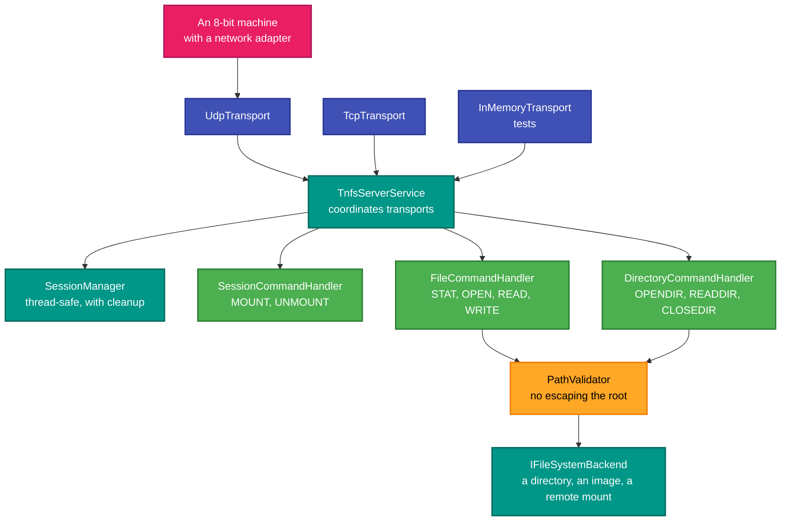
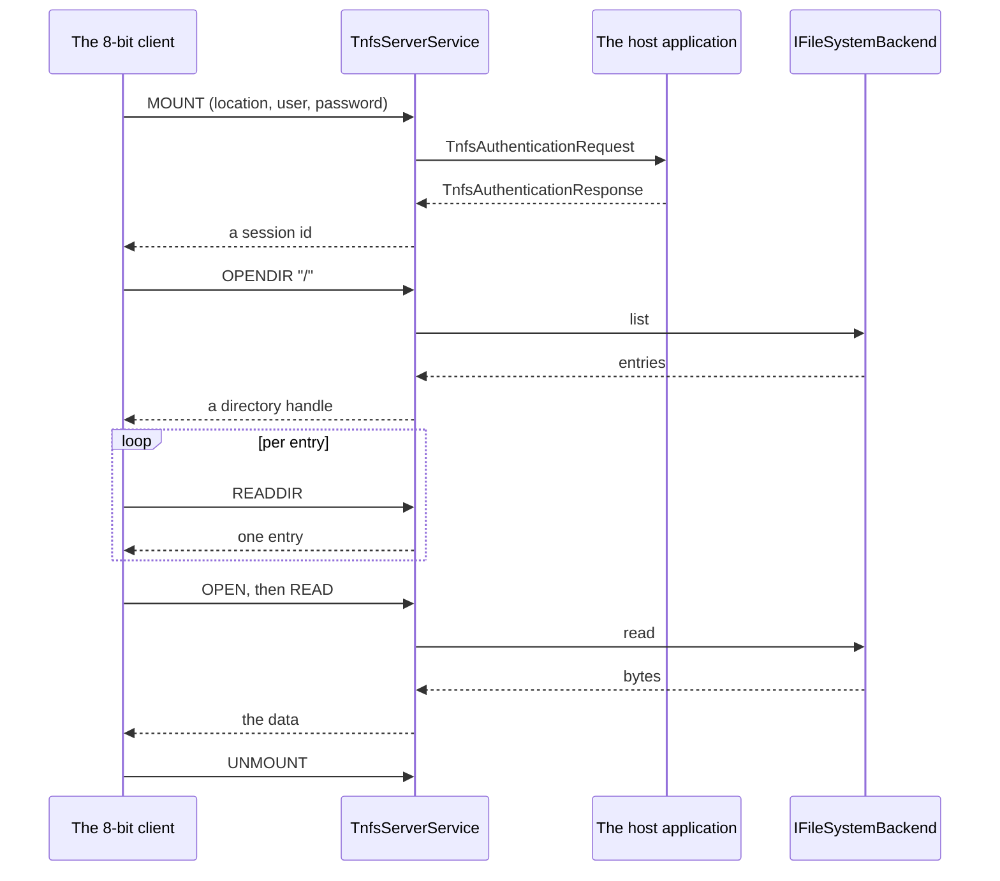

# RetroIO.Protocols.Tnfs

## What it is

**TNFS** — the Trivial Network File System: a filesystem served over UDP, designed for 8-bit machines
with network adapters. Both halves are here: a server that serves any RetroIO volume, and the client
types a caller needs.

## Why you need it

It is how a real Atari, Commodore or ZX Spectrum with a modern network adapter (FujiNet and its
relatives) gets at files. Those machines cannot run SMB or NFS — there is no room and no stack — so TNFS
is deliberately small: a 4-byte header, little-endian, over UDP.

Serving it from RetroIO means the machine can reach **anything RetroIO can mount**: a directory, a disk
image, a remote share. The 8-bit side sees a filesystem and knows nothing about what is behind it.

Two things in here are more careful than the protocol requires, on purpose:

- **`PathValidator`** prevents directory traversal. A filesystem protocol that takes a path from the
  network and opens it is an obvious way to escape the served root, and the server is exposed to a local
  network where anything might be speaking.
- **Pooled buffers.** `TnfsBuffer` wraps pooled memory and returns it on disposal, and `TnfsMessage` uses
  it, so message processing allocates nothing per request. A server answering a steady stream of small
  UDP datagrams is exactly where per-message allocation shows up.

## What you can use it for

- **Serving files to a real 8-bit machine** — the main use.
- Serving a disk image, a native directory or a remote mount, identically.
- **Mounting** a TNFS server as a volume, through `RetroIO.Storage.Providers`.
- Authenticating mounts: the server raises `TnfsAuthenticationRequest` and the host answers, so
  authentication is the host's policy rather than the protocol's.
- **Testing without a network**: `InMemoryTransport` gives bidirectional channels, so the protocol can be
  driven fast and deterministically.
- Serving over TCP as well as UDP — `ITransport` has both.
- Reporting real traffic: `TnfsServerStatistics` is live counters, shared as a singleton with the
  management API.

## Prerequisites

| Requirement | Needed for | Notes |
|---|---|---|
| .NET SDK as pinned in `global.json` | Everything | |
| `RetroIO.Storage.Core` | Serving files | Through `IFileSystemBackend` |
| `RetroIO.Server.Core` | The backend and path validation | |
| A free UDP port | Serving | 16384 is the conventional TNFS port |
| A machine or emulator with a network adapter | A real end-to-end test | `tnfs-stress` otherwise |

## The server

## A session

## Contents

| Area | Types |
|---|---|
| Server | `TnfsServerService`, `TnfsServerOptions`, `TnfsServerExtensions`, `TnfsServerStatistics` |
| Sessions | `SessionManager`, `TnfsSession`, `SessionStatistics`, `DirectoryHandle` |
| Commands | `SessionCommandHandler`, `FileCommandHandler`, `DirectoryCommandHandler` |
| Wire | `TnfsHeader` (4 bytes, little-endian), `TnfsMessage`, `TnfsBuffer` (pooled) |
| Transports | `ITransport`, `UdpTransport`, `TcpTransport`, `InMemoryTransport`, `TransportCapabilities` |
| Authentication | `TnfsAuthenticationRequest`, `TnfsAuthenticationResponse`, `TnfsAuthenticateEventHandler` |
| Client-side results | `TnfsResult<T>`, `TnfsDirectoryEntry`, `TnfsFileStat`, `TnfsVersionInfo`, `TnfsFreeSpace`, `TnfsDirEntryExtended`, `TnfsOpenDirXResult`, `TnfsReadDirXResult` |

## Endianness

**All multi-byte TNFS values are little-endian** — the opposite of most of the ND protocols in this repo.
`EndianHelper` in `RetroIO.Server.Core` has the read and write helpers; use them rather than assuming the
host's order.

## Related

- [`tnfs-stress`](../../tools/RetroIO.Tools.TnfsStress/README.md) — load and soak a server.
- `TnfsVolumeProvider` in [`RetroIO.Storage.Providers`](../RetroIO.Storage.Providers/README.md) — the
  client side, as a mountable volume.
- The management API exposes the live statistics; see
  [`RetroIO.Management.Api`](../RetroIO.Management.Api/README.md).
