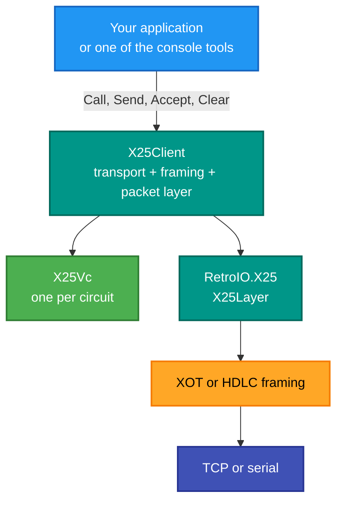
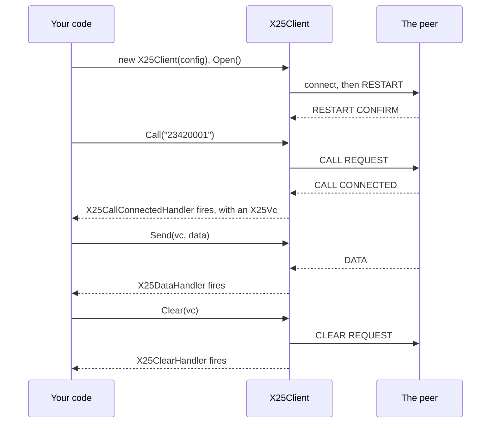

# RetroIO.Protocols.X25.Client

## What it is

The **application surface** of the X.25 stack. `X25Client` wraps a transport, XOT framing and the
packet layer into one object: open it, place calls on it, send on them, close it.

## Why you need it

Writing an X.25 application from the packet layer up means repeating the same dozen steps in the
same order every time — open a transport, initialise framing, configure the packet layer, do the
restart handshake, then loop reading and dispatching. Done five times, that produced five subtly
different versions, and the differences were all bugs.

This is that sequence written once. It is also what makes the console tools small: `x25echo`,
`x25pad`, `x25traffic` and `x25nmc` are each a few hundred lines because the protocol work is here.

## What you can use it for

- Placing a call and sending data, in about ten lines.
- **Answering** calls: `X25IncomingCallHandler` fires, you call `Accept`, and not accepting rejects
  the call.
- Several circuits at once on one link — each is an `X25Vc`.
- Running a `PadClient` over the clean stack, through `X25ClientPadTransport`.
- Writing a console tool: `ToolSupport` has the endpoint parsing and console-logger construction, so
  each tool does not re-implement the same boilerplate.

## Prerequisites

| Requirement | Needed for | Notes |
|---|---|---|
| .NET SDK as pinned in `global.json` | Everything | |
| `RetroIO.X25` | The packet layer | |
| `RetroIO.Protocols.X25` | `PadClient`, when you want a PAD | Not needed for plain calls |
| Something to call | Any real use | A switch, or another `X25Client` in listen mode |

## The shape of it

## Placing a call

## Key types

| Type | Role |
|---|---|
| `X25Client` | The object: open, call, accept, send, clear, close |
| `X25ClientConfig` | What to open — endpoint, framing, addresses, circuit count |
| `X25ClientFraming` | XOT or HDLC. This also decides whether LAPB is in the path |
| `X25Vc` | One virtual circuit as an application sees it |
| `X25IncomingCallHandler` | A call arrived. Call `Accept` to take it; returning without accepting rejects it |
| `X25CallConnectedHandler` | A call you placed was accepted |
| `X25DataHandler`, `X25ClearHandler` | Data arrived; the circuit ended |
| `X25ClientPadTransport` | Runs a `PadClient` over this client rather than over the full runtime |
| `ToolSupport` | Endpoint parsing and console logging for the CLI tools |

## Which framing to choose

| `X25ClientFraming` | LAPB in the path? | Use for |
|---|---|---|
| XOT | **no** — RFC 1613 puts the packet straight on TCP | A switch, a Cisco router, most things |
| HDLC | **yes** | A serial line, or a TCP trunk that emulates one |
