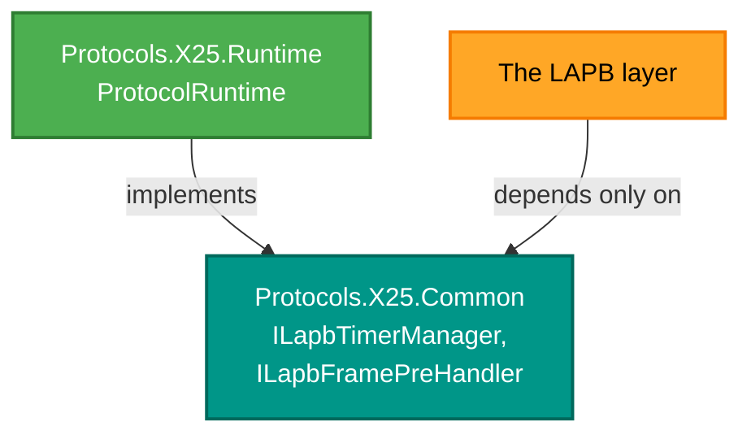

# RetroIO.Protocols.X25.Common

## What it is

The small things the X.25 packages share and none of them should own: a logger, an INI reader, the
XOT header helper, and a few interfaces that exist to break a dependency.

## Why you need it

Two reasons, and the second is the interesting one.

The ordinary reason is that a logger and a config reader are needed by several packages, and a
shared copy beats four copies that drift.

The real reason is **decoupling**. `ILapbTimerInterface`, `ILapbTimerManager` and
`ILapbFramePreHandler` exist so that the LAPB layer does not have to depend on the runtime that
drives it. Without them, `LapbLayer` would reference `ProtocolRuntime`, the runtime would reference
LAPB, and neither could be tested or replaced on its own. An interface in a package both sides
already depend on is how that knot is cut.

`XotUtils` is the same idea applied to bytes: the XOT header was built in two places — `XOTLayer`
and `XotSerialBridge` — and two copies of a header format is one copy too many.

## What you can use it for

- Logging from a protocol package without dragging in a logging framework.
- **Capturing log output for a GUI**: `HistoryLoggingProvider` keeps it in a circular buffer, which
  is what the desktop log window renders.
- Reading an INI configuration file (`IniConfig`) — the switch's configuration format.
- Constructing or reading an XOT header without repeating the layout.
- Supplying time to LAPB from a test instead of a clock, through `ILapbTimerInterface`.

## Prerequisites

| Requirement | Notes |
|---|---|
| .NET SDK as pinned in `global.json` | |
| No dependencies on other RetroIO packages | Deliberate — this is the package everything else may depend on |

## Contents

| Type | Role |
|---|---|
| `Logger`, `LogEntry`, `LogLevel` | The built-in logger |
| `HistoryLoggingProvider` | Captures log messages into a circular buffer for display |
| `IniConfig` | The INI reader the switch configuration uses |
| `XotUtils` | One place that knows the XOT header layout |
| `PacketInfo` | The structure passed between layers |
| `ILapbTimerInterface`, `ILapbTimerManager` | Timing for LAPB, suppliable by a test |
| `ILapbFramePreHandler` | Lets LAPB pre-store a frame for relationship linking without knowing the runtime |

## Why the interfaces live here

The arrows both point **at** this package. That is the whole trick: neither side references the
other, so each can be tested alone.
