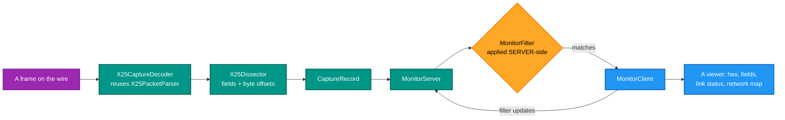
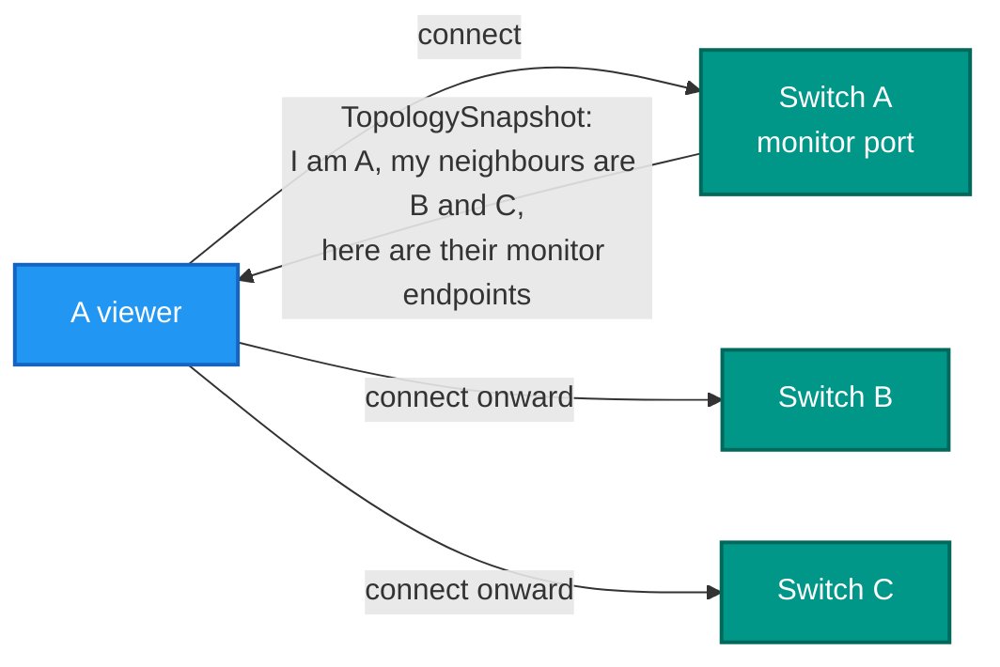

# RetroIO.Protocols.X25.Monitor

## What it is

The monitoring plane: a passive server that decodes captured frames and streams them to viewers, a
client that receives them, and **X25MON/1** — the compact binary protocol between the two.

The division of labour is the design: **the server decodes, the client only renders.**

## Why you need it

When a call fails, the answer is in a packet nobody looked at. A clear carries a cause and a
diagnostic; a refused call says why. Those bytes are the difference between "it does not work" and
"not obtainable, diagnostic 67".

Why a *protocol* rather than just a log file: because a viewer wants to filter, and filtering at the
viewer means sending everything and throwing most of it away. `MonitorFilter` is applied
**server-side**, so a busy switch streams only what the viewer asked for. And because a GUI should not
contain a protocol decoder — if it did, the decoder would drift from the codec, and a packet view
showing something different from what the stack parsed is worse than no packet view.

Two further things it buys: a **byte range** on every decoded field, so a viewer can highlight the
hex a field came from; and **topology**, so a viewer can discover a network by walking neighbours
instead of being configured with it.

## What you can use it for

- Live packet decode in a GUI, with hex highlighting that lines up with the fields.
- Watching several switches at once from one viewer.
- **Discovering a network**: `TopologySnapshot` carries a switch's identity and its neighbours,
  including each neighbour's monitor endpoint — so a viewer connects onward by itself.
- A link-status view: `PortStatus` and `StatusSnapshot` carry per-port counters, published
  periodically.
- Streaming log records from where they are emitted to where they are read (`LogRecord`).
- Writing your own viewer: `MonitorClient` is UI-agnostic.

## Prerequisites

| Requirement | Needed for | Notes |
|---|---|---|
| .NET SDK as pinned in `global.json` | Everything | |
| `RetroIO.X25` | Decoding packets | It reuses `X25PacketParser`, so the decode cannot drift |
| A free TCP port | `MonitorServer` | One per monitored node |
| Traffic | Seeing anything | It is passive; it generates nothing |

## Server decodes, client renders



## The wire format

```
[u32 big-endian payload length][MonitorMessage in the protobuf wire format]
```

Protobuf **wire format**, hand-rolled, with no protobuf library and no code generation. Unknown field
tags are skipped, so a newer server never breaks an older viewer. `MonitorFrameReader` reassembles
frames from an arbitrary stream — partial reads and several frames in one read are both handled,
which they will be on a real socket.

**The same protocol is spoken by the C emulator**, whose `src/util/x25mon.h` is the other
implementation. One viewer can therefore watch both stacks.

## Discovering a network



This is **purely a management overlay** — the X.25 protocol is unaffected, and a switch that declares
no neighbours simply cannot be walked onward from.

## Contents

| Type | Role |
|---|---|
| `MonitorProtocol`, `MonitorBinaryCodec` | X25MON/1: the framing and the codec |
| `MonitorMessage` | The envelope; `Type` selects which payload is present |
| `MonitorFrameReader` | Reassembles length-prefixed frames from a stream |
| `MonitorServer` | Passive; accepts viewers, applies each one's filter, pushes records |
| `MonitorClient` | Receives decoded records, sends filter updates. UI-agnostic |
| `CaptureRecord` | One fully decoded frame: envelope, raw hex, per-layer decode |
| `MonitorLayer`, `MonitorField` | One decoded layer, and one field with its byte range |
| `CaptureDirection` | Which way the frame travelled relative to the observing port |
| `MonitorFilter` | A server-side filter; an empty dimension matches everything |
| `PortStatus`, `StatusSnapshot` | Per-port counters and a point-in-time snapshot |
| `TopologySnapshot`, `NeighbourInfo` | Identity and neighbours, for network discovery |
| `LogRecord` | A log record captured at its source and streamed |
| `X25CaptureDecoder`, `X25Dissector` | Raw packet to record; parsed packet to fields with offsets |
