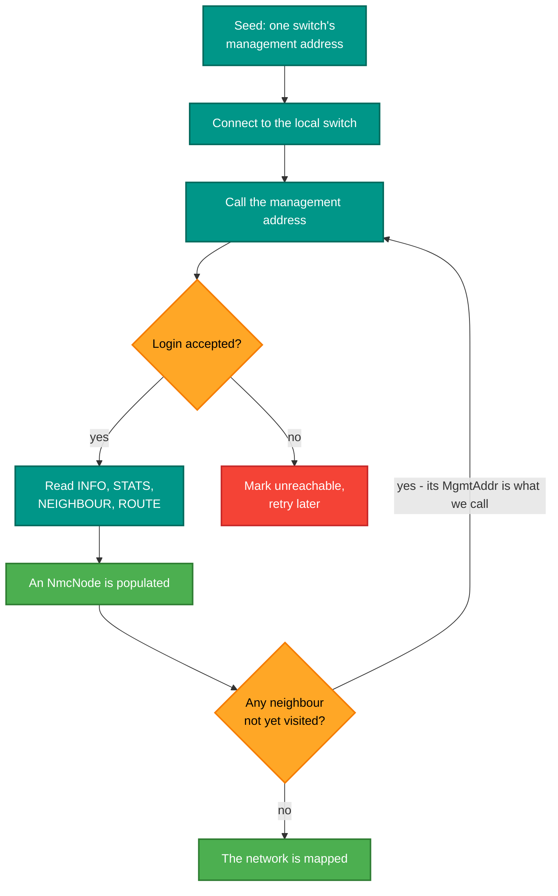
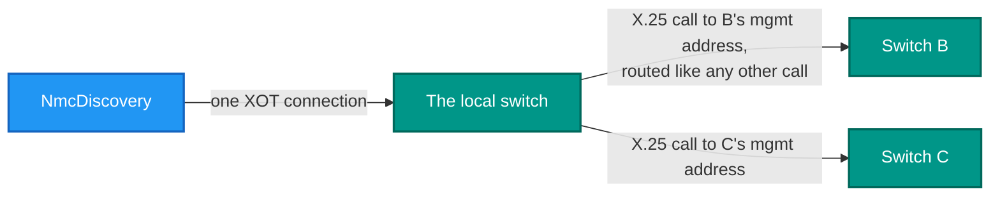

# RetroIO.Protocols.X25.Nmc

## What it is

Network discovery over the **in-band** management plane. Point it at one switch and it walks the whole
network: it connects locally, calls the seed switch's management address, logs in, reads identity,
topology and routes — and then does the same to each neighbour it learns about.

## Why you need it

One switch you can watch with its own CLI. Ten you cannot, and the questions you actually have are
network-wide: which trunk is down, where are the circuits, which hop is refusing calls.

The deeper reason is that it monitors the network **through the network**. No management LAN, no
accounts on each box: if a switch is reachable by an X.25 call, it can be monitored. That is how it was
done on real networks, and it has a useful side effect — the monitoring path is itself a proof that
routing works. A node you cannot reach to monitor is a node you cannot reach at all.

`NmcLineParser` is separate from the discovery engine for a reason worth knowing: it is pure and
allocation-light, so the console and the GUI share it, and it is **verified byte-for-byte against the
switch's own output**. The management response format is a contract between this package and
`RetroIO.Protocols.X25.Switch.Management`, and the parser's tests are what hold it.

## What you can use it for

- Discovering a whole network from one seed address.
- Reading each node's identity, counters, neighbours and routing table as typed records.
- Driving a console or a GUI from the same parsed data.
- Noticing a node that has stopped answering — a discovered node keeps its last known state and is
  retried.
- Parsing a captured management response in a test without a network.

## Prerequisites

| Requirement | Needed for | Notes |
|---|---|---|
| .NET SDK as pinned in `global.json` | Everything | |
| `RetroIO.Protocols.X25.Client` | Placing the management calls | |
| A reachable local switch | Any discovery run | Every call goes through it |
| A management address per switch | Reaching each node | Set in each switch's configuration |
| A username and password per switch | Logging in | The management API authenticates |
| A route to each management address | Reaching neighbours | Ordinary routing rules apply |

## The walk

## Through the network, not around it

One TCP connection, several X.25 calls — one per monitored switch, each on its own logical channel.

## Contents

| Type | Role |
|---|---|
| `NmcDiscovery` | The walk: connect, call, log in, read, follow neighbours |
| `NmcDiscoveryOptions` | Options for one run |
| `NmcNode` | A discovered switch: identity, counters, neighbours, routes — updated as it is walked |
| `NmcNodeInfo` | Identity, from an `INFO` response |
| `NmcStats` | Aggregate counters, from a `STATS` response |
| `NmcNeighbour` | A neighbour over a trunk, from a `NEIGHBOUR` response. Its `MgmtAddr` is what the walk calls |
| `NmcRoute` | One routing-table entry, from a `ROUTE` response |
| `NmcLineParser`, `NmcParsedLine`, `NmcLineKind` | Text responses to typed records. Pure, shared by console and GUI |
| `NmcNodeChanged` | A discovered node's state changed |

## Tests

The parser is the part with a format contract, so it is the part tested hardest: its fixtures are the
switch's real output, and a change to `SwitchCli`'s columns fails here. That is intentional — better a
failing test than a monitor that silently shows nothing.
