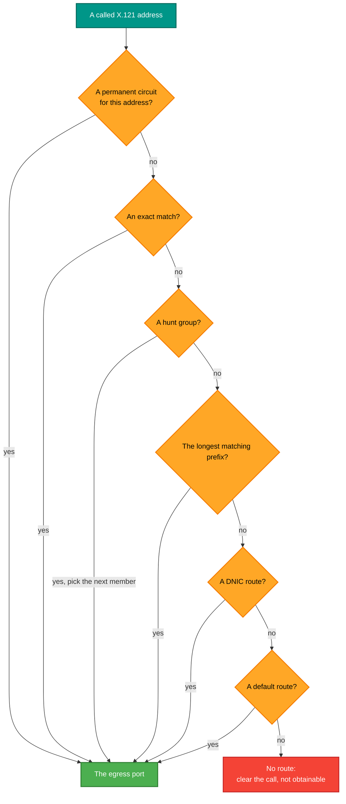
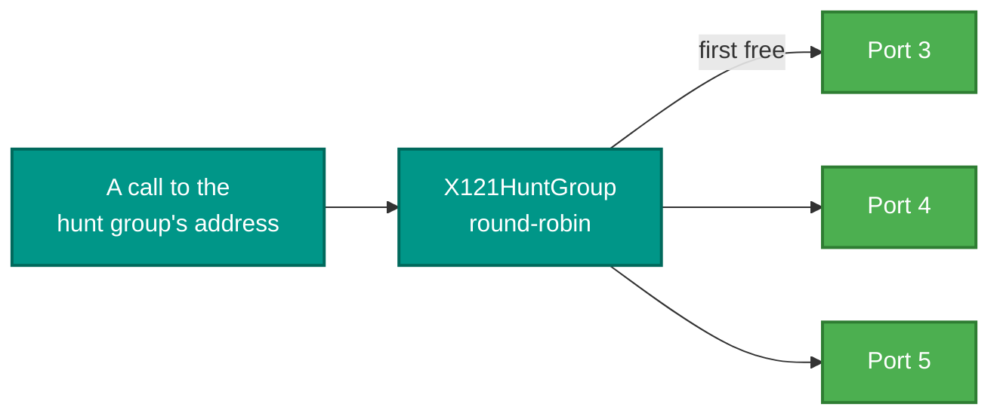

# RetroIO.Protocols.X25.Routing

## What it is

The X.121 routing table: the thing that answers "which port does this address live behind?" It holds
four kinds of entry and evaluates them in a fixed order of precedence, and it supports hunt groups.

## Why you need it

A switch receives a call to an **address** and has to choose a **port**. That choice is not a simple
lookup, because real networks need several kinds of rule at once: one exact address that goes
somewhere special, a block of addresses that leave by a trunk, a whole foreign network reached by its
DNIC, and a default for everything else.

The part that must not be got wrong is the **order**. A more specific rule has to win over a general
one, or the default route swallows everything and nothing else ever matches. That precedence is
encoded in `X121RouteType` rather than left to the order entries happen to be added in.

## What you can use it for

- Resolving a called address to a port, with the precedence already right.
- Spreading calls across a set of ports with a **hunt group**, round-robin — which is how a pool of
  receiving lines is reached by one configured name.
- Holding a routing table to show in a management CLI or a GUI, without a switch attached.

## Prerequisites

| Requirement | Notes |
|---|---|
| .NET SDK as pinned in `global.json` | |
| No transport, no sockets | It is a lookup table; it carries no traffic |

## Precedence, which is the point

**Most specific first.** That ordering is why a default route can exist at all.

## Contents

| Type | Role |
|---|---|
| `X121RoutingTable` | The table: add entries, resolve an address |
| `X121Route` | One entry |
| `X121RouteType` | The kind of entry **and its precedence** |
| `X121HuntGroup` | A set of member ports a hunt route distributes calls across, round-robin |

## Hunt groups

A hunt group turns one configured name into several ports tried in turn. It is how a bank of
receiving lines was reached historically: the caller dials one number, and whichever line is free
answers.

