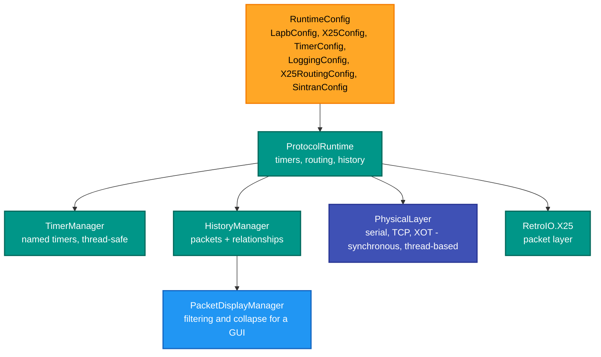
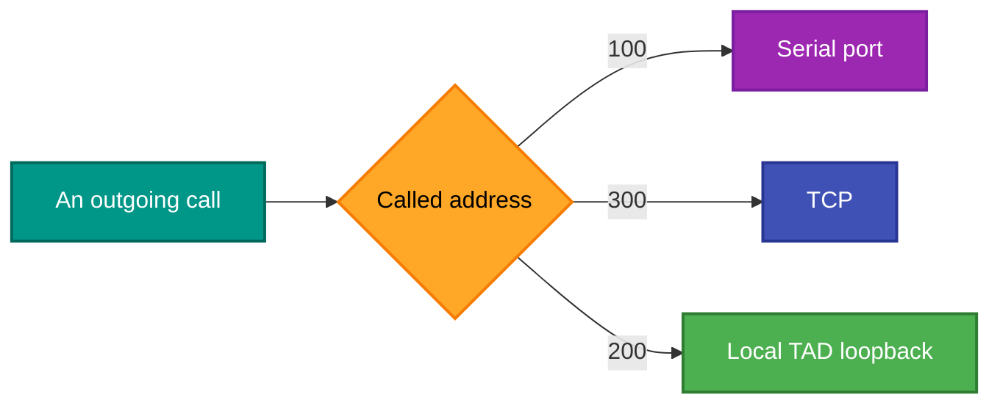

# RetroIO.Protocols.X25.Runtime

## What it is

The assembled X.25 runtime: a physical layer that owns the serial port, the TCP connections and the
XOT transports, a central `ProtocolRuntime` that ties the layers together with timers, routing and
packet history, and the full configuration model — including Cisco-style routing, known hosts and
PVC bindings.

This is the **composition** package. The protocol work is elsewhere; this decides what is wired to
what.

## Why you need it

A packet layer, a link and a router are three objects. Something has to own them, give them a clock,
keep the history they all announce into, and hold the configuration that says which serial port and
which XOT destination. Doing that ad hoc in each application is how four applications end up with
four slightly different stacks.

It is also where the **synchronous, thread-based** choice lives: the physical layer does not use
async/await. That is deliberate for a protocol stack driven by timers, where an `await` in the wrong
place reorders events that the specification says are ordered.

`ProtocolRuntime` has been explicitly pulled apart over time — `HistoryManager` and `TimerManager`
both say in their own documentation that they were extracted from it to reduce its size. Worth knowing
before adding anything new to it.

## What you can use it for

- Standing up a complete stack from a configuration file, rather than by hand.
- **Cisco-style routing configuration**: `X25RoutingConfig` mirrors `interface Serial0` and
  `x25 route`, so a configuration from a real router translates.
- Declaring **known hosts** — which machines are reachable through which interface or gateway,
  including multi-hop.
- Binding permanent virtual circuits (`PvcBinding`, `PvcDefinition`).
- Driving a GUI: `PacketDisplayManager` filters and collapses the packet list, and
  `PacketDisplayUpdateEventArgs` carries real-time updates with relationship visibility.
- Running without hardware: the serial port has a mock mode (`MockSerialEventArgs`).

## Prerequisites

| Requirement | Needed for | Notes |
|---|---|---|
| .NET SDK as pinned in `global.json` | Everything | |
| `RetroIO.X25` | The packet layer | |
| `RetroIO.Protocols.X25` | Services, PAD/TAD, XOT transports | |
| `RetroIO.Protocols.X25.Common` | Logger, INI, the timer seams | |
| A serial port | The serial interface only | Mock mode otherwise |
| A configuration | Any real use | `RuntimeConfig` and the `*Config` types below |

## What it assembles

## Address-based transport selection

`PhysicalLayer` routes a call by its address — the defaults in the code are `100` to serial, `300` to
TCP and `200` to the local TAD loopback. That is a development convenience, not a specification: it is
what makes a three-way test possible on one machine without configuring anything.

## Contents

| Area | Types |
|---|---|
| The runtime | `ProtocolRuntime`, `RuntimeConfig`, `TimerManager` |
| Physical layer | `PhysicalLayer`, `PhysicalLayerConfig`, `PhysicalLayerStatistics`, `StationType` |
| Serial | `SerialTransport`, `SerialTransportConfig`, `SerialInterfaceConfig`, `MockSerialEventArgs`, `SerialLapbLink`, `SerialX25LinkOptions`, `SerialX25LinkRole` |
| Configuration | `LapbConfig`, `X25Config`, `TimerConfig`, `LoggingConfig`, `SintranConfig` |
| Routing configuration | `X25RoutingConfig`, `X25RouteEntry`, `RouteType`, `TcpLapbInterfaceConfig` |
| Reachability | `KnownHostEntry`, `HostReachability` |
| Permanent circuits | `PvcBinding`, `PvcDefinition` |
| GUI support | `PacketDisplayManager`, `PacketDisplayItem`, `PacketDisplayStatistics`, `PacketDisplayUpdateEventArgs` |

## A note before extending it

`ProtocolRuntime` is the largest thing here and has twice had pieces extracted out of it. If you are
adding behaviour, look first at whether it belongs in a new small class that the runtime holds, the way
`TimerManager` and `HistoryManager` do.
