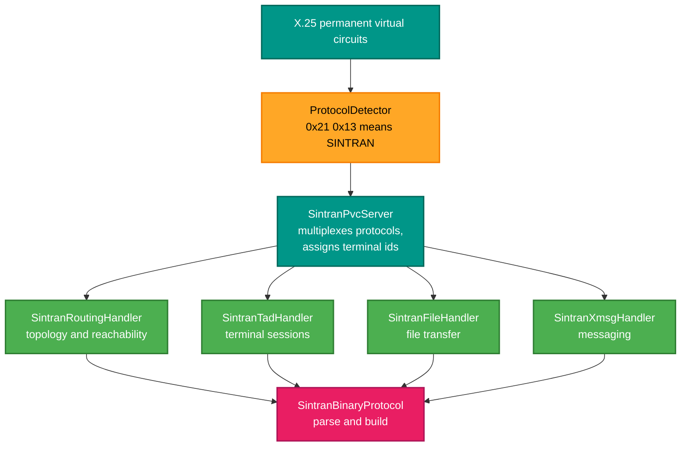
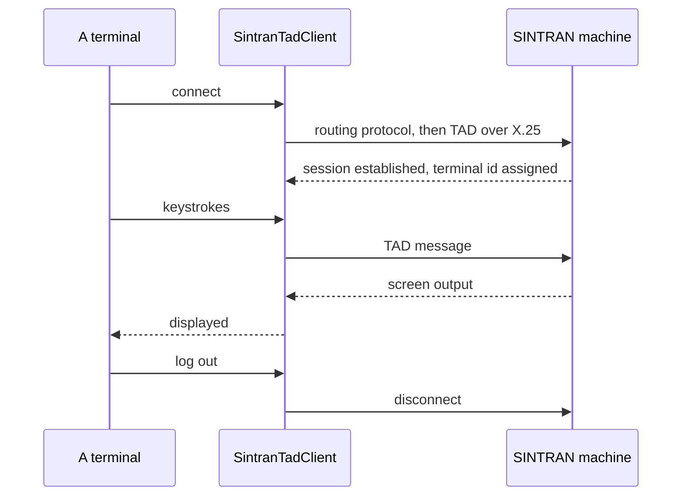

# RetroIO.Protocols.X25.Sintran

## What it is

SINTRAN's own protocols, carried over X.25 permanent virtual circuits: the routing-information
protocol, TAD terminal access, file transfer, and XMSG messaging — plus the PVC server that
multiplexes them.

## Why you need it

A Norsk Data machine running SINTRAN III does not just speak X.25. It speaks **its own protocols on
top of X.25**, and on permanent circuits rather than dialled calls. If you want to reach one — open a
terminal session, move a file, learn what it can reach — you need these, not just the packet layer.

The identifying detail, and the one that makes discrimination possible at all: a SINTRAN routing frame
announces itself with **`0x21 0x13`** at the start of a LAPB information field. That marker is how
`ProtocolDetector` in `RetroIO.Link` tells a SINTRAN frame from an X.25 one on the same link.

Much of this was read off real SINTRAN NPL source — `MP-P2-TAD.NPL` and `RP-P2-TAD.NPL` are cited in
the code, with line numbers. That is why the message formats are precise rather than inferred: they
came from the machine's own source, not from a capture somebody interpreted.

## What you can use it for

- **Terminal access to a SINTRAN machine**: `SintranTadClient` connects to a remote TAD server;
  `SintranTadHandler` is the server side, answering terminal connections from SINTRAN PAD clients.
- **File transfer** both ways: `SintranFileHandler` does uploads, downloads, directory listings and
  file management.
- **Routing information**: `SintranRoutingHandler` exchanges topology and reachability between
  systems.
- **Messaging**: `SintranXmsgHandler` queues, delivers and notifies.
- Running several of these at once over one machine's circuits — `SintranPvcServer` multiplexes them
  and assigns terminal ids.
- Parsing a captured SINTRAN frame: `SintranBinaryProtocol` handles both the LAPB-level routing
  format and the X.25 payload format.

## Prerequisites

| Requirement | Needed for | Notes |
|---|---|---|
| .NET SDK as pinned in `global.json` | Everything | |
| `RetroIO.Protocols.X25` | The X.25 services layer | |
| Permanent virtual circuits configured | Anything real | These protocols do not dial; the circuit is provisioned |
| A SINTRAN machine or an emulator | The lab tests | Record as SKIPPED if unavailable, never as passed |
| The research notes | Understanding the formats | The `DOC` junction, and the NPL sources cited in the code |

## How it layers

## A terminal session

## Contents

| Type | Role |
|---|---|
| `SintranPvcServer` | Manages the permanent circuits and multiplexes the protocols over them |
| `SintranBinaryProtocol` | Parser and builder: the LAPB-level routing format (`0x21 0x13`) and the X.25 payload format |
| `SintranPacket`, `SintranRoutingFrame` | The two frame shapes |
| `ISintranProtocolHandler` | The seam every handler implements |
| `SintranRoutingHandler` | Routing information and network topology |
| `SintranTadHandler`, `SintranTadSession`, `TadSessionState` | The TAD server side, and one session's lifecycle |
| `SintranTadMessage`, `SintranTadMessageTypes` | TAD message formats, from the NPL sources |
| `SintranTadClient` | The client side: connect to a remote SINTRAN TAD server |
| `SintranFileHandler` | File transfer operations |
| `SintranXmsgHandler` | Message queuing, delivery and notification |
| `SintranTadProtocolService` | Routes incoming X.25 calls to the PVC server |

## Where the formats came from

The TAD message formats cite `RP-P2-TAD.NPL:162-178` and `MP-P2-TAD.NPL` — real SINTRAN source. When
extending this, read the NPL rather than guessing from a capture: a capture shows one machine's
behaviour in one situation, and the source shows the rule.

See also [`RetroIO.Protocols.Xmsg`](../RetroIO.Protocols.Xmsg/README.md), which implements the ND
messaging system in depth, including its own TAD server and client.
