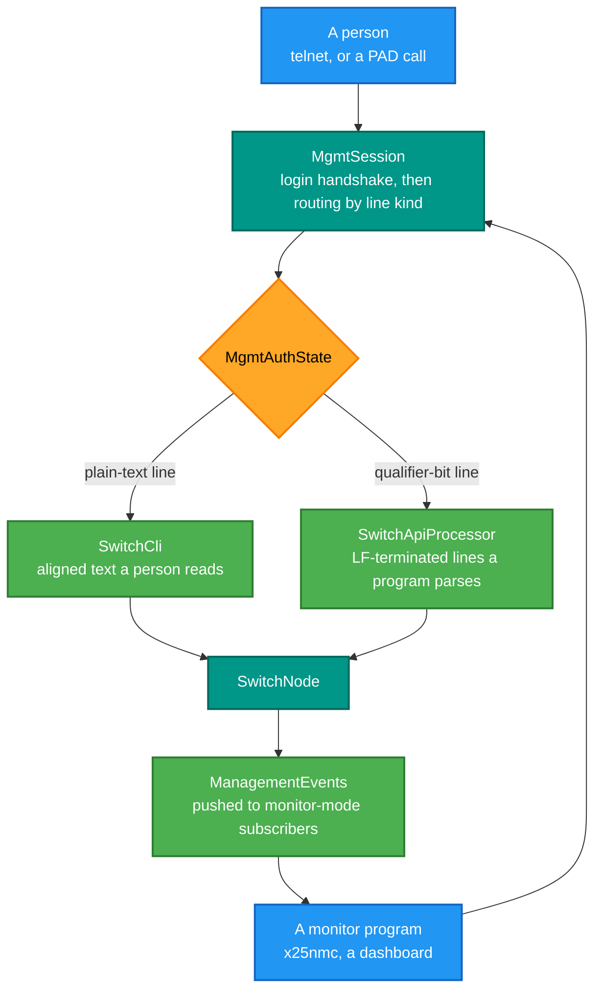
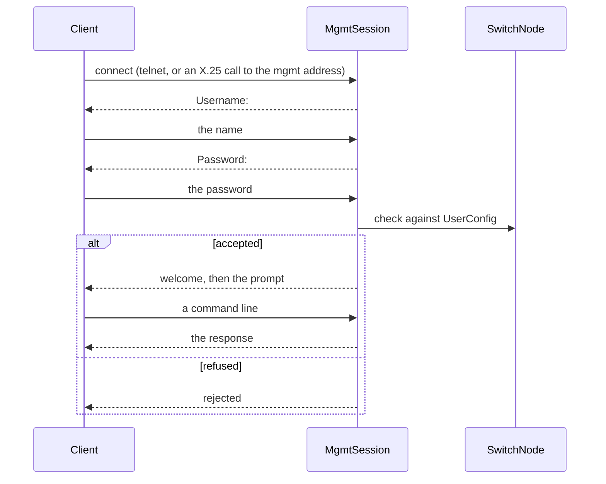

# RetroIO.Protocols.X25.Switch.Management

## What it is

The management surfaces of a switch. Two of them, over the same authenticated session: a **command
CLI** a person types at, and a **machine API** a monitoring program parses. Plus a raw-telnet server
with a real line editor, for reaching the CLI over TCP.

## Why you need it

A running switch is useless if you cannot ask it anything. You need to see the routing table, the
ports, the circuits that are up, the counters — and sometimes to change a route or clear a stuck
circuit without restarting.

Why **two** surfaces rather than one: a human wants aligned columns and friendly words; a program
wants lines it can parse without regretting it later. Trying to serve both from one format produces
output that is awkward to read *and* fragile to parse. So plain-text lines go to the CLI, and
qualifier-bit lines go to the machine API, on the same circuit — the Q bit is the discriminator.

The telnet line editor exists because a raw TCP console is not a terminal. Nothing echoes your
keystrokes, backspace arrives as a byte, and a telnet client sends IAC negotiation sequences that are
not input. `TelnetLineEditor` handles all three, which is the difference between a usable console and
a confusing one.

## What you can use it for

- A telnet management console on a switch (`TelnetCliServer`).
- An **in-band** management session over an X.25 circuit — no management LAN needed, which is how
  `x25nmc` reaches switches through the network it is monitoring.
- A machine-readable status feed for a monitor or dashboard (`SwitchApiProcessor`).
- Subscribing to asynchronous events: a session can enter monitor mode and be pushed changes.
- Parsing switch output in a test, byte for byte — which is what keeps the format from drifting.

## Prerequisites

| Requirement | Needed for | Notes |
|---|---|---|
| .NET SDK as pinned in `global.json` | Everything | |
| `RetroIO.Protocols.X25.Switch` | The switch it manages | It reads `SwitchNode` |
| A configured management user | Any session | `UserConfig` on the switch |
| A free TCP port | `TelnetCliServer` only | The in-band API needs no extra port |

## The two surfaces, one session

## Logging in

## Contents

| Type | Role |
|---|---|
| `MgmtSession` | One authenticated session: login, then route lines by kind. Can enter monitor mode |
| `MgmtAuthState` | Where a session is in the handshake |
| `MgmtResult` | What feeding one line produced |
| `SwitchCli` | Parses a command line, renders the exact CLI text, applies the mutating commands |
| `SwitchApiProcessor` | Answers request keywords with line-oriented, LF-terminated responses |
| `ManagementEvents` | Formats the asynchronous events pushed to subscribed sessions |
| `TelnetCliServer` | Accepts raw TCP on the management port and drives each connection |
| `TelnetLineEditor`, `TelnetInput` | Character-at-a-time editing: echo, backspace, discard IAC, report a line on CR or LF |

## A note on the response format

`SwitchCli` renders the **exact** text of the management CLI, and that exactness is deliberate: the
format is a contract. `RetroIO.Protocols.X25.Nmc`'s `NmcLineParser` parses these same lines, and its
documentation says it is verified byte-for-byte against this output. Changing a column here breaks a
parser there, and the tests are what catch it.
