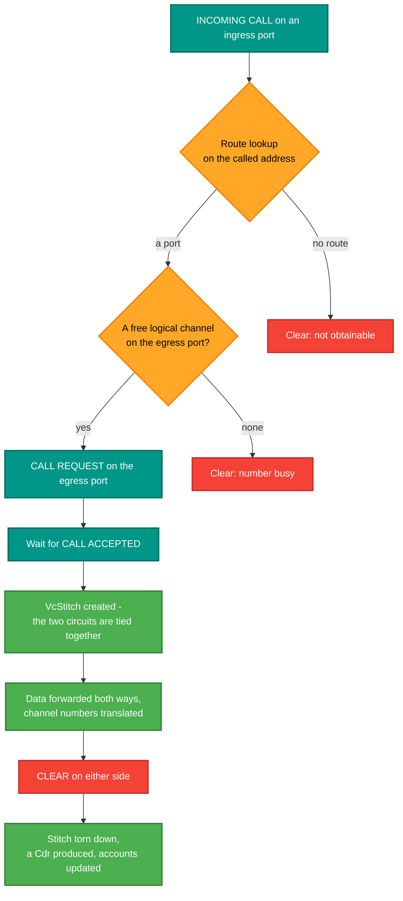
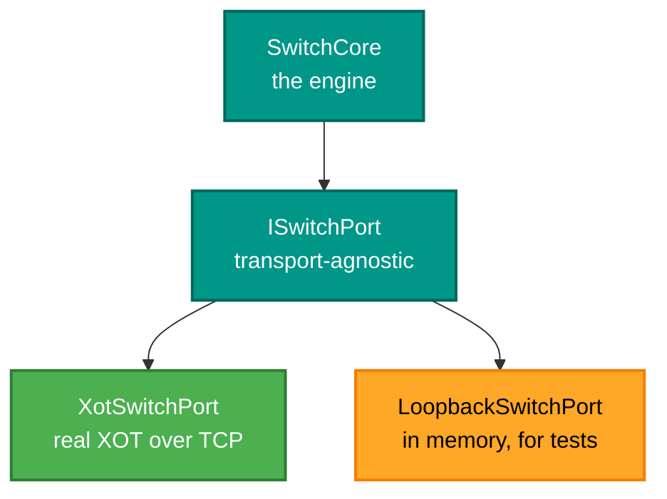

# RetroIO.Protocols.X25.Switch

## What it is

The **switching engine**: the thing that makes a network out of links. It watches every attached
port, routes an incoming call to an egress port, **stitches** the two circuits together, forwards
data both ways, and tears the pair down on clear — while keeping per-port counters, per-subscriber
accounts and Call Detail Records.

## Why you need it

An X.25 virtual circuit is not a point-to-point link. A caller places a call to an **address**, and
something has to decide which port that address lives behind, allocate a logical channel on it, and
then join the two halves for the life of the call.

That joining is the idea the whole package is built around, and it is worth being precise about:
there are **two circuits**, not one. A call in on one port and a call out on another, each with its
own logical channel number, tied together by a `VcStitch`. Packets are translated from one to the
other in both directions. A switch that tried to use one circuit end to end could not renumber
channels per hop, and per-hop channel numbering is what lets every link use its own small range.

## What you can use it for

- Building a switch, a transit node, or a gateway between two networks.
- **Accounting**: `SwitchAccount` accumulates per-subscriber totals as calls complete, and `Cdr`
  summarises each finished circuit.
- Holding data a slow leg will not take yet, rather than dropping it — that is `QueuedPacket`.
- **Testing a whole switch with no network at all**: `LoopbackSwitchPort` captures outward operations
  and lets inward stimuli be injected, so the engine can be driven deterministically.
- Reading live state for a management surface: `SwitchNode` is the shared model the engine mutates
  and the management packages read.

## Prerequisites

| Requirement | Needed for | Notes |
|---|---|---|
| .NET SDK as pinned in `global.json` | Everything | |
| `RetroIO.X25` | The packet layer | |
| `RetroIO.Protocols.X25.Routing` | Route lookup | |
| `RetroIO.Protocols.X25.Common` | `IniConfig`, for the configuration loader | |
| An INI configuration | Any real switch | `SwitchConfigLoader` parses it |
| Free TCP ports | Real ports, not loopback ones | One per listening port |

## A call through the engine

## Ports are abstract on purpose

`ISwitchPort` decouples the engine from the medium — XOT, HDLC over TCP, serial, or nothing at all.
`LoopbackSwitchPort` is what makes the engine testable: no sockets, no timing, no ports to collide.

## Contents

| Type | Role |
|---|---|
| `SwitchCore` | The engine: route, stitch, forward, tear down |
| `SwitchNode` | The runtime state — config, ports, stitches, accounts, uptime |
| `VcStitch` | The mapping that ties an ingress circuit to an egress one |
| `ISwitchPort` | A port, independent of its transport |
| `XotSwitchPort`, `LoopbackSwitchPort` | A real one and a test one. `XotSwitchPort` also shows a monitor what crosses it: `PacketCaptured` (every packet, both directions), the byte totals in `PortCounters`, and `ConnectAttempts`, `LastConnectedMs` and `LastDisconnectedMs`, counted as the C emulator counts them. It takes an optional `ILogger`, and a listening port binds the address in `PortConfig.Host` |
| `SwitchConfig`, `SwitchConfigLoader` | The parsed configuration, and the INI loader with its defaults |
| `PortConfig`, `PortType`, `PortTransport`, `PortMode` | One port's configuration. `PortMode`: `1 = DTE`, `0 = DCE` |
| `SwitchAccount`, `AccountConfig` | Per-subscriber accounting, configuration and lifetime counters |
| `Cdr` | A Call Detail Record for one completed circuit |
| `QueuedPacket` | A packet held because the egress leg would not take it |
| `PortCounters` | Per-port lifetime counters (calls, packets and X.25 packet bytes), safe to read from another thread |

## Defaults worth knowing

`PortConfig` follows the switch configuration specification: window size **2**, packet size **128**,
LCI base **1** and count **16**, TCP port **1998**. A configuration that omits a field gets these,
so a file shorter than you expect is not necessarily incomplete.
