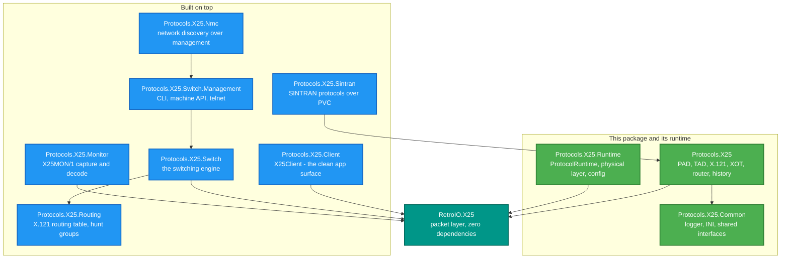
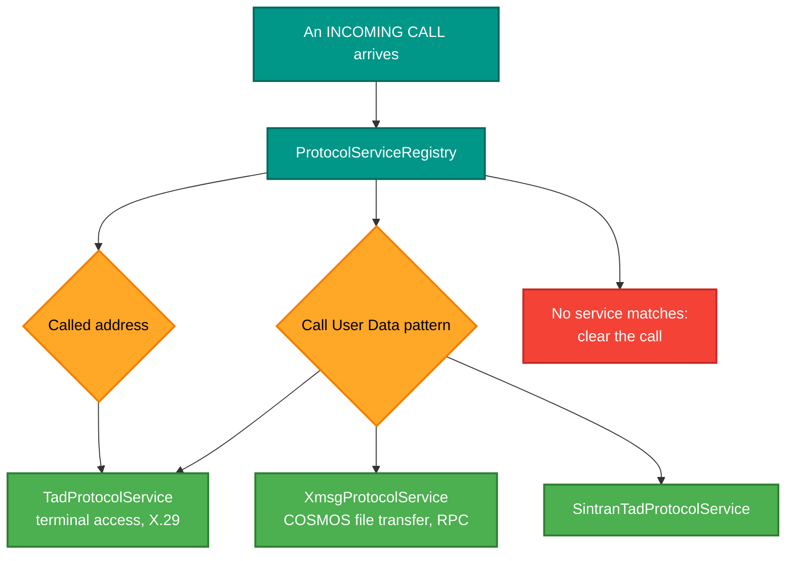

# RetroIO.Protocols.X25

## What it is

The X.25 **runtime and services** package, and the index for the ten-package X.25 family. Where
[`RetroIO.X25`](../RetroIO.X25/README.md) is the pure packet layer with no dependencies, this is
everything built around it: the PAD and TAD services, X.3/X.28/X.29, X.121 addressing, the XOT
transports, the router, the packet-history bus, and the service registry that decides which service
answers an incoming call.

## Why you need it

The packet layer gets you a circuit. It does not get you a **service**. A real X.25 network answers
calls with something: a PAD for a terminal, a TAD for a machine, XMSG for file transfer. Deciding
which one answers — from the called address and the Call User Data — is this package's job, and it
is the difference between a protocol implementation and a usable network.

It also holds the parts that are about *operating* a network rather than speaking the protocol: the
history bus that every layer announces packets on, the unified packet tracking that follows one
packet through HDLC, LAPB and X.25 under a single id, and the statistics each layer publishes.

## What you can use it for

- **Answer calls with a service.** `ProtocolServiceRegistry` routes by called address and CUD
  pattern; `TadProtocolService` and `XmsgProtocolService` are two implementations.
- **Be a terminal**: `PadClient` with X.3 parameters, X.28 commands and X.29 remote control.
- **Answer terminals**: `TadServer`, including a built-in loopback echo on address 200 for testing.
- **Route calls** Cisco-style: `X25Router` matches X.121 patterns with priority and failover.
- **Speak XOT** in both directions: `XotClientTransport` and `XotServerTransport` (RFC 1613).
- **Bridge at speed**: `XotSerialBridge` passes traffic XOT-to-serial, XOT-to-XOT or
  serial-to-serial, bypassing the routing layer for throughput.
- **Validate and parse addresses**: `X121` implements the international numbering plan.
- **Trace a packet through the whole stack** under one id, which is what the desktop packet view
  renders.

## Prerequisites

| Requirement | Needed for | Notes |
|---|---|---|
| .NET SDK as pinned in `global.json` | Everything | |
| `RetroIO.X25` | The packet layer | All circuit state lives there, never here |
| `RetroIO.Link`, `.Lapb`, `.Hdlc` | Links and framing | |
| `RetroIO.Protocols.X25.Common` | Logging, INI config, shared seams | |
| A reachable peer or a loopback | Anything that opens a transport | `TadServer`'s address 200 echo needs nothing |

## The X.25 family, and which package to reach for

| Package | Reach for it when you want to | README |
|---|---|---|
| `RetroIO.X25` | Encode, decode or drive the packet layer itself | [README](../RetroIO.X25/README.md) |
| `RetroIO.Protocols.X25` | Answer calls with a service; PAD, TAD, routing, XOT | this file |
| `.X25.Client` | Write an application: open, call, send, clear | [README](../RetroIO.Protocols.X25.Client/README.md) |
| `.X25.Common` | The logger, INI config and seams the others share | [README](../RetroIO.Protocols.X25.Common/README.md) |
| `.X25.Runtime` | The full runtime with physical layer and configuration | [README](../RetroIO.Protocols.X25.Runtime/README.md) |
| `.X25.Switch` | Build a switch: ports, stitching, accounting | [README](../RetroIO.Protocols.X25.Switch/README.md) |
| `.X25.Switch.Management` | A management CLI or machine API on a switch | [README](../RetroIO.Protocols.X25.Switch.Management/README.md) |
| `.X25.Routing` | An X.121 routing table with hunt groups | [README](../RetroIO.Protocols.X25.Routing/README.md) |
| `.X25.Monitor` | Capture, decode and stream traffic to a viewer | [README](../RetroIO.Protocols.X25.Monitor/README.md) |
| `.X25.Nmc` | Discover and walk a whole network | [README](../RetroIO.Protocols.X25.Nmc/README.md) |
| `.X25.Sintran` | SINTRAN's own protocols over permanent circuits | [README](../RetroIO.Protocols.X25.Sintran/README.md) |

## How an incoming call finds its service

`X25ProtocolDetectionService` is what reads the CUD: the first octets of Call User Data identify the
protocol (PAD, TAD, XMSG, IP, CLNP and others), which is how one switch answers several kinds of
caller on one address range.

## Key areas in this package

| Area | Types |
|---|---|
| PAD and TAD | `PadClient`, `TadServer`, `LocalTadProtocol`, `IPadTransport`, `RuntimePadTransport` |
| Triple-X | `X3`, `X3Parameters` (all 22), `X28`, `X29`, `X29Messages` |
| Addressing | `X121`, `X121AddressInfo` |
| XOT | `XotClientTransport`, `XotServerTransport`, `XotSerialBridge`, `XotInterfaceConfig` |
| Routing | `X25Router`, `X25Route`, `X25RoutingLayer` |
| Services | `IProtocolService`, `ProtocolServiceRegistry`, `X25ProtocolDetectionService` |
| History and statistics | `X25PacketHistory`, `HistoryManager`, `UnifiedPacketInfo`, the per-layer `*Statistics` |
| XMSG over X.25 | `LocalXMSGProtocol`, `XMSGServiceRegistry` |

## Specifications

`E:\Dev\RCL\Specs\X25` — X.25 (10/96), X.3, X.28, X.29, X.75, RFC 1613, RFC 1662, ISO 13239. Read
the clause rather than citing it from memory; the `x25-stack` skill lists the traps in the extracted
text.

## Tests

`tests/RetroIO.Protocols.X25.Tests`, which spans this package and `RetroIO.X25`. `X25VectorTests`
runs `tests/x25-vectors/x25-vectors.json` — **the same file the C emulator reads**, so the two
implementations cannot drift apart silently.
