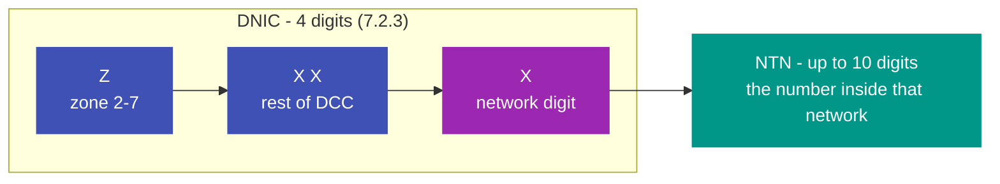
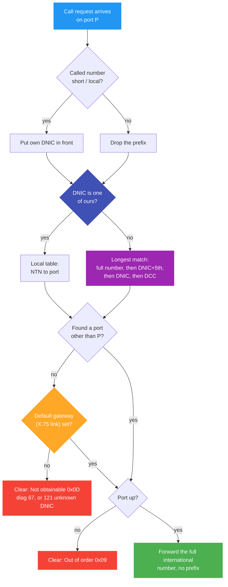
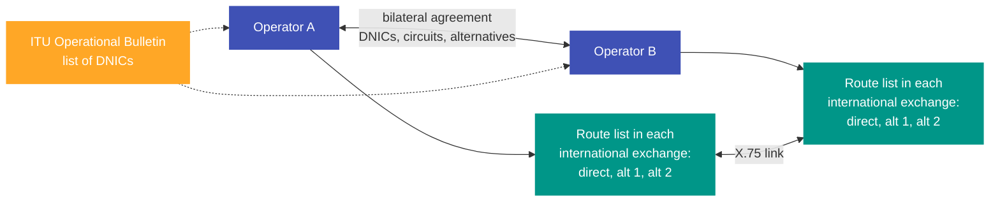

# X.121 addresses and X.25 call routing

How an X.25 address is built, how a local number differs from an international one, and how a switch
should decide where a call goes. Every rule below cites its clause in the ITU-T text:

- [ITU-T X.121](https://www.itu.int/rec/T-REC-X.121/en) (10/2000) - the international numbering plan
- [ITU-T X.25](https://www.itu.int/rec/T-REC-X.25/en) (10/96) - the DTE/DCE interface, address field and clearing causes
- [ITU-T X.75](https://www.itu.int/rec/T-REC-X.75/en) (10/96) - the signalling between public networks (the gateway link)
- [CCITT X.110](https://www.itu.int/rec/T-REC-X.110/en) (11/88) - international routing principles and routing plan

## 1. What an address is made of

An **international data number** is `DNIC + NTN`, or `DCC + NN` where a country has one numbering
scheme for all its networks (X.121 7.6.1).

| Part | Digits | Meaning | Clause |
|---|---|---|---|
| DCC (Data Country Code) | 3 | The country; the first digit is the zone | 7.2.3, 7.2.7 |
| Network digit | 1 | Which network in that country (up to 10 per DCC) | 7.2.4 |
| DNIC (Data Network Identification Code) | 4 | DCC + network digit | 7.2.3 |
| NTN (Network Terminal Number) | up to 10 | The full number used **inside** the network, no prefix | 7.6.2, 7.7 |
| NN (National Number) | up to 11 | Same idea, used after a bare DCC | 7.6.2, 7.7 |
| International number | 5 to 14 | DNIC + NTN, or DCC + NN | 7.7 |

**The first digit** (Table 1/X.121, 7.2.2):

| First digit | Meaning |
|---|---|
| 1 | Global: mobile satellite (`111S`, 7.4) and global public data networks (7.5) |
| 2 - 7 | A country or region; the digit is the geographic zone (7.2.7) |
| 8, 9, 0 | **Escape codes**, not part of any DNIC: the rest is from another numbering plan (7.9, Table 2) |

**Examples, one of each kind.** The country codes are from X.121 Annex J (240 Sweden, 242 and 243 Norway).
The network digits and subscriber numbers are made up for the example, except where a source is named.

| Dialled | Split | What it is |
|---|---|---|
| `110006` | NTN `110006` | A local number inside our own network (a SINTRAN machine). No DNIC: the switch adds its own |
| `2422 110006` | DNIC `2422` + NTN `110006` | The same machine called from another network, if our DNIC were `2422` (DCC `242` Norway, network `2`) |
| `2402 0001730` | DNIC `2402` + NTN `0001730` | An international data number in Sweden (DCC `240`, network `2`); the Tor address book has it as `024020001730`, with the prefix |
| `0 2402 001487` | prefix `0` + DNIC `2402` + NTN | The same kind of number with a one-digit international prefix in front, as dialled on the Tor machine (7.8) |
| `243 12345678` | DCC `243` + NN `12345678` | A country with one numbering scheme for all its networks: no network digit, the national number follows (7.6.1) |
| `7501 1 2345` | DNIC `7501` + 5th digit `1` + rest | A DNIC shared by several networks, split on the 5th digit (Annex A.2) |
| `111S ...` | DNIC `111S` + mobile earth station number | Mobile satellite: `S` is the ocean area (7.4, Annex I) |
| `9 4722123456` | escape `9` + E.164 number | A phone number, reached through an analogue interface (Table 2) |
| `0 4722123456` | escape `0` + E.164 number | A phone or ISDN number, digital interface requested (Table 2) |
| `8 ...` | escape `8` + F.69 number | A telex number (Table 2; still "for further study") |

**`0` has two meanings.** It can be a national prefix (row 4) or the E.164 escape code (row 9). Which one a
network uses it for is its own choice (7.8.2), so the switch must be told; the digits alone do not say.

**The X.25 address field** holds at most **15 digits including any prefix and escape code** in the normal
(non-TOA/NPI) format (X.25 5.2.1). That is why a prefix for international format can be only one digit:
14 + 1 = 15 (X.121 7.8, note).

## 2. Local and international dialling

A DTE may dial a short **local** number (the NTN alone) or a full **international** number. A national
**prefix** tells the two apart. The prefix is not part of the address and is **never signalled across a
network boundary** (X.121 7.8.1); what it is, is a national matter.

| Dialled | Reads as | Notes |
|---|---|---|
| `110006` | NTN `110006` in our own network | A local SINTRAN number; the switch adds its own DNIC |
| `02402001487` | prefix `0` + DNIC `2402` + NTN `001487` | From the Tor address book; DCC `240` is Sweden in Annex J, network digit `2` |

Annex J lists only the DCCs; which network carries the digit `2` is in the ITU's published DNIC list, not
in X.121 itself.

## 3. Our own DNIC

Which DNIC is "ours" is **configured**, not derived. A switch can own several (a country may get more
DCCs, 7.2.6), and networks may **share one DNIC and split it on the 5th digit**: X.121 Annex A.2 gives
the example of DNIC `7501` shared, with `75011` for one network and `75012`, `75013` for another.

## 4. How a call should be routed

The rules in the picture:

- **Complete the number first.** A local number gets our own DNIC in front, so every later step sees one
  form (7.6.1, 7.6.2).
- **Longest match wins**: an exact number before `DNIC + 5th digit`, before the DNIC, before the DCC.
- **Never route a call back out of the port it came in on.** That only makes a loop.
- **Toward another network, send the full international number without the prefix** (7.8.1). Between
  public networks that link is X.75.
- **No route at all** clears with *Not obtainable*; **a route whose port is down** clears with *Out of order*.

## 5. How routes between networks were set up (1980s)

No ITU text defines a protocol that passes routes between networks. Routes were a **plan made by people**:

- **The operators plan them, by agreement between each pair of countries** (X.110 3.1). In return for
  questions, each one tells the other which DNICs its international exchanges reach, circuits and speeds,
  busy hours, alternative routes and facilities (X.110 9, Annex C).
- **Each destination has a fixed list**: a direct "high usage" route, then alternative route 1, then
  alternative route 2 (X.110 3.5, Appendix I.1). An agreed route may be offered on to third countries.
- **Each international exchange picks the next link** from the called DNIC or DCC (X.110 3.10, 5.1; X.121
  7.12). Reading digits after the DNIC is agreed between the two sides. The route is kept for the whole call
  (X.110 3.11).
- **At most 4 international links** in a row, and at most 2 by satellite (X.110 3.2, 3.4).
- **No loops** (X.110 3.6, 5.6): every transit network writes its DNIC into the call, in the X.75 *transit
  network identification* field (X.75 5.3.1). X.75 clears a call whose route would loop or grow too long
  (Table E.1 items 40, 41).
- **Several X.75 links to the same network**: which one a call takes is "network dependent" (X.75 3.0).
- **The ITU's only part** is the DNIC list. A new, changed or removed DNIC is reported to the ITU and
  published in the *Operational Bulletin*, with a full list once a year (X.121 Annex L).

**Not in any text:** how a new DNIC got from the Bulletin into a switch. Typed in by an operator fits all of
the above, but that is an inference. Inside one network, routing was the maker's own design. Sources found
so far say Telenet used fixed tables, Tymnet a central supervisor, and Datapac updated its routes from its
neighbours (Sproule and Mellor, IEEE Trans. Communications, 1981).

**For our switch** this means: own DNIC(s) set in the configuration; per destination a route with ordered
backups; a default gateway last; at most 4 transit networks; never a network the call has already passed.

## 6. Clearing causes a router uses

Cause field, Table 5-7/X.25; network diagnostic, Table E.1/X.25.

| Cause | Code | When |
|---|---|---|
| Number busy | `0x01` | The called DTE is busy |
| Network congestion | `0x05` | The network cannot take the call now |
| Out of order | `0x09` | The route exists, its link is down (X.25 4.6.2 - 4.6.3) |
| Not obtainable | `0x0D` | No route for the called address |
| Local procedure error | `0x13` | The call request itself is bad |

| Diagnostic | Decimal | When |
|---|---|---|
| Invalid called DTE address | 67 | No such number in our network, or a malformed one (Annex E, call request rule 7) |
| International routing problem | 119 | No way out to another network |
| Unknown called DNIC | 121 | The DNIC is not ours and no route or gateway knows it |

## 7. Status in RetroIO

Done: one router decides every incoming call on every line and switch port, with the causes of section 6,
and the address check follows section 1 (any 1-15 digits; the DNIC rules only for international numbers).

Not done yet: own-DNIC completion, the longest-match order over DNIC and DCC, and the default gateway. The
lookup in `RetroIO.Protocols.X25.Routing` still ranks every address prefix above a DNIC route.
