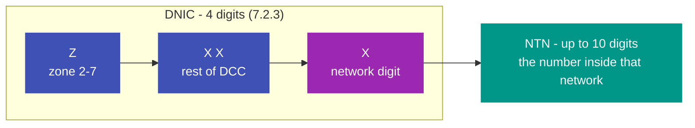
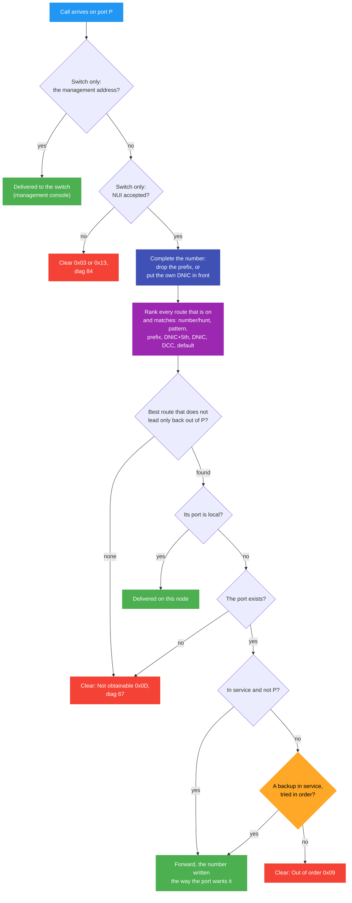
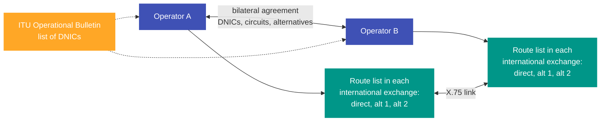

# X.121 addresses and X.25 call routing

How an X.25 address is built, how a local number differs from an international one, and how a switch
should decide where a call goes. Every rule below cites its clause in the ITU-T text:

- [ITU-T X.121](https://www.itu.int/rec/T-REC-X.121/en) (10/2000) - the international numbering plan
- [ITU-T X.25](https://www.itu.int/rec/T-REC-X.25/en) (10/96) - the DTE/DCE interface, address field and clearing causes
- [ITU-T X.75](https://www.itu.int/rec/T-REC-X.75/en) (10/96) - the signalling between public networks (the gateway link)
- [CCITT X.110](https://www.itu.int/rec/T-REC-X.110/en) (11/88) - international routing principles and routing plan

## 1. What an address is made of

An **international data number** is `DNIC + NTN`, or `DCC + NN` where a country has one numbering
scheme for all its networks (X.121 7.6.1).



| Part | Digits | Meaning | Clause |
|---|---|---|---|
| DCC (Data Country Code) | 3 | The country; the first digit is the zone | 7.2.3, 7.2.7 |
| Network digit | 1 | Which network in that country (up to 10 per DCC) | 7.2.4 |
| DNIC (Data Network Identification Code) | 4 | DCC + network digit | 7.2.3 |
| NTN (Network Terminal Number) | up to 10 | The full number used **inside** the network, no prefix | 7.6.2, 7.7 |
| NN (National Number) | up to 11 | Same idea, used after a bare DCC | 7.6.2, 7.7 |
| International number | 5 to 14 | DNIC + NTN, or DCC + NN | 7.7 |

**The first digit** (Table 1/X.121, 7.2.2):

| First digit | Meaning |
|---|---|
| 1 | Global: mobile satellite (`111S`, 7.4) and global public data networks (7.5) |
| 2 - 7 | A country or region; the digit is the geographic zone (7.2.7) |
| 8, 9, 0 | **Escape codes**, not part of any DNIC: the rest is from another numbering plan (7.9, Table 2) |

**Examples, one of each kind.** The country codes are from X.121 Annex J (240 Sweden, 242 and 243 Norway).
The network digits and subscriber numbers are made up for the example, except where a source is named.

| Dialled | Split | What it is |
|---|---|---|
| `110006` | NTN `110006` | A local number inside our own network (a SINTRAN machine). No DNIC: the switch adds its own |
| `2422 110006` | DNIC `2422` + NTN `110006` | The same machine called from another network, if our DNIC were `2422` (DCC `242` Norway, network `2`) |
| `2402 0001730` | DNIC `2402` + NTN `0001730` | An international data number in Sweden (DCC `240`, network `2`); the Tor address book has it as `024020001730`, with the prefix |
| `0 2402 001487` | prefix `0` + DNIC `2402` + NTN | The same kind of number with a one-digit international prefix in front, as dialled on the Tor machine (7.8) |
| `243 12345678` | DCC `243` + NN `12345678` | A country with one numbering scheme for all its networks: no network digit, the national number follows (7.6.1) |
| `7501 1 2345` | DNIC `7501` + 5th digit `1` + rest | A DNIC shared by several networks, split on the 5th digit (Annex A.2) |
| `111S ...` | DNIC `111S` + mobile earth station number | Mobile satellite: `S` is the ocean area (7.4, Annex I) |
| `9 4722123456` | escape `9` + E.164 number | A phone number, reached through an analogue interface (Table 2) |
| `0 4722123456` | escape `0` + E.164 number | A phone or ISDN number, digital interface requested (Table 2) |
| `8 ...` | escape `8` + F.69 number | A telex number (Table 2; still "for further study") |

**`0` has two meanings.** It can be a national prefix (row 4) or the E.164 escape code (row 9). Which one a
network uses it for is its own choice (7.8.2), so the switch must be told; the digits alone do not say.

**The X.25 address field** holds at most **15 digits including any prefix and escape code** in the normal
(non-TOA/NPI) format (X.25 5.2.1). That is why a prefix for international format can be only one digit:
14 + 1 = 15 (X.121 7.8, note).

## 2. Local and international dialling

A DTE may dial a short **local** number (the NTN alone) or a full **international** number. A national
**prefix** tells the two apart. The prefix is not part of the address and is **never signalled across a
network boundary** (X.121 7.8.1); what it is, is a national matter.

| Dialled | Reads as | Notes |
|---|---|---|
| `110006` | NTN `110006` in our own network | A local SINTRAN number; the switch adds its own DNIC |
| `02402001487` | prefix `0` + DNIC `2402` + NTN `001487` | From the Tor address book; DCC `240` is Sweden in Annex J, network digit `2` |

Annex J lists only the DCCs; which network carries the digit `2` is in the ITU's published DNIC list, not
in X.121 itself.

## 3. Our own DNIC

Which DNIC is "ours" is **configured**, not derived. A switch can own several (a country may get more
DCCs, 7.2.6), and networks may **share one DNIC and split it on the 5th digit**: X.121 Annex A.2 gives
the example of DNIC `7501` shared, with `75011` for one network and `75012`, `75013` for another.

## 4. How a call is routed

This is what the code does (`X121RoutingTable.Resolve` in `RetroIO.Protocols.X25.Routing`). The switch
asks it through `SwitchCallRouter`, and the desktop runtime through `X25Router`, so both decide from the
same table and the same lookup. Where the code does something no ITU text asks for, the text says
**not in the spec**.



### 4.1 The lookup order

1. **Number completion** (`ToInternational`), only when an international prefix is set (X.121 7.8.1: the
   prefix is not part of the number). A number that starts with the prefix has it taken off; any other
   number is a national one and gets the first 4 digits of the first own DNIC in front (7.6.1, 7.6.2).
   With no prefix set, nothing can tell the two apart and the number is used as it came in. **Escape codes
   (8, 9, 0, X.121 7.9 and Table 2) are not recognised**: a number after an escape code is completed like
   any other (open, see section 7).
2. **Exact number or hunt group.** It matches the international number, or the own DNIC followed by its
   digits, so a route written as the local number `110006` also takes `2422110006`.
3. **Pattern route** (`regex`), over the whole international number. Below every exact number and above
   every prefix: **not in the spec**.
4. **Address prefix**, the longest first. A prefix of any length beats every DNIC route: **not in the
   spec** (X.121 7.12 says the DNIC or DCC chooses the network, and does not mention prefixes).
5. **DNIC with its 5th digit** (5 digits, the shared-DNIC case of X.121 Annex A.2; 7.12.2).
6. **DNIC** (4 digits, 7.12.2).
7. **DCC**, the country (3 digits, 7.12.1).
8. **Default route**, the default gateway.

**The longer match always wins** inside a class, and a higher class always beats a lower one. Between two
routes of the same class and length, the higher `Priority` wins, then the route written first. `Priority`
is kept from the old route list; it is **not in the spec**. The routing screen lists the routes in exactly
this order (`RoutesInLookupOrder`).

A route is passed over when it is switched off (`enabled = no`), when it is for the other direction
(`direction = incoming` or `outgoing`), or when it has a call user data pattern the call does not match.

### 4.2 The default gateway

A route of kind `default`: it matches every number and ranks last, so it is used only when nothing more
exact matches. It is the way out to other networks, usually the X.75 link to another network. Like any route it can
have backups. The old runtime key `DefaultGateway` (a machine id) becomes the route "Default gateway" when
a known host with that id is reached directly; until 2026-11-18 no call ever used it.

### 4.3 Backup ports and the order they are tried

Every route can name backup ports (`backup_ports` in the switch, `BackupPorts` in JSON). X.110 3.5 and
Appendix I.1 describe a direct route, then alternative route 1, then alternative route 2. The lookup:

1. takes the route's own port when it is in service and is not the arrival port;
2. otherwise tries the backups **in the order they are written**, skipping the arrival port; `local` as a
   backup means this node; the first one in service is used;
3. clears with Out of order 0x09 when none is in service.

When the route's own port does not exist at all, the call is cleared Not obtainable 67 and the backups are
**not** tried: a missing port is a mistake in the configuration, not a line that is down (**our choice, not
in the spec**). The test box on the routing screen prints the order tried ("tried x75-gw (out of order),
then backup 1").

"In service" means: in the switch, the port is started and its peer is linked (`SwitchCallRouter.IsInService`);
in the runtime, the line's transport is active, and a dynamic XOT address counts while any XOT client line
is active (`X25Router.PortStatusOf`).

### 4.4 Other rules

- **Never back out of the arrival port.** A route whose own port and every backup is the port the call
  came in on is skipped, and the next best route is tried. The no-route text then says "the only matching
  routes lead back out of the port the call came in on". X.110 3.6 and 5.6 ask for no circular routes;
  this one-hop check is ours, the real loop check is open (section 7).
- **Hunt groups** (`hunt`): one number shared by several ports. Members are taken in turn (round robin);
  the arrival port and a member that is down are skipped. No members: Not obtainable 67. All down: Out of
  order. Round robin is **not in the spec**.
- **The called number sent on** is written the way the out port asks (`called_address`): `as_received`,
  `international` (no prefix, X.121 7.8.1 and 7.12.6-7.12.7) or `national` (own DNIC taken off). A switch
  trunk defaults to `international`, an access port to `as_received`.

### 4.5 Checks before the lookup

In the switch (`SwitchCore.OnIncomingCall`), in this order:

1. **The management address** (`[switch] mgmt_addr`), compared with the number as it came in: the call is
   for the switch itself and goes to the management console. Not routed, no NUI check.
2. **NUI** (X.25 6.21): an NUI that no account has clears with Invalid facility request 0x03, diagnostic 84
   (Table C.1 row 15); no NUI on a port that needs one clears with Local procedure error 0x13, diagnostic 84
   (row 16).
3. The lookup above.

In the runtime (`X25Router.DecideIncomingCall`), in this order:

1. **The accepted-address list** of an XOT server entry: a called number the entry does not take clears
   with Access barred 0x0B, diagnostic 70 (Table C.1 row 25).
2. **An incoming route must match** (direction `incoming` or `both`): otherwise Not obtainable 0x0D, diagnostic 67.
3. **Wait mode** (`AnswerIncomingCallsAutomatically = false`): the call is offered to the program and waits
   for its Accept or Reject. One that is not answered is cleared by the line's X.25 engine when T11 runs out,
   180 s (X.25 4.1.4, Table D.1), with diagnostic 49; the cause is Local procedure error 0x13 at a DCE and
   DTE originated 0x00 at a DTE.
4. **Automatic answering** (the default): the local service that takes the number answers it; if none
   does, Not obtainable 67.

The runtime has no NUI check. It does not forward an incoming call to another of its lines: a route whose
port is another line is treated like a local route (open, section 7).

### 4.6 The configuration

**Switch `.ini`** (`SwitchConfigLoader`). The own network is `[network] own_dnic` (comma list, the first one
completes local numbers) and `international_prefix`; without a `[network]` section, `[switch] dnic`. A route
`[route.N]` names exactly one of `number`, `prefix`, `dnic`, `dcc`, `default = yes`, `regex`, or `hunt` with
`hunt_group`; then `port` (a `[port.N]` name or number), `backup_ports`, `name`, `note`, `enabled`,
`direction`. `[hunt.N] members` lists port numbers. `[port.N] called_address` is the form of section 4.4. An
error stops the load with "[route.N] line L: ...". `local` is refused in the switch.

**Runtime JSON**, section `Routing` (names are read without regard to case): `OwnDnics` (list),
`InternationalPrefix`, and `Routes`, each with `Name`, `Kind` (`exact`, `prefix`, `dnic`, `dcc`, `default`,
`hunt`, `regex`), `Match`, `Port` (a line name, or `local`), `BackupPorts`, `HuntPorts`, `Enabled`, `Note`,
`Direction`, `CallUserDataPattern`, `Priority`.

One example in both forms: own network 2422 with prefix 0, a local TAD, Sweden's network 2402, Denmark
(DCC 238), and a default gateway with a backup.

```ini
[network]
own_dnic = 2422
international_prefix = 0

[route.0]
name = TAD
number = 110006
port = terminals

[route.1]
name = Datapak
dnic = 2402
port = x75-gw
backup_ports = nordic

[route.2]
name = Denmark
dcc = 238
port = nordic

[route.3]
name = Gateway
default = yes
port = x75-gw
backup_ports = nordic
```

```json
"Routing": {
  "OwnDnics": [ "2422" ],
  "InternationalPrefix": "0",
  "Routes": [
    { "Name": "TAD",     "Kind": "exact",   "Match": "110006", "Port": "local" },
    { "Name": "Datapak", "Kind": "dnic",    "Match": "2402",   "Port": "x75-gw", "BackupPorts": [ "nordic" ] },
    { "Name": "Denmark", "Kind": "dcc",     "Match": "238",    "Port": "nordic" },
    { "Name": "Gateway", "Kind": "default", "Match": "",       "Port": "x75-gw", "BackupPorts": [ "nordic" ] }
  ]
}
```

**Old configurations still load.** In the switch, `type` with `address`, `prefix_len`, `dnic`, `dcc`, `regex`
and `backup_port` reads as before; a missing `port` there means port 0. In the runtime, each old
`RoutingTable` entry is converted after the new routes (`RoutingConfigConverter`, `X121LegacyPattern`):

| Old `X121AddressPattern` | Becomes |
|---|---|
| `.*`, `^.*`, `^.*$`, `*`, empty | default route |
| digits, or `^digits$` | exact number |
| `digits.*`, `^digits.*`, `^digits` | prefix |
| anything else | pattern route |

`Type = Local` becomes port `local`; `Gateway` goes to the line of the known host it names; `Priority` is
kept, and a disabled entry stays, disabled. One change in behaviour: an old pattern `200` with no anchors
used to match `1200` too; it now matches only `200`. Saving on the routing screen writes the new keys and
empties `RoutingTable` and `DefaultGateway`.

## 5. How routes between networks were set up (1980s)

No ITU text defines a protocol that passes routes between networks. Routes were a **plan made by people**:

- **The operators plan them, by agreement between each pair of countries** (X.110 3.1). In return for
  questions, each one tells the other which DNICs its international exchanges reach, circuits and speeds,
  busy hours, alternative routes and facilities (X.110 9, Annex C).
- **Each destination has a fixed list**: a direct "high usage" route, then alternative route 1, then
  alternative route 2 (X.110 3.5, Appendix I.1). An agreed route may be offered on to third countries.
- **Each international exchange picks the next link** from the called DNIC or DCC (X.110 3.10, 5.1; X.121
  7.12). Reading digits after the DNIC is agreed between the two sides. The route is kept for the whole call
  (X.110 3.11).
- **At most 4 international links** in a row, and at most 2 by satellite (X.110 3.2, 3.4).
- **No loops** (X.110 3.6, 5.6): every transit network writes its DNIC into the call, in the X.75 *transit
  network identification* field (X.75 5.3.1). X.75 clears a call whose route would loop or grow too long
  (Table E.1 items 40, 41).
- **Several X.75 links to the same network**: which one a call takes is "network dependent" (X.75 3.0).
- **The ITU's only part** is the DNIC list. A new, changed or removed DNIC is reported to the ITU and
  published in the *Operational Bulletin*, with a full list once a year (X.121 Annex L).



**Not in any text:** how a new DNIC got from the Bulletin into a switch. Typed in by an operator fits all of
the above, but that is an inference. Inside one network, routing was the maker's own design. Sources found
so far say Telenet used fixed tables, Tymnet a central supervisor, and Datapac updated its routes from its
neighbours (Sproule and Mellor, IEEE Trans. Communications, 1981).

**For our switch** this means: own DNIC(s) set in the configuration; per destination a route with ordered
backups; a default gateway last; at most 4 transit networks; never a network the call has already passed.

## 6. Clearing causes the router sends

Cause field, Table 5-7/X.25; diagnostic, Annex E; which one for which case, Table C.1/X.25 (10/96). The
causes are on `X25CallDecision`.

| Cause | Code | Diagnostic | When | Sent by |
|---|---|---|---|---|
| Not obtainable | `0x0D` | 67 | No route; a route to a port that does not exist; a hunt group with no members; no local service takes the number (Table C.1 row 24) | switch and runtime |
| Access barred | `0x0B` | 70 | The XOT server entry does not take that called number (row 25) | runtime |
| Out of order | `0x09` | 0 | The route's port and every backup are down; every hunt member is down; the out port went down while the call was placed (4.6.4) | switch; the runtime gives the same answer for a call it places |
| Number busy | `0x01` | 71 | The out port is up but has no free logical channel (row 31) | switch |
| Invalid facility request | `0x03` | 84 | An NUI that no account has (6.21, row 15) | switch |
| Local procedure error | `0x13` | 84 | No NUI on a port that needs one (row 16) | switch |
| Local procedure error / DTE originated | `0x13` / `0x00` | 49 | Wait mode: nobody answered within T11, 180 s (4.1.4, Table D.1); `0x13` at a DCE, `0x00` at a DTE | the line's X.25 engine |
| DTE originated | `0x00` | - | A local service refuses the call (4.1.7) | runtime |

**The DTE side sends cause 0.** On a link manager link the runtime is the DTE, and the X.25 engine turns
every cause without bit 8 into DTE originated `0x00` (Table 5-7, note a). So there a call with no route is
cleared with `0x00` and diagnostic 67, while every other line and the switch send `0x0D` with 67. That is
what the spec allows a DTE; whether the runtime should be the DCE on such a link is open (section 7).

Diagnostics 119 (international routing problem) and 121 (unknown called DNIC) are never sent: a number
with no route always gets 67.

## 7. Status in RetroIO

Done (2026-11-18, not yet committed): one route table and one lookup for the switch and the runtime, with
own-DNIC completion, the order of section 4.1, the default gateway, ordered backup ports, the arrival-port
rule, switched-off routes, hunt groups that skip a member that is down, and the causes of section 6. Old
configurations load as section 4.6 says. The RetroX25 desktop program has one Routing screen that lists the
routes in this order and has a box to test a number.

Still open, each one in `src/BUGS.md` by name:

- **No hop limit and no loop check** (`RetroIO.Protocols.X25.Routing`): X.110 3.2, 3.6 and 5.6, and X.75
  5.3.1 (the transit network field) and Table E.1 items 40 and 41. `[switch] max_hops` (default 15) is read,
  shown and written back, but nothing uses it.
- **Escape codes** (`RetroIO.Protocols.X25.Routing`): X.121 7.9, Table 2 and note 2 of 7.2.
- **No forwarding between lines** (`RetroIO.Protocols.X25.Runtime`): an incoming call is never sent on to
  another runtime line.
- **DTE cause on a link manager link** (`RetroIO.Protocols.X25.Runtime`): section 6.
- **Why `PlaceCall` failed** (`RetroIO.Protocols.X25.Switch`): a failed XOT dial can be reported as Number busy.
- **Routing screen and the built-in switch** (`RetroX25.Desktop`): the screen does not edit the switch's
  own `.ini` routes.
- **Routing screen Save drops comments** (`RetroX25.Desktop`).
