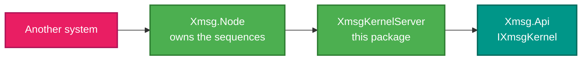

# RetroIO.Protocols.Xmsg.Api.Node

## What it is

One class: `XmsgKernelServer`. It exposes the XMSG kernel as a **server** on a node, so other systems can
reach the kernel's services rather than only local code calling it.

## Why you need it

[`RetroIO.Protocols.Xmsg.Api`](../RetroIO.Protocols.Xmsg.Api/README.md) is the kernel as a **library** — you
call it in-process. A real ND network also expects the kernel to be reachable *over* the network: another
system asks this one about a port, a message or a privilege.

This package is the small adapter that makes that work, and it is separate for a deliberate reason. The
kernel API must not depend on the node, or the node on the kernel — the two are composed, not entangled.
Keeping the server in its own package means the kernel can be used with no node at all, which is exactly
what its unit tests do.

## What you can use it for

- Making the kernel's services answerable from another system.
- Composing a node that offers the kernel alongside other servers (TAD, FA, chat).
- Testing the kernel's server behaviour without the full node host.

## Prerequisites

| Requirement | Notes |
|---|---|
| .NET SDK as pinned in `global.json` | |
| `RetroIO.Protocols.Xmsg.Api` | The kernel itself |
| `RetroIO.Protocols.Xmsg.Node` | The node it registers with, as an `IXmsgServer` |

## Where it sits

## Tests

`src/RetroIO.Protocols.Xmsg.Api.Node/tests`.
