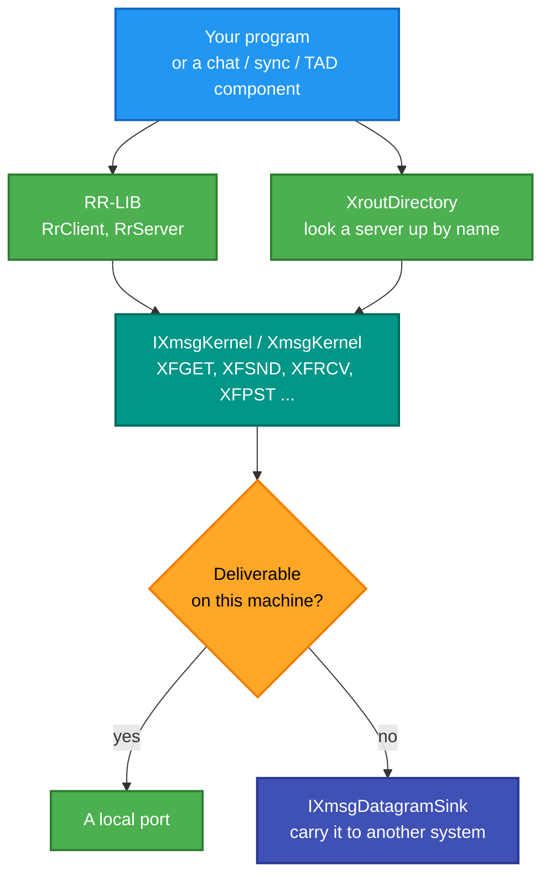
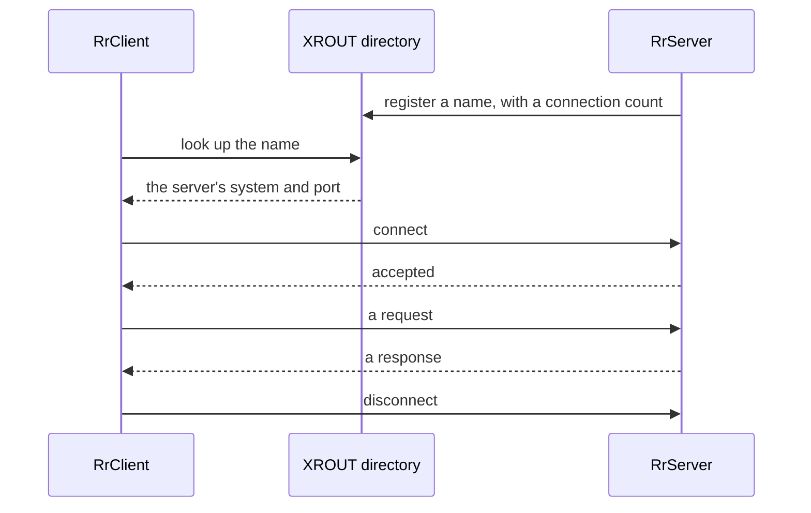

# RetroIO.Protocols.Xmsg.Api

## What it is

The **XMSG kernel API** — the functions a SINTRAN III task actually called — plus **RR-LIB**, the
request/response library built on top of it, and the **XROUT** directory and management services.

These are the `MON 200B` calls: `XFGET` to reserve a message buffer, `XFSND` to send, `XFRCV` to receive,
`XFPST` for port status, and the rest, each returning a status in the T register.

## Why you need it

Two quite different reasons.

**To behave like an ND task.** If you are writing something that a real SINTRAN machine will talk to, the
machine expects the other end to act like an XMSG task: open a port, reserve a buffer, send, wait, check a
status. Modelling that faithfully — including the option bits and the negative error codes in the T
register — is what makes the conversation work rather than nearly work.

**To understand captures and documentation.** Every ND manual, every listing, every capture annotation
speaks in these names. Having `XmsgFunction`, `XmsgOption` and `XmsgError` as real types means a trace can
be read in the same vocabulary as the manual.

RR-LIB is here because request/response is what most XMSG programs actually do, and doing it by hand means
re-implementing connection tables and framing every time. `RrClient` connects by name and sends requests;
`RrServer` registers a name and answers them.

## What you can use it for

- Writing a program that a SINTRAN machine accepts as an XMSG peer.
- **Request/response** without the plumbing: `RrClient`, `RrServer`, with `RrStatus` and `RrEvent` codes.
- Looking a server up **by name** through the XROUT directory (`XroutDirectory`, `XroutNameEntry`), with
  free-connection counts.
- XROUT management: tracing, crash handling, attributes, network-server information — `XroutRequests`
  covers appendix B sections 3.18 to 3.24.
- Walking your own ports and messages (`XmsgListing`, via `XFLMP`).
- Checking a sender's privileges before acting on a message (`XmsgPrivilegeCheck`, `XFCPV`).
- Carrying a message **off this machine**: `IXmsgDatagramSink` is what the kernel hands an undeliverable
  local message to.

## Prerequisites

| Requirement | Needed for | Notes |
|---|---|---|
| .NET SDK as pinned in `global.json` | Everything | |
| `RetroIO.Protocols.Xmsg` | The wire format and the code tables | |
| An `IXmsgDatagramSink` | Reaching another system | Without one, the kernel is local-only |
| The documentation | Getting the semantics right | The `DOC` junction; appendix B is cited by section |

## The kernel, and what sits on it

## A request/response exchange

## Contents

| Area | Types |
|---|---|
| The kernel | `IXmsgKernel`, `XmsgKernel`, `XmsgException` |
| Status and results | `XmsgStatus` (the T register), `XmsgMessageStatus`, `XmsgPortStatus`, `XmsgReceiveResult`, `XmsgQueueSnapshot` |
| Identifiers | `XmsgPortNumber` (PORTNO), `XmsgMessageIdentifier` (MESAD), `XmsgMagicNumber`, `XmsgHashedMagicNumber` (RPORT) |
| Options | `XmsgBufferOptions` (XFGET), `XmsgWaitOptions` (XFPST/XFGST/XFRCV/XFRRH/XFRRE), `XmsgSendFlags` |
| Buffers | `XmsgMessageBuffer` |
| Privilege | `XmsgPrivilegeCheck` (XFCPV), `XmsgPrivilegeInformation` |
| Listing | `XmsgListing` (XFLMP), `XmsgLinkInformation` |
| RR-LIB | `IRrClient`, `IRrServer`, `RrClient`, `RrServer`, `RrEndpointBase`, `RrStatus`, `RrError`, `RrEvent`, `RrMessageKind` |
| XROUT | `XroutDirectory`, `XroutNameEntry`, `XroutRequests`, `XroutReply`, `XftraRequests`, `XftraOperation` |
| Naming | `XmsgServerName`, `XmsgKnownServers`, `SintranPassword` |
| Off-machine | `IXmsgDatagramSink` |

## A note on the status convention

Every XMSG function returns its status in the **T register**, and errors are **negative**. `XmsgStatus`
models that, and `XmsgException` is thrown only when the caller asked for exceptions — because a task that
checks the status itself is the normal pattern on this system, not an anti-pattern.

## Tests

`src/RetroIO.Protocols.Xmsg.Api/tests`, plus `src/RetroIO.Protocols.Xmsg.Api.Node/tests` for the server
wrapper.
