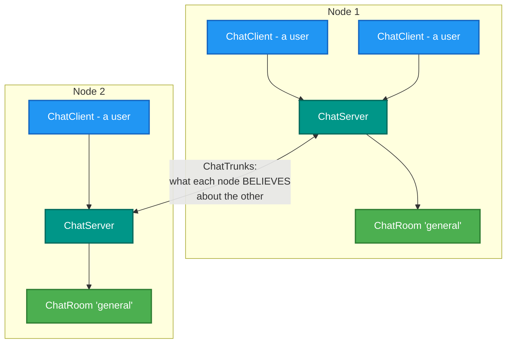
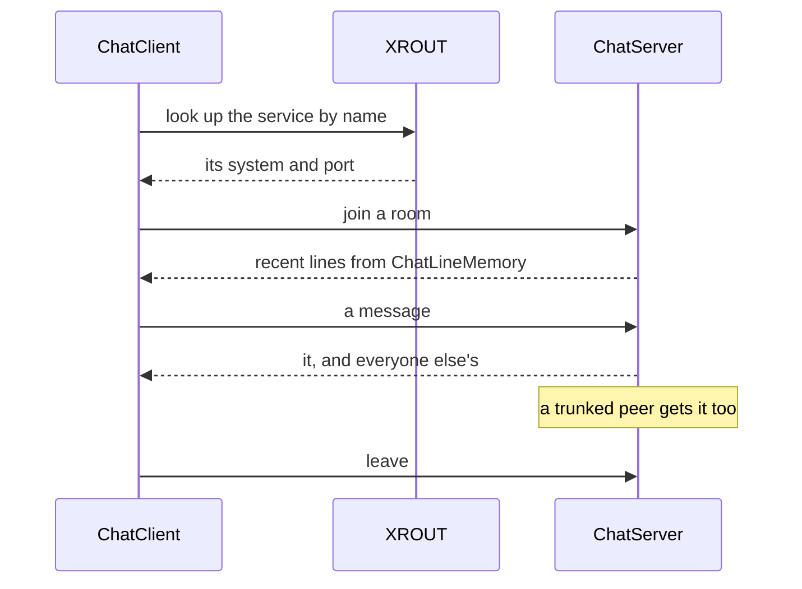

# RetroIO.Protocols.Xmsg.Chat

## What it is

A chat service over XMSG: rooms, users, and **trunks** between nodes so rooms span more than one system.

## Why you need it

Partly because it is genuinely useful on a multi-machine network, and partly because it is the clearest
**end-to-end exercise** of the XMSG stack that is not a file transfer.

A chat service needs exactly the things that are easy to get subtly wrong: look a named service up and join it,
hold several conversations at once, deliver messages in order, notice when a peer has gone, and keep working
when a node in the middle restarts. If chat works between three machines, the name service, the sessions, the
sequences and the relay all work.

`ChatTrunkState` is "what a node **believes** about a peer it is trunked to" — which is the honest framing. A
node cannot know a peer is up; it can only know what it last heard, and `ChatTrunkTick` is what keeps that
belief current.

## What you can use it for

- A chat service across one or several ND machines.
- Joining a service **by name** through XROUT, which is the normal way a program is found.
- Exercising the XMSG stack end to end without moving files.
- Holding recent lines for a client that joins late (`ChatLineMemory`).
- Using ND calendar time correctly in timestamps (`NdCalendarTime`).

## Prerequisites

| Requirement | Needed for | Notes |
|---|---|---|
| .NET SDK as pinned in `global.json` | Everything | |
| `RetroIO.Protocols.Xmsg.Api` | The kernel and the name lookup | |
| A node | Anything live | |
| A registered service name | Clients finding the server | Through XROUT |
| Two or more nodes | Trunking | One node works on its own |

## Rooms, and trunks between nodes

## Joining

## Contents

| Type | Role |
|---|---|
| `ChatServer` | The service |
| `ChatClient` | One user: joins by name, then talks to the service directly |
| `ChatRoom`, `ChatRooms` | A room, and the set of them |
| `ChatMessage`, `ChatMessageKind`, `ChatMessageKinds` | The message types exchanged |
| `ChatLineMemory` | Recent lines, for a client that joins late |
| `ChatTrunks`, `ChatTrunkState`, `ChatTrunkTick` | Links between nodes, and what each believes about the other |
| `NdCalendarTime` | ND calendar time |

## Tests

`src/RetroIO.Protocols.Xmsg.Chat/tests`.
