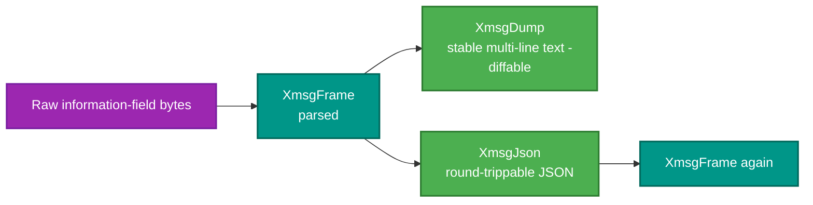

# RetroIO.Protocols.Xmsg.Diagnostics

## What it is

Two ways to look at an XMSG frame: a **stable human-readable text dump**, and **round-trippable JSON**.

## Why you need it

Because an XMSG frame is a SINTRAN header, an XMSG sub-header and a TLV letter body, and reading that as hex
is not a reasonable way to spend an afternoon. `XmsgDump` renders it as labelled lines.

The word **stable** in that description is the important one. The dump format is fixed so it can be compared
— a captured frame dumped today and the same frame dumped after a change in the codec produce diffable text,
which turns "did my change alter the parse?" into a one-line answer.

The JSON is **round-trippable**, which buys something different: a frame can be written out, edited by hand,
read back and sent. That is how a malformed or unusual frame is constructed for a test without writing bytes
by hand.

## What you can use it for

- Reading a captured frame.
- **Diffing** two parses of the same bytes, to see whether a codec change moved anything.
- Serialising frames to JSON for a fixture, editing them, and loading them back.
- Converting byte blobs to and from compact uppercase hex (`HexBytes`).
- Putting a decoded frame in a log or a bug report in a form somebody else can read.

## Prerequisites

| Requirement | Notes |
|---|---|
| .NET SDK as pinned in `global.json` | |
| `RetroIO.Protocols.Xmsg` | The frame types it renders |

## Two views of one frame

## Contents

| Type | Role |
|---|---|
| `XmsgDump` | A frame as stable, human-readable multi-line text |
| `XmsgJson` | Round-trippable JSON serialisation |
| `HexBytes` | Byte blobs to and from compact uppercase hex |
| `XmsgFrameDto`, `XmsgHeaderDto`, `XmsgSubHeaderDto`, `XmsgBodyDto` | The JSON views of a frame and its parts |
| `XroutParameterDto` | One TLV parameter |
| `TadChainDto`, `TadMessageDto` | A decoded TAD chain and one message |
| `RoutingCommandDto` | A decoded ROUTING command |
