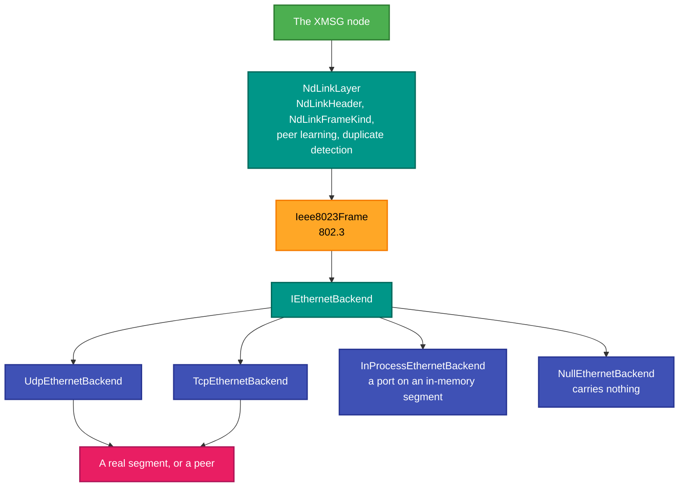
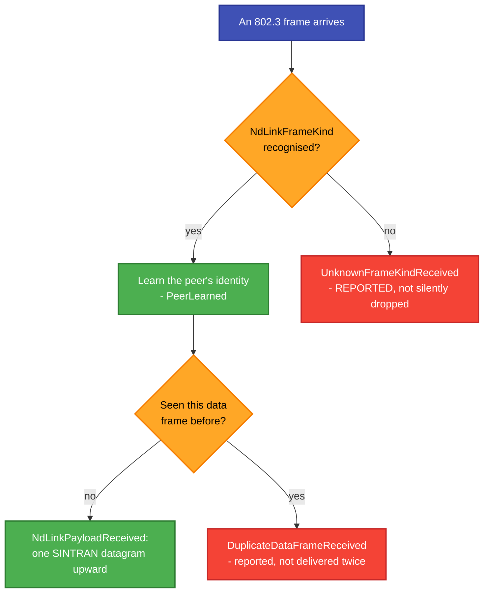

# RetroIO.Protocols.Xmsg.Ethernet

## What it is

The **ND link layer over Ethernet**: IEEE 802.3 frames carrying SINTRAN datagrams, with the ND link header,
its frame kinds, MAC addressing and peer learning — plus several backends, including one that needs no network
at all.

## Why you need it

Norsk Data machines did not only talk over serial lines. On Ethernet, SINTRAN datagrams are carried in 802.3
frames with ND's own link header in front of them, and that header is not IP, not ARP and not anything a modern
stack will parse for you.

Two behaviours in here are the reason the package is more than a frame struct:

- **Peer learning.** `PeerLearned` fires when the peer's identity is worked out from an inbound frame. You do
  not have to be told who is at the other end; the first frame says.
- **Duplicate detection.** `DuplicateDataFrameReceived` exists because on a real segment you will see the same
  data frame twice, and treating a retransmission as new data corrupts the conversation.

And `UnknownFrameKindReceived` is a deliberate choice about unknown traffic: report it rather than discard it
silently. A segment with a frame kind we do not handle is information, not noise — it is how the next thing to
implement gets found.

## What you can use it for

- Talking XMSG to an ND machine **over Ethernet** rather than a serial line.
- Carrying ND frames over **UDP or TCP** when there is no shared segment — `UdpEthernetBackend` and
  `TcpEthernetBackend`.
- **Testing with no network whatsoever**: `InProcessEthernetSegment` is a segment in memory and
  `InProcessEthernetBackend` is one port on it, so several nodes can talk inside one process.
- Discarding deliberately: `NullEthernetBackend` sends nothing and receives nothing, which is a useful
  null object rather than a stub.
- Learning what is on a segment: unknown frame kinds are reported.

## Prerequisites

| Requirement | Needed for | Notes |
|---|---|---|
| .NET SDK as pinned in `global.json` | Everything | |
| `RetroIO.Protocols.Xmsg` | The datagrams inside the frames | |
| `RetroIO.Protocols.Xmsg.Node` | Running a node over it | |
| A shared segment, or a reachable peer | Anything real | UDP/TCP backends when there is no segment |
| Nothing | The in-process backend | Which is why the tests need no hardware |

## The layering

## What happens to an inbound frame

## Contents

| Type | Role |
|---|---|
| `NdLinkLayer` | The ND link layer: header, kinds, peer learning, duplicates |
| `NdLinkHeader`, `NdLinkFrameKind`, `NdNpduType` | The header and what a frame is |
| `NdMacAddress`, `NdPhysicalUserFamily` | ND addressing |
| `NdSendOutcome` | What a send did |
| `Ieee8023Frame` | The 802.3 frame |
| `IEthernetBackend`, `EthernetBackendFactory` | The backend seam and its factory |
| `UdpEthernetBackend`, `TcpEthernetBackend` | Carrying frames when there is no shared segment |
| `InProcessEthernetSegment`, `InProcessEthernetBackend` | A segment and a port, in memory |
| `NullEthernetBackend` | Carries nothing, deliberately |
| `EthernetPacketReceived`, `NdLinkPayloadReceived`, `PeerLearned`, `DisconnectRequested`, `UnknownFrameKindReceived`, `DuplicateDataFrameReceived`, `FrameTransmitted` | The events |

## Tests

`src/RetroIO.Protocols.Xmsg.Ethernet/tests` — which run over `InProcessEthernetSegment`, so they need no
network interface and no privileges.
