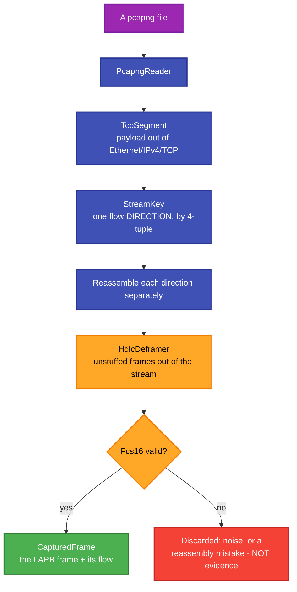

# RetroIO.Protocols.Xmsg.Hdlc

## What it is

A pipeline that turns a **pcapng capture** of the `nd100x --hdlc` TCP bridge into FCS-valid LAPB frames and
the SINTRAN information fields inside them.

## Why you need it

This is how the ND protocols were worked out, and it is still how a disagreement with a real machine gets
settled.

A capture of the bridge is TCP, and TCP is not frames: segments arrive out of order, a frame can be split
across two of them, and two frames can share one. Getting from "a pcapng file" to "these are the LAPB frames,
and these passed their frame check" means reassembling each TCP flow direction separately and then
de-framing the byte stream — which is exactly what the pipeline does.

The **FCS check** is what makes the output trustworthy. A frame that fails it is noise or a reassembly
mistake, and treating it as protocol evidence is how people end up documenting a field that does not exist.
`CapturedFrame` keeps the frame **together with the TCP flow it came from**, so a claim about direction can be
checked rather than assumed.

## What you can use it for

- Reading a capture of a real ND session into frames you can analyse.
- Building a test fixture from real traffic rather than from an assumption.
- Checking which side sent what — the flow is attached to every frame.
- Verifying that our own framing produces what the machine produces.
- Reusing the LAPB frame decode: `LapbFrame` and `LapbControl` come from
  [`RetroIO.Lapb`](../RetroIO.Lapb/README.md), so the capture path and the live path decode identically.

## Prerequisites

| Requirement | Needed for | Notes |
|---|---|---|
| .NET SDK as pinned in `global.json` | Everything | |
| `RetroIO.Lapb` | The frame types | Shared with the live stack, on purpose |
| A pcapng capture | Anything | Of the `nd100x --hdlc` TCP bridge |

## The pipeline

## Contents

| Type | Role |
|---|---|
| `HdlcPcap` | The top-level pipeline: capture in, FCS-valid frames and information fields out |
| `PcapngReader` | Reads the capture file |
| `TcpSegment` | One TCP payload out of a captured Ethernet/IPv4/TCP packet |
| `StreamKey` | Identifies one flow **direction** by its 4-tuple |
| `HdlcDeframer` | Splits a reassembled stream into unstuffed frames |
| `Fcs16` | The frame check |
| `CapturedFrame` | A LAPB frame together with the flow it came from |

## A note on method

Decode a **complete, known-good** exchange end to end before drawing conclusions — a search for a pattern you
expect can only confirm what you already imagined, and finding nothing says more about the pattern than about
the capture. The frames are in order in the file; read them in order.
