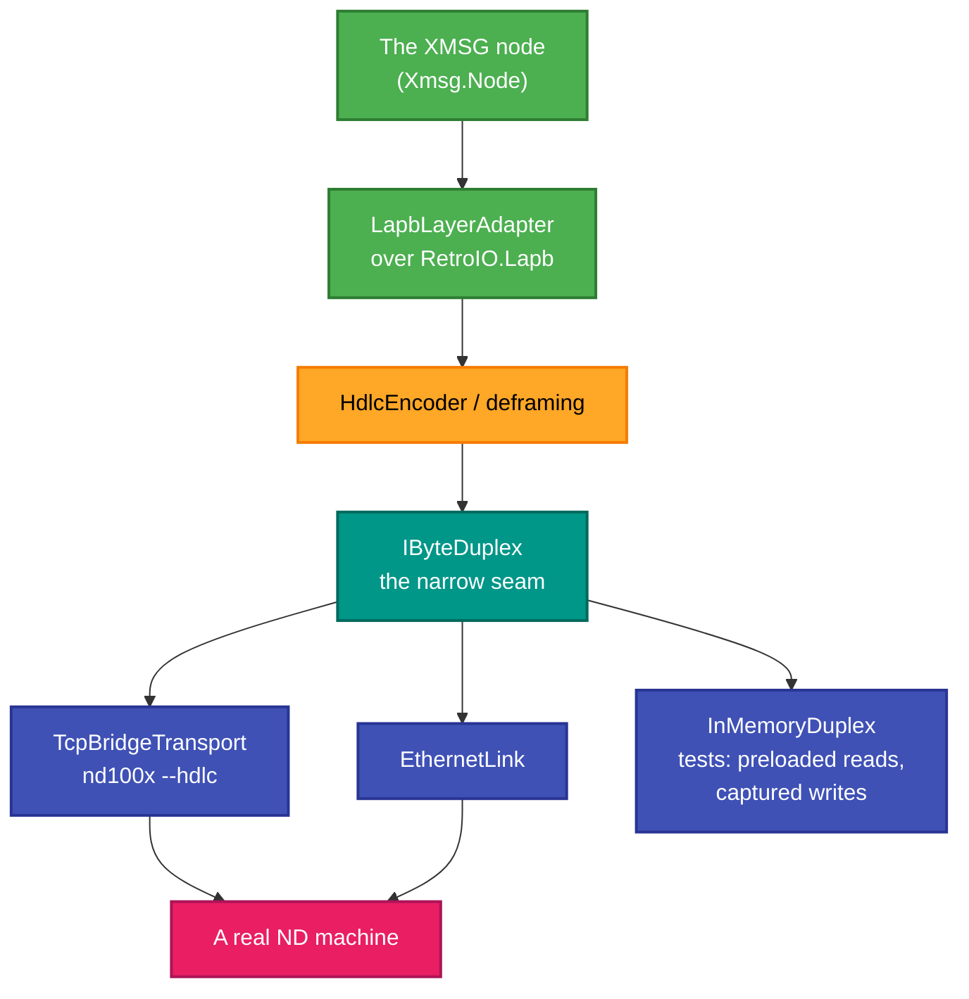
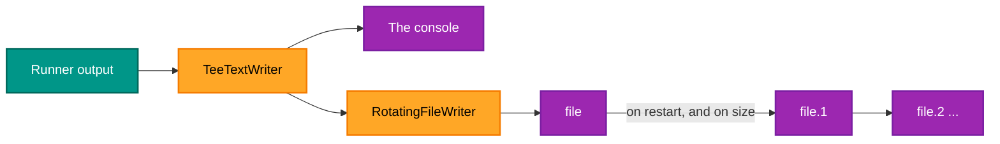

# RetroIO.Protocols.Xmsg.Live

## What it is

A **live XMSG node**: the pieces that connect one to a real byte stream — a TCP bridge to `nd100x --hdlc`, or
an Ethernet link — plus the logging a long-running process needs.

## Why you need it

Everything else in the XMSG family works on frames. Something has to turn a socket into frames and keep doing
it for days.

`IByteDuplex` is the seam, and it is narrow on purpose: a bidirectional raw-byte channel, nothing else. That
is what lets `InMemoryDuplex` stand in for a socket in a test — reads served from a pre-loaded buffer, writes
captured — so a whole session can be driven with no network and no timing.

The log rotation is here because it turned out to matter. `RotatingFileWriter` rotates **once on
construction** as well as on size, so every process restart begins a fresh empty file. Without that, working
out which run a line came from means reading timestamps and guessing. `TeeTextWriter` fans output to the
console *and* the file, so you do not have to choose between watching it and keeping it.

## What you can use it for

- Running a node against a real ND machine over the `nd100x --hdlc` TCP bridge.
- Running one over Ethernet (`EthernetLink`).
- **Driving a full session in a test** with `InMemoryDuplex` — no socket, no waiting.
- Keeping usable logs from a long run: rotation, size limits, and console plus file at once.
- Encoding HDLC for the live path (`HdlcEncoder`), and adapting the LAPB layer to it
  (`LapbLayerAdapter`).

## Prerequisites

| Requirement | Needed for | Notes |
|---|---|---|
| .NET SDK as pinned in `global.json` | Everything | |
| `RetroIO.Protocols.Xmsg`, `.Node` | The frames and the node state | |
| `RetroIO.Lapb` | The link layer | |
| A reachable bridge | `TcpBridgeTransport` | `nd100x --hdlc` |
| A writable log directory | The rotating writer | |
| A real machine or emulator | An end-to-end run | `InMemoryDuplex` otherwise |

## How a live node is assembled

## Logging that survives a restart

Linux-syslog-style numbering: the live file shifts to `.1`, `.1` to `.2`, and the oldest retained version is
deleted.

## Contents

| Type | Role |
|---|---|
| `LiveNode` | A node wired to a live transport |
| `IByteDuplex` | The bidirectional raw-byte seam |
| `TcpBridgeTransport` | Connects to the `nd100x --hdlc` bridge and pumps the stream both ways |
| `EthernetLink` | The Ethernet path |
| `InMemoryDuplex` | A duplex for tests |
| `HdlcEncoder`, `LapbLayerAdapter` | Framing, and the adapter onto the LAPB engine |
| `RawFrameReceivedHandler` | The body of an FCS-valid LAPB frame, taken off the transport |
| `LogRotator`, `RotatingFileWriter`, `TeeTextWriter`, `LogLevel` | Logging for a long-running process |

## Tests

`src/RetroIO.Protocols.Xmsg.Live/tests`. Historically the LAPB tests lived here too — `RetroIO.Lapb`'s README
records that they stay until they follow the engine across.
