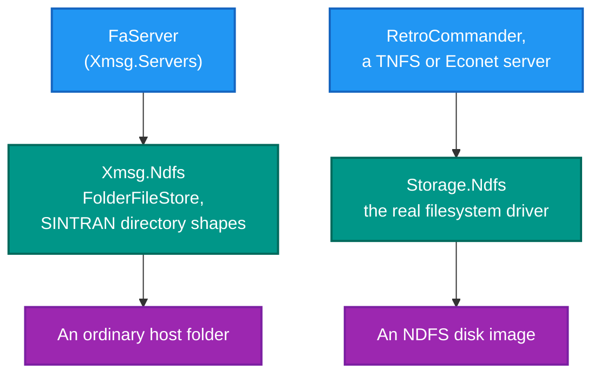

# RetroIO.Protocols.Xmsg.Ndfs

## What it is

The SINTRAN **directory and file store** as the file-access protocol sees it: directory entries, object
entries, filenames, access rights, and a folder-backed store that serves them.

## Why you need it

The file-access server has to answer "what is in this directory?" and "give me this file" in **SINTRAN's own
terms** — a 42-byte directory record with its state bits, a packed object entry, a SINTRAN filename with its
version and type. A client on a real machine expects those shapes, not a .NET `FileInfo`.

This package is deliberately separate from
[`RetroIO.Storage.Ndfs`](../RetroIO.Storage.Ndfs/README.md), and the difference is worth being clear about:

| | Reads | For |
|---|---|---|
| `RetroIO.Storage.Ndfs` | a real **NDFS disk image** | mounting a volume, users, quotas, repair |
| **this package** | an ordinary **host folder** | serving files over the XMSG file-access protocol |

`FolderFileStore` presents a normal directory as if it were SINTRAN storage. That is what lets the file server
serve files that live in a plain folder on a modern machine — no disk image needed.

## What you can use it for

- Backing `FaServer` with a host folder (`FolderFileStore`).
- Building or reading a SINTRAN **directory listing** in the wire shape a client expects.
- Encoding and decoding an **object entry** — `FaObjectEntryHeader` builds and splits its packed words.
- Handling SINTRAN filenames properly (`FaFileName`).
- Reporting the outcome of a store correctly (`FaStoreStatus`).
- Reading the state bits of a directory entry (`FaDirectoryFlags`, bytes 0–1 of the 42-byte record).

## Prerequisites

| Requirement | Needed for | Notes |
|---|---|---|
| .NET SDK as pinned in `global.json` | Everything | |
| `RetroIO.Protocols.Xmsg` | The FA codecs and types | |
| A readable (and writable, to store) folder | `FolderFileStore` | An ordinary host directory |

## Two NDFS packages, two jobs

Same filesystem family, different problem. Do not reach for this one to open a disk image.

## Contents

| Type | Role |
|---|---|
| `FolderFileStore` | A host folder presented as SINTRAN storage |
| `FaFileInfo` | One file as the store reports it |
| `FaDirectoryListing`, `FaDirectoryEntry` | A listing, and one 42-byte record |
| `FaDirectoryFlags` | The state bits, bytes 0–1 of that record |
| `FaFolderEntry` | A folder within a listing |
| `FaObjectEntryHeader`, `FaObjectHeaderFlags` | Builds and splits the packed words of an object entry |
| `FaFileName` | A SINTRAN filename |
| `FaAccessRights` | Access rights as the protocol carries them |
| `FaStoreStatus` | The outcome of a store operation |

## Tests

`src/RetroIO.Protocols.Xmsg.Ndfs/tests`.
