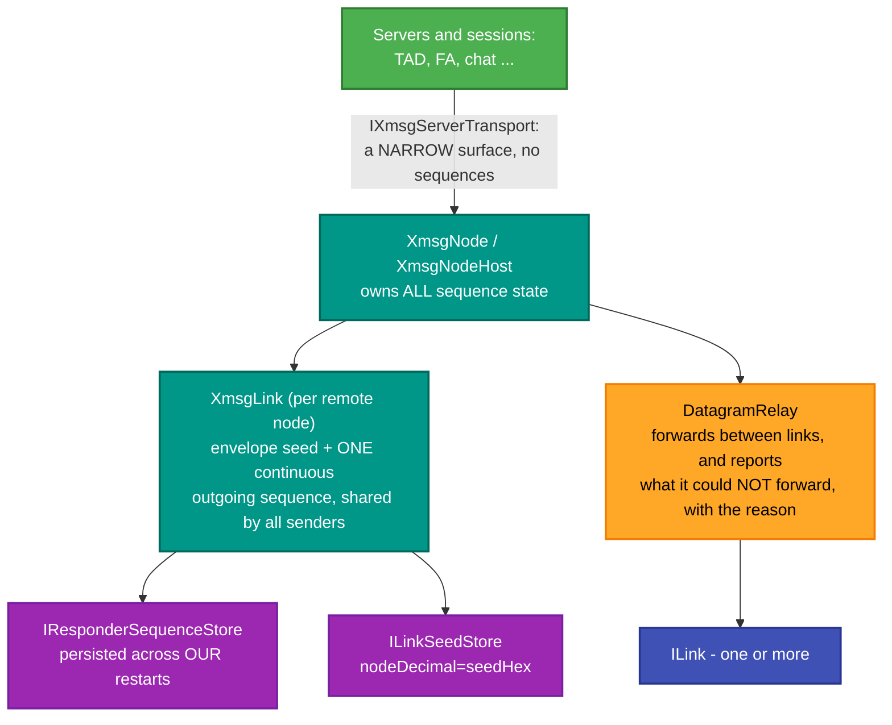
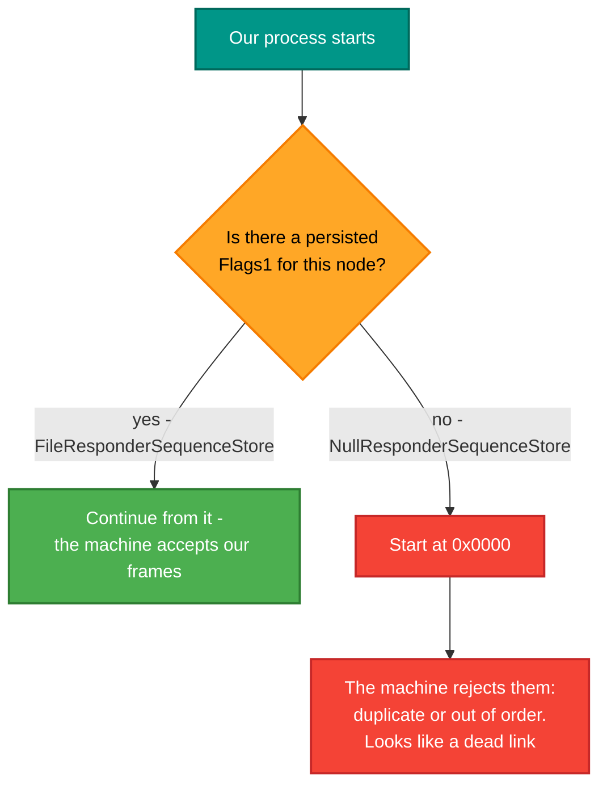

# RetroIO.Protocols.Xmsg.Node

## What it is

**A node on an ND network.** Where the codec is stateless, this is where all the state lives: per-remote-node
envelope seeds and datagram sequences, link bindings, a datagram relay between links, the server registry,
and the TAD terminal-session machinery on both sides of a `connect-to`.

## Why you need it

Because reliability against a **real machine** is not optional and is not stateless.

The central fact, and it is stated plainly in the code's own documentation: **SINTRAN's XMSG keeps a
persistent outgoing datagram sequence per remote node, and expects ours to continue across our process
restarts.** If we restart and begin again at zero, the machine rejects our frames as duplicates or
out-of-order — and the symptom looks like a dead link rather than a numbering problem. That is why
`IResponderSequenceStore` exists, why `FileResponderSequenceStore` persists to a file, and why
`NullResponderSequenceStore` is documented as suitable for tests and nothing else.

The second reason is that one node may have **several links** and has to forward between them.
`DatagramRelay` does that, and reports both what it relayed and what it could not, with the reason —
because a silently dropped datagram on a relay is the hardest kind of fault to find.

The third is the `XmsgLink` rule: the seed and the single continuous outgoing sequence are **shared by every
server and session** that sends to that node. The node owns them, not the servers. A server that kept its own
sequence would collide with its neighbour on the same link.

## What you can use it for

- Running a node that a SINTRAN machine will talk to reliably, across restarts.
- **Relaying** datagrams between links (`SintranDatagramRelay`, `DatagramRelay`).
- Hosting servers: `IXmsgServer` registered with the node, listed like COSMOS `list-servers`.
- **TAD terminal sessions**, both directions: `TadAskerSession` is the reactive client driver,
  `TadServerSession`-backed servers answer, and `TadReplayServer` replays a captured exchange.
- Simulating a remote machine's terminal: `TadTerminalMenu` is a message-of-the-day banner, a `#` prompt and
  a four-item menu, which is enough to prove a session end to end.
- Classifying what a link carries (`LinkBinding`, `BoundProtocolDetector`).

## Prerequisites

| Requirement | Needed for | Notes |
|---|---|---|
| .NET SDK as pinned in `global.json` | Everything | |
| `RetroIO.Protocols.Xmsg` | The wire format | |
| `RetroIO.Protocols.Xmsg.Api` | The kernel, for servers that use it | |
| An `ILink` | Anything live | HDLC over serial, a TCP bridge, or Ethernet |
| **A persistent sequence store** | Talking to a real machine | `FileResponderSequenceStore`. `Null...` is for tests only |
| A writable directory | The file-backed stores | One small text file each |

## What the node owns



`IXmsgServerTransport` is deliberately **narrow**: it is the only surface a high-level server may use, and it
does not expose sequences. The node owns those, so a server cannot get them wrong.

## Why the sequence must survive a restart



## A `connect-to` terminal session

```mermaid
sequenceDiagram
    participant A as TadAskerSession (client)
    participant H as The host (a machine, or TadServer)

    A->>H: the connect letter
    H-->>A: session setup, negotiation
    Note over A,H: 7SYCN tracks the login state;<br/>7CESC brackets escape processing
    H-->>A: login prompt
    A->>H: credentials
    H-->>A: the message of the day, then a # prompt
    loop each exchange
        H-->>A: a data frame
        A->>H: ack it, then the next input
    end
    A->>H: disconnect
```

## Contents

| Area | Types |
|---|---|
| The node | `XmsgNode`, `XmsgNodeHost`, `XmsgLayer`, `XmsgRelayNode`, `XmsgServerHost` |
| Per-node state | `XmsgLink`, `XmsgAnsweredFlags1` |
| Persistence | `IResponderSequenceStore`, `FileResponderSequenceStore`, `NullResponderSequenceStore`, `ILinkSeedStore`, `FileLinkSeedStore` |
| Relay | `DatagramRelay`, `SintranDatagramRelay`, `DatagramRelayed`, `DatagramNotRelayed` |
| Links | `ILink`, `LinkStatus`, `LinkXmsgTransport`, `LinkBinding`, `IProtocolDetector`, `BoundProtocolDetector` |
| Servers | `IXmsgServer`, `IXmsgServerTransport`, `XmsgServerInfo`, `XmsgServiceInfo`, `XmsgKnownServices` |
| TAD sessions | `TadSession`, `TadSessionRole`, `TadSessionState`, `TadAskerSession`, `TadConnectClient`, `TadNegotiatedParameters` |
| TAD wire | `TadMessageBuilder`, `TadChainWriter`, `TadFrameContext`, `TadOp`, `TadErrorCodes`, `TadRejectPolicy` |
| TAD state words | `SycnState` (7SYCN login state), `CescState` (7CESC escape control), `TerminalModeFlags`, `EchoStrategy` |
| Replay and simulation | `TadReplayServer`, `TadReplayResult`, `TadTerminalResponder`, `TadTerminalMenu`, `TadMenuResult`, `TadDisconnectMode` |

## Specification

`TAD-Message-Formats.md` (sections 21, 22.12 and 22.13 are cited in the code) and the NDInsight XMSG notes,
through the `DOC` junction. The TAD driver is described as *reactive*: it acks every host data frame and
responds per the wire spec, rather than driving a sequence of its own — which is what the real asker does.

## Tests

`src/RetroIO.Protocols.Xmsg.Node/tests`, with fixtures from `tests/RetroIO.Protocols.Xmsg.TestSupport`.
