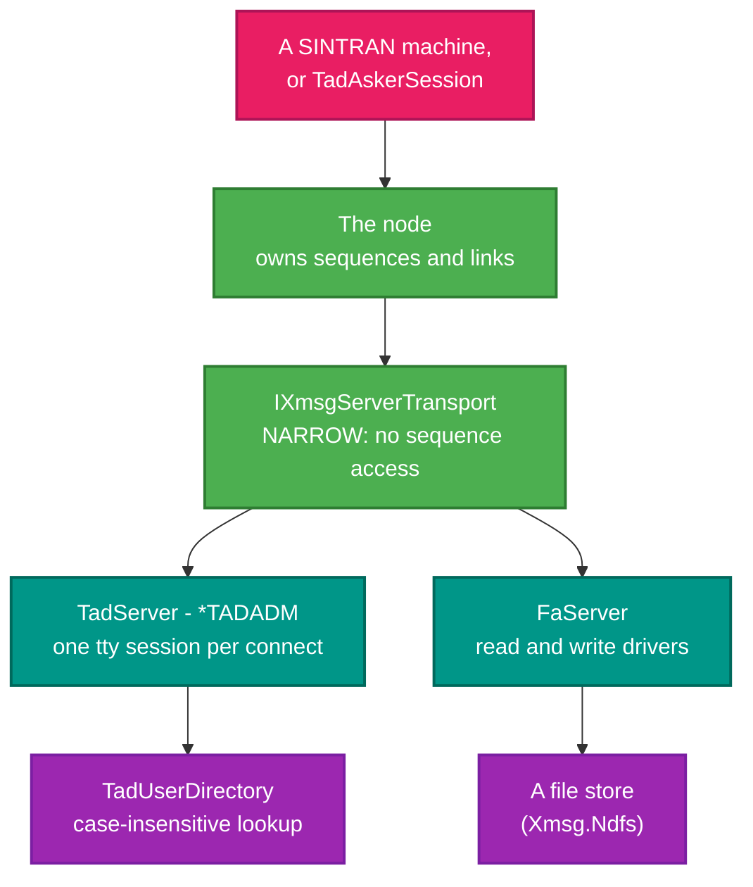
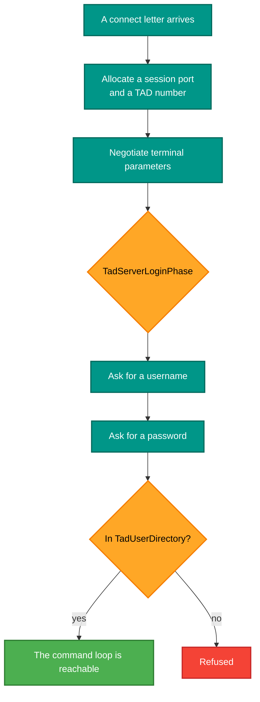

# RetroIO.Protocols.Xmsg.Servers

## What it is

The high-level XMSG **servers** — the named programs a remote system connects to:

- **`TadServer`**, the terminal server registered as `*TADADM`, which answers `connect-to` with a real login
  and a tty session.
- **`FaServer`**, the file-access server, with read and write drivers.

## Why you need it

A node with no servers answers nothing. These are what a SINTRAN machine, or our own client, actually
connects *to*: ask for a terminal and you get a login prompt; ask for a file and you get its bytes.

`*TADADM` is the name worth remembering — it is how the terminal server is found in the XROUT name table, the
same way COSMOS finds it.

The design rule these follow is the one stated in
[`RetroIO.Protocols.Xmsg.Node`](../RetroIO.Protocols.Xmsg.Node/README.md): a server uses the **narrow**
`IXmsgServerTransport` and **does not own sequence state**. The node owns it, shared across every server on
that link. A server that kept its own numbering would collide with the one beside it.

Login is a real sequence, not a formality. `TadServerLoginPhase` walks the phases a session must pass before
the command loop is reachable, and `TadUserDirectory` holds the accounts — with case-insensitive lookup,
because that is what the machine does.

## What you can use it for

- **Answering `connect-to`** from a real machine or from our own client: one tty session per concurrent
  connection.
- Serving files: `FaServer` with `FaReadDriver` and `FaWriteDriver` over a source and a target.
- Defining who may log in (`TadUser`, `TadUserDirectory`).
- Streaming a reply **longer than one terminal buffer** correctly — `TadOutputMode` is how that is handled
  rather than truncated.
- Holding per-session state properly: `TadServerSession` carries the endpoint, the allocated session port and
  TAD number, the negotiation state and the connect-letter metadata.

## Prerequisites

| Requirement | Needed for | Notes |
|---|---|---|
| .NET SDK as pinned in `global.json` | Everything | |
| `RetroIO.Protocols.Xmsg` | The wire format | |
| `RetroIO.Protocols.Xmsg.Node` | Registration, and all sequence state | A server cannot run without a node |
| `RetroIO.Protocols.Xmsg.Ndfs` | `FaServer`'s file store | |
| Accounts | Any TAD login | `TadUserDirectory` |
| A client | Anything end to end | A real machine, or `TadAskerSession` from the node package |

## Where the servers sit

## A terminal login

## Contents

| Type | Role |
|---|---|
| `TadServer` | The `*TADADM` terminal server; plugs into the node as an `IXmsgServer` |
| `TadServerSession` | All per-session state: endpoint, session port, TAD number, login and negotiation state, connect-letter metadata |
| `TadServerLoginPhase` | The phases before the command loop |
| `TadUser`, `TadUserDirectory` | Accounts, with case-insensitive lookup |
| `TadOutputMode` | How a reply longer than one terminal buffer is streamed |
| `FaServer`, `FaServerStatus` | The file-access server |
| `FaReadDriver`, `FaReadSource` | The read half |
| `FaWriteDriver`, `FaWriteTarget` | The write half |
| `FaFileEndpoint` | A file as an endpoint of a transfer |

## Related

- [`.Xmsg.Node`](../RetroIO.Protocols.Xmsg.Node/README.md) — the node, the sequences, and the client side of
  TAD (`TadAskerSession`, `TadReplayServer`, `TadTerminalMenu`).
- [`.Xmsg.Ndfs`](../RetroIO.Protocols.Xmsg.Ndfs/README.md) — the directory and store `FaServer` reads and
  writes.
- [`.Xmsg.Sync`](../RetroIO.Protocols.Xmsg.Sync/README.md) — a daemon that uses file access to keep folders in
  step.
