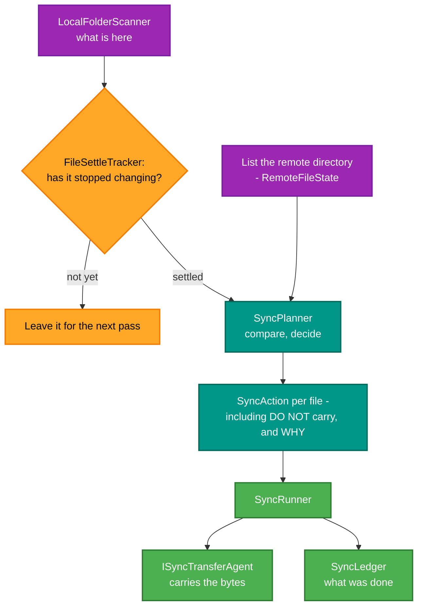

# RetroIO.Protocols.Xmsg.Sync

## What it is

A **folder synchronisation daemon** for a SINTRAN machine: it scans local folders, lists the remote user's
directory, decides what to carry each way, and records what it did in a ledger.

## Why you need it

Copying files to an ND machine by hand, one at a time, through a terminal session, is how an afternoon
disappears. This keeps a folder on each side in step.

Two problems it solves that are not obvious until you hit them:

- **A file that is still being written must not be carried.** Copying half a file produces a corrupt file on
  the machine and no error anywhere. `FileSettleTracker` watches a file's **size and last-write time** —
  `FileSizeAndTime` is described as "the two things that say whether it is still being written" — and waits
  until it has settled.
- **SINTRAN filenames are not host filenames.** `SintranFileName` handles the conversion, and `SintranParity`
  the character-level detail. A name that is legal here may be illegal there, and silently mangling it makes
  the file unfindable from the machine.

The design choice worth knowing: `SyncPlanner` **decides** and `SyncRunner` **acts**, and a `SyncAction`
records one thing the daemon has decided to do **or has decided not to do, and why**. That means a dry run is
a real feature rather than a debug flag, and "why was this file skipped?" has an answer.

## What you can use it for

- Keeping a local folder and a SINTRAN user's directory in step, one way or both.
- **Seeing what would happen** before it happens — the plan is data.
- Deciding what to do about sub-folders, explicitly (`SyncSubfolderPolicy`) rather than by accident.
- Keeping a record across runs (`SyncLedger`, `SyncLedgerFile`), so an interrupted run resumes sensibly.
- Mapping several folders at once (`SyncFolderMap`, `SyncFolderMapping`).
- Supplying your own transfer mechanism through `ISyncTransferAgent` — the planner does not care how bytes
  move.

## Prerequisites

| Requirement | Needed for | Notes |
|---|---|---|
| .NET SDK as pinned in `global.json` | Everything | |
| `RetroIO.Protocols.Xmsg` | The file-access protocol | |
| An `ISyncTransferAgent` | Actually moving anything | Usually backed by the FA client |
| A reachable machine | A real run | |
| A writable ledger location | Resuming correctly | |
| Folder mappings | Anything | `SyncFolderMap` |

## One pass

## Contents

| Type | Role |
|---|---|
| `SyncRunner`, `SyncPass` | Runs a pass |
| `SyncPlanner` | Compares both sides and decides |
| `SyncAction`, `SyncActionKind` | One decision — including a decision *not* to act, with the reason |
| `SyncDirection` | Which way a file was carried |
| `FileSettleTracker`, `FileSizeAndTime` | Whether a file has stopped being written |
| `LocalFolderScanner`, `LocalFileState` | The local side |
| `RemoteFileState` | A file in the remote user's directory, as a listing reports it |
| `SyncFolderMap`, `SyncFolderMapping` | Which local folder corresponds to which remote one |
| `SyncSubfolderPolicy` | What to do with a file in a sub-folder of a mapped folder |
| `SyncLedger`, `SyncLedgerFile` | The record across runs |
| `ISyncTransferAgent`, `SyncTransferRequest`, `SyncTransferResult` | The transfer seam |
| `SintranFileName`, `SintranParity` | Name conversion, and the character-level detail |

## Tests

`src/RetroIO.Protocols.Xmsg.Sync/tests`.
