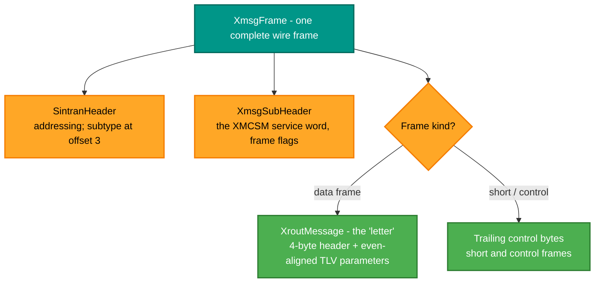
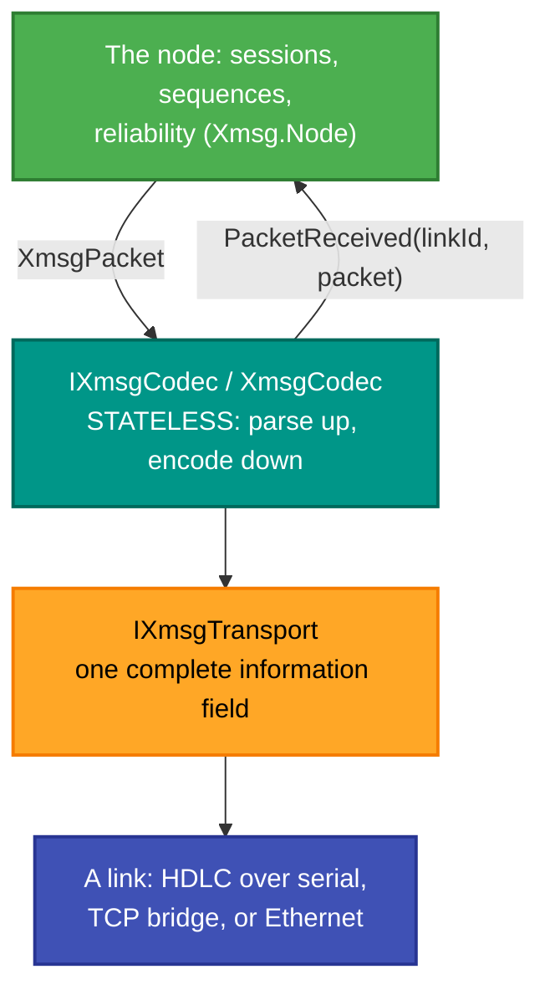
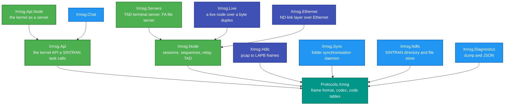

# RetroIO.Protocols.Xmsg

## What it is

**XMSG** — the Norsk Data inter-process and inter-machine messaging system that SINTRAN III and COSMOS are
built on. This package is the wire layer: the frame format, the codec, and the decoded vocabulary of every
service, function, error and status code. It is also the index for the twelve-package XMSG family.

## Why you need it

Almost everything interesting an ND machine does between processes or between systems goes through XMSG.
File transfer, terminal sessions, the name service, chat, remote procedure calls: all of them are XMSG
messages with a different service number. So this is not one feature — it is the bus.

The package is large because the vocabulary is large and **naming it is most of the work**. `XmsgError`,
`XroutError`, `XmsgFunction`, `XroutService`, `XmsgMessageType`, `SintranErrors` and a dozen more are the
real code tables, generated from the documentation (`eng/gen-xmsg-enums.py`, `eng/gen-sintran-errors.py`)
rather than typed by hand — because a mistyped error number produces a bug that looks like a protocol
mystery.

The codec is **deliberately stateless**. `XmsgCodec` parses one information field into a packet and raises
it, or serialises a packet and sends it. It holds no session and no reliability state; that lives one layer
up in [`RetroIO.Protocols.Xmsg.Node`](../RetroIO.Protocols.Xmsg.Node/README.md). Keeping them apart is what
lets a captured frame be parsed with no node, no link and no sequence state at all.

## What you can use it for

- Parsing or building any XMSG frame, including from a capture.
- Reading a SINTRAN header, an XMSG sub-header, an XROUT letter body and its TLV parameters.
- **File access**: the FA conversation — connect, open, read, write, list, delete — as codecs and a
  client/server conversation pair.
- **The name service**: XROUT `XSGSY` "get routing info for system N", both client and server, over an
  `IRoutingTable`.
- Decoding **TAD** message chains (protocol `0xDD`) and ROUTING commands (`0xDE`).
- Reading **QFORM** bodies — the tagged parameter format.
- Looking up what a status or error code actually means, including SINTRAN's own file-system error numbers
  with ND's recovery advice.

## Prerequisites

| Requirement | Needed for | Notes |
|---|---|---|
| .NET SDK as pinned in `global.json` | Everything | |
| `RetroIO.Lapb`, `RetroIO.Hdlc` | A live link | Not needed to parse a captured frame |
| `python3` | Regenerating the enums | `eng/gen-xmsg-enums.py`, `eng/gen-sintran-errors.py` |
| The research notes | Understanding any of it | The `DOC` junction — NDInsight's XMSG notes are cited throughout |
| A SINTRAN machine | The lab tests | Record as SKIPPED when unavailable |

## A frame

`XmcsmService` is the 32-bit control/service word that selects what the message **is** — a connect letter,
a session setup, terminal data, a notification — and for XROUT letters carries the service number.

## The codec seam

## The XMSG family

| Package | Reach for it when you want to |
|---|---|
| `Protocols.Xmsg` | Parse or build a frame; look up a code | this file |
| [`.Xmsg.Api`](../RetroIO.Protocols.Xmsg.Api/README.md) | Call XMSG the way a SINTRAN task would; RR-LIB; XROUT |
| [`.Xmsg.Api.Node`](../RetroIO.Protocols.Xmsg.Api.Node/README.md) | Expose the kernel as a server |
| [`.Xmsg.Node`](../RetroIO.Protocols.Xmsg.Node/README.md) | Run a node: sessions, sequences, relay, TAD sessions |
| [`.Xmsg.Servers`](../RetroIO.Protocols.Xmsg.Servers/README.md) | Answer `connect-to`; serve files |
| [`.Xmsg.Hdlc`](../RetroIO.Protocols.Xmsg.Hdlc/README.md) | Turn a pcapng capture into LAPB frames |
| [`.Xmsg.Live`](../RetroIO.Protocols.Xmsg.Live/README.md) | Run a live node over a TCP bridge or serial |
| [`.Xmsg.Ethernet`](../RetroIO.Protocols.Xmsg.Ethernet/README.md) | Carry ND datagrams over Ethernet |
| [`.Xmsg.Chat`](../RetroIO.Protocols.Xmsg.Chat/README.md) | A chat service over XMSG |
| [`.Xmsg.Sync`](../RetroIO.Protocols.Xmsg.Sync/README.md) | Synchronise folders with a SINTRAN machine |
| [`.Xmsg.Ndfs`](../RetroIO.Protocols.Xmsg.Ndfs/README.md) | SINTRAN directory entries and a file store |
| [`.Xmsg.Diagnostics`](../RetroIO.Protocols.Xmsg.Diagnostics/README.md) | Dump a frame, or round-trip it through JSON |

## Contents, by area

| Area | Types |
|---|---|
| Frame | `XmsgFrame`, `SintranHeader`, `XmsgSubHeader`, `XroutMessage`, `XroutParameter` |
| Codec | `IXmsgCodec`, `XmsgCodec`, `XmsgCodecBase`, `IXmsgTransport`, `XmsgPacketReceived` |
| Build and parse | `XmsgFrameBuilder`, `XroutMessageBuilder`, `XmsgPacketBuilder`, `XmsgPacketParser`, `XmsgPacket`, `XmsgPacketInfo`, `XmsgDataFields`, `XmsgEnvelope` |
| Code tables | `XmsgError`, `XmsgFunction`, `XmsgMessageType`, `XmsgOption`, `XmsgCrashCode`, `XmsgDriverFunction`, `XmcsmService`, `XmcsmMask`, `XmsgFrameFlags`, `XroutService`, `XroutError`, `XmfidoStatus`, `SintranErrors` |
| File access (FA) | `FaConnectLetter`, `FaClientConversation`, `FaServerConversation`, `FaOpenFileCodec`, `FaTransferCodec`, `FaListFilesCodec`, `FaDeleteFileCodec`, `FaReadLadder`, `FaWriteLadder`, `FaSintranError` |
| Name service | `IRoutingTable`, `InMemoryRoutingTable`, `ListRoutingClient`, `ListRoutingServer`, `RoutingTableEntry` |
| TAD and ROUTING | `TadChain`, `TadMessage`, `TadOpcodes`, `RoutingCommandInfo` |
| QFORM | `QformReader`, `QformWriter`, `QformField`, `QformValue`, `QformTagByte`, `QformClass` |
| Fragments | `SintranFragmentReassembler`, `SintranMessageFragment` |
| Secure datagrams | `SecureDatagramSession`, `SecureDatagramReceiver`, `SecureDatagramState` |
| Helpers | `NdEndian`, `SintranName`, `XmsgPortWordAllocator`, `XmsgRandomGenerator` |

## Tests

`src/RetroIO.Protocols.Xmsg/tests`, with shared fixtures in `src/tests/RetroIO.Protocols.Xmsg.TestSupport`.
The codec tests run against **real captured frames** — which is the only way to be sure about a format whose
documentation is partial. `XmsgFrameFlags` says so plainly in its own summary: the byte is only partially
decoded, and the safe normative rule is to mirror the captured value per frame type.
