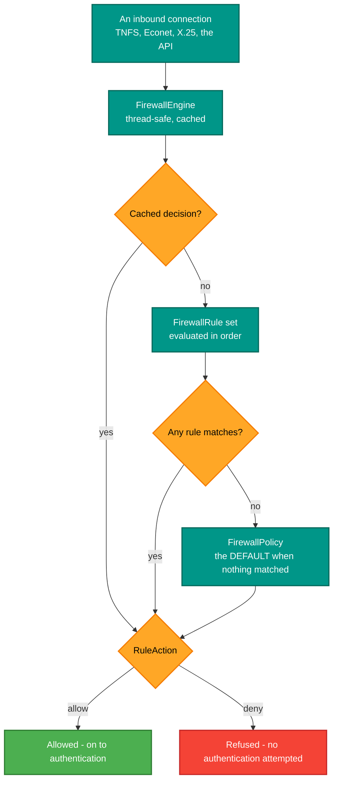

# RetroIO.Security.Firewall

## What it is

A rule-based firewall for the protocol servers: rules with role-based access control, a decision engine with an
in-memory cache, a default policy, and atomic JSON persistence.

## Why you need it

Authentication says **who**; authorisation says **may they do this**. A firewall answers a question before
either: **should this connection be talking to us at all?** A TNFS or Econet server is exposed on a local
network where anything might be speaking, and refusing a host outright is cheaper and safer than
authenticating it.

Three details make it worth a package rather than an `if`:

- **A default policy.** `FirewallPolicy` decides what happens when no rule matches, and it must be a deliberate
  choice. A firewall that silently defaults to allow is decoration.
- **Caching, because this is on the hot path.** Every connection is checked, so `FirewallEngine` caches
  decisions in memory and is thread-safe for concurrent access. `FirewallCacheStats` exists so you can tell
  whether the cache is doing anything.
- **Atomic writes.** `FirewallPersistence` writes the configuration atomically. A half-written firewall
  configuration, read after a crash, is a server with rules nobody intended.

RBAC is in the rules themselves (`FirewallRule` with RBAC support, `FirewallRuleManager`), so who may *change* a
rule is as controlled as what the rule does.

## What you can use it for

- Allowing or refusing traffic by rule, before authentication.
- Setting a default policy explicitly.
- Managing rules at runtime through the management API, with RBAC on who may.
- **Testing a rule before committing to it** — `TestFirewallRequest` and `FirewallTestResult` in the management
  contracts exist for exactly that.
- Watching the cache (`FirewallCacheStats`).

## Prerequisites

| Requirement | Needed for | Notes |
|---|---|---|
| .NET SDK as pinned in `global.json` | Everything | |
| `RetroIO.Security` | The principal and the surrounding pipeline | |
| A writable directory | Persistence | Written atomically |
| A considered default policy | Anything real | The default-when-nothing-matches case is a decision, not a detail |

## Where it sits, and how a decision is made

Note the order: **the firewall runs before authentication**, so a refused host never gets to present
credentials.

## Contents

| Type | Role |
|---|---|
| `FirewallEngine` | The decision engine: in-memory cache, thread-safe |
| `FirewallDecision` | The outcome |
| `FirewallRule` | One rule, with RBAC support |
| `RuleAction` | Allow or deny |
| `FirewallPolicy` | The default when no rule matches |
| `FirewallRuleManager` | Managing rules and who may change them |
| `FirewallConfiguration` | The configuration, with JSON persistence |
| `FirewallPersistence` | Atomic writes |

## Managed from the API

`FirewallController` in [`RetroIO.Management.Api`](../RetroIO.Management.Api/README.md) exposes this over REST,
with the DTOs in [`RetroIO.Management.Contracts`](../RetroIO.Management.Contracts/README.md) — including the
test-a-rule endpoint, so a rule can be checked against a hypothetical request before it is enabled.
