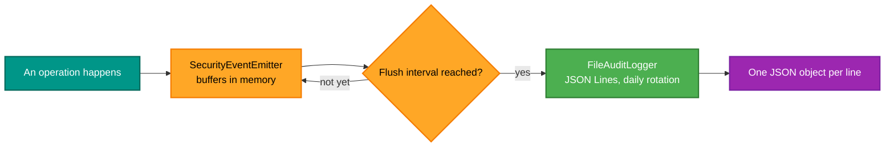
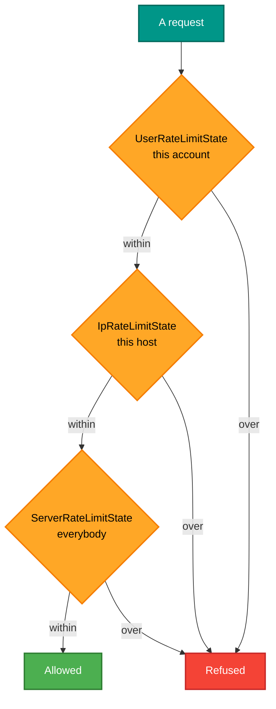

# RetroIO.Security.Implementation

## What it is

The concrete security providers: a file-based audit logger, a batching event emitter, and an in-memory rate
limiter that persists its state.

## Why you need it

[`RetroIO.Security`](../RetroIO.Security/README.md) defines the interfaces; something has to do the work. These
are the implementations a RetroIO server uses unless you supply your own.

The choices in them are all about a **long-running server**:

- **JSON Lines, not a log file.** One JSON object per line, with daily rotation and automatic archival. That is
  readable by a person *and* parsable by a program, which a prose log is not — and an audit trail you cannot
  query is an audit trail you will not use.
- **Batching.** `SecurityEventEmitter` buffers in memory and flushes periodically. Auditing every file read
  synchronously would put a disk write in the middle of every operation, which on a busy TNFS server is the
  whole cost.
- **Persisted rate-limit state.** `InMemoryRateLimiter` keeps its counters in memory for speed but writes them
  to JSON about once a minute. Restart the server and the limits are still roughly right — rather than every
  caller getting a fresh allowance, which is exactly the wrong behaviour if a restart was caused by load.

Limits are tracked per user, per IP **and** server-wide, because those are three different problems: one
account misbehaving, one host misbehaving, and the server simply being at capacity.

## What you can use it for

- An audit trail you can grep, or feed to anything that reads JSON Lines.
- Rate limiting that survives a restart.
- Security events without a write on every operation.
- A starting point to replace: each of these is one class behind an interface.

## Prerequisites

| Requirement | Needed for | Notes |
|---|---|---|
| .NET SDK as pinned in `global.json` | Everything | |
| `RetroIO.Security` | The interfaces | |
| A writable directory | The audit log and the rate-limit state | |
| Disk space and rotation awareness | A long run | Daily rotation with archival |

## How an event reaches the disk

## Three scopes of rate limit

All three must allow it. One account hammering the server, one host hammering it, and the server being full are
distinct conditions with distinct answers.

## Contents

| Type | Role |
|---|---|
| `FileAuditLogger` | JSON Lines audit log, one object per line, daily rotation with archival |
| `SecurityAuditEntry`, `SecurityEventType`, `AuditSeverity` | What is recorded |
| `SecurityEventEmitter` | Buffers events and flushes periodically |
| `InMemoryRateLimiter` | Fast in memory, persisted to JSON about once a minute |
| `RateLimitConfig`, `RateLimitResult`, `RateLimitState` | Configuration, outcome, and the persisted state |
| `UserRateLimitState`, `IpRateLimitState`, `ServerRateLimitState` | The three scopes |
| `SecurityPrincipal` | An authenticated — or anonymous — user through the pipeline |
