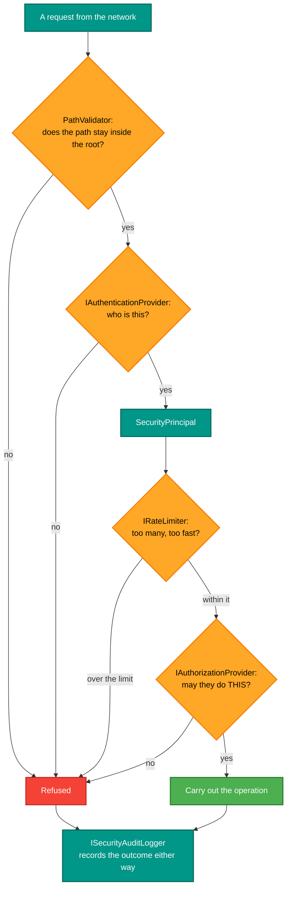

# RetroIO.Security

## What it is

The security **abstractions**: authentication, authorisation, auditing, rate limiting and path validation — as
interfaces and request/result types, with no implementation.

## Why you need it

Because a server that exposes a filesystem to a network needs all five, and because they must be
**replaceable**. A home lab wants a JSON file; somebody else wants an enterprise directory. Interfaces here,
implementations in [`RetroIO.Security.Implementation`](../RetroIO.Security.Implementation/README.md), means
either is a composition choice rather than a fork.

The one that is not optional is `PathValidator`. A protocol that takes a path from the network and opens it is
the classic way to escape a served root, and every protocol in RetroIO does exactly that. Validating paths is
not a hardening step to add later; it is the difference between serving a directory and serving the disk.

`RateLimitConfig` uses a **token bucket** — which matters because the alternative, a fixed window, lets a
caller send a whole window's worth in one burst at the boundary.

## What you can use it for

- Authenticating through a provider of your choosing (`IAuthenticationProvider`).
- Authorising an operation, with ACLs and inheritance (`IAuthorizationProvider`, `AccessControlEntry`,
  `AclInheritanceFlags`).
- **Auditing** with typed entries — authentication, authorisation and file access each have their own — so an
  audit log can be read by a program.
- Rate limiting per user, per address or server-wide.
- **Validating a path** before opening it.
- Mapping an external identity onto an internal user (`IIdentityProvider`, `ExternalIdentityMapping`).

## Prerequisites

| Requirement | Notes |
|---|---|
| .NET SDK as pinned in `global.json` | |
| Nothing else | These are interfaces; `RetroIO.Security.Implementation` supplies the behaviour |

## The pipeline

**Both outcomes are audited.** A log that records only failures cannot answer "who read that file?", and one
that records only successes cannot show an attack.

## Contents

| Area | Types |
|---|---|
| Authentication | `IAuthenticationProvider`, `AuthenticationRequest`, `AuthenticationResult`, `AuthenticationMethod`, `AuthenticationFailureReason` |
| Principals | `SecurityPrincipal`, `SecurityPrincipalConstants` |
| Authorisation | `IAuthorizationProvider`, `AuthorizationRequest`, `AuthorizationResult`, `AccessControlEntry`, `PathPermissions`, `AclInheritanceFlags`, `FileSystemOperation` |
| Auditing | `ISecurityAuditLogger`, `SecurityAuditEntry`, `AuthenticationAuditEntry`, `AuthorizationAuditEntry`, `FileAccessAuditEntry`, `SecurityEventType`, `SecurityEventSeverity` |
| Rate limiting | `IRateLimiter`, `RateLimitKey`, `RateLimitConfig` (token bucket), `RateLimitResult` |
| Paths | `PathValidator`, `PathValidationResult` |
| External identity | `IIdentityProvider`, `IdentityProviderType`, `ExternalIdentityMapping`, `InternalUser`, `OAuthTokenInfo` |

## Related

- [`RetroIO.Identity`](../RetroIO.Identity/README.md) — RetroIDP, which supplies the users.
- [`RetroIO.Security.Implementation`](../RetroIO.Security.Implementation/README.md) — the concrete providers.
- [`RetroIO.Security.Firewall`](../RetroIO.Security.Firewall/README.md) — rule-based access control in front of
  all of this.
