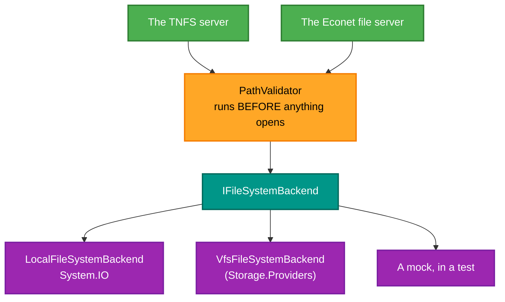

# RetroIO.Server.Core

## What it is

Four things a protocol server needs: the filesystem backend abstraction, a real implementation of it, path
validation, and little-endian binary helpers.

## Why you need it

**`IFileSystemBackend`** is the seam between a protocol server and the files. A TNFS or Econet server should not
know whether it is serving a real directory, a mounted disk image or a remote share — and, just as usefully, it
should be testable against a mock. One interface does both.

**`PathValidator`** is here rather than in a protocol package because every protocol has the same hole. A path
arrives from the network; if it is opened without checking, `../../..` escapes the served root. The summary says
it plainly: prevent traversal, ensure paths stay within root. That is not a feature, it is the floor.

**`EndianHelper`** exists because TNFS is **little-endian** throughout, and most of the ND protocols in this repo
are not. Mixing those up produces values that are plausible and wrong — a length of 256 read as 1 — which is
much harder to spot than a crash.

## What you can use it for

- Writing a protocol server against a backend rather than against the disk.
- **Testing one** against a mock filesystem, with no files at all.
- Validating a network-supplied path before acting on it.
- Reading and writing little-endian values without hand-rolling shifts.
- Serving the real filesystem, via `LocalFileSystemBackend`.

## Prerequisites

| Requirement | Notes |
|---|---|
| .NET SDK as pinned in `global.json` | |
| Nothing else | This is meant to be depended **on**, not to depend |

## The seam

Validation is **in front of** the backend, not inside it. A backend that validated would be trusted to, and one
that forgot would be a hole.

## Contents

| Type | Role |
|---|---|
| `IFileSystemBackend` | The abstraction: a real filesystem, a VFS mount, or a mock |
| `LocalFileSystemBackend` | The real thing, over `System.IO` |
| `PathValidator` | Prevents traversal; keeps paths inside the root |
| `EndianHelper` | Little-endian read and write helpers — **TNFS is little-endian throughout** |

## Related

- [`RetroIO.Protocols.Tnfs`](../RetroIO.Protocols.Tnfs/README.md) and
  [`RetroIO.Protocols.Econet`](../RetroIO.Protocols.Econet/README.md) — the servers that use this.
- `VfsFileSystemBackend` in [`RetroIO.Storage.Providers`](../RetroIO.Storage.Providers/README.md) — the backend
  that serves mounted volumes.
