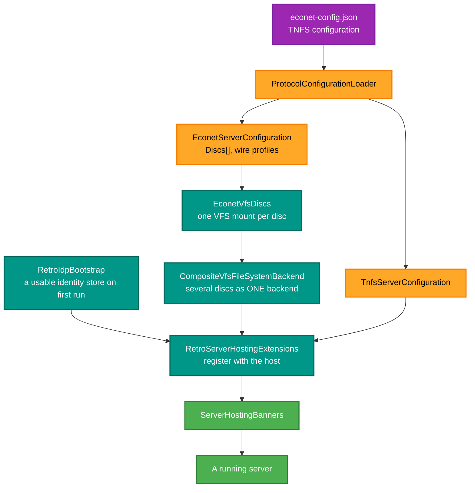
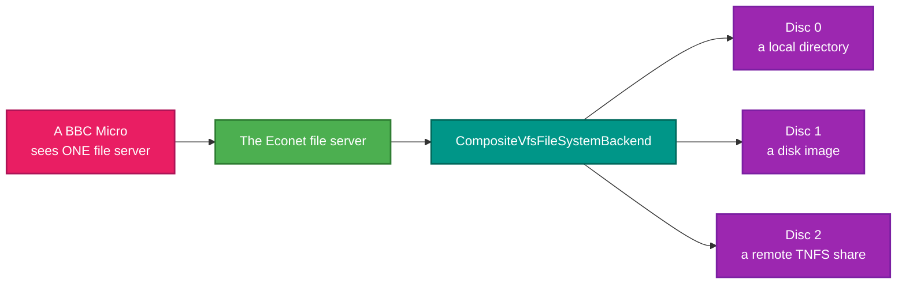

# RetroIO.Server.Hosting

## What it is

The hosting layer: loading the protocol configuration files, bootstrapping identity and the Econet discs,
registering everything with a .NET host, and printing the startup banners.

## Why you need it

Because the gap between "the libraries are composed" and "a server is running" is full of small decisions, and
they need to be somewhere.

**Configuration.** `ProtocolConfigurationLoader` reads `econet-config.json` and the TNFS configuration and turns
them into typed options. `EconetDiscConfiguration` is the interesting one: a disc either defines a mount inline
(a provider plus a URI) or references an existing RetroVFS mount by id — and the code says plainly that the
reference form is **reserved and not wired yet**, which is exactly the kind of thing that should be written down
rather than discovered.

**Bootstrap.** `RetroIdpBootstrap` makes sure there is a usable identity store on first run. A server whose very
first start requires a manual user-creation step is a server nobody gets working.

**Composition of discs.** `EconetVfsDiscs` builds the Econet file server's backend from the `Discs[]` array: one
VFS mount per disc, wrapped in a `CompositeVfsFileSystemBackend` so **one server can mix discs from different
providers** — a local directory, a disk image, a remote share.

**Binding.** `EconetMachineWireProfile` exists because the thing it configures,
`WireProfileResolver.MachineOverride`, is a `readonly struct` and JSON binding does not work well with those. A
separate bindable type is the honest fix, and the reason is recorded where it is.

## What you can use it for

- Hosting a RetroIO server in a .NET application or Windows service.
- Configuring Econet discs from JSON, including a mix of providers.
- Pinning a particular client machine to a wire profile.
- Getting a working identity store on first run.
- Printing a startup banner that says what actually came up.

## Prerequisites

| Requirement | Needed for | Notes |
|---|---|---|
| .NET SDK as pinned in `global.json` | Everything | |
| `RetroIO.Server`, `.Server.Core` | Composition and the backend | |
| `RetroIO.Protocols.Tnfs`, `.Econet`, `.DriveWire` | The servers being hosted | |
| `RetroIO.Storage.Providers` | The VFS-backed discs | |
| `econet-config.json` | Econet | Defines the discs |
| A TNFS configuration | TNFS | |
| `drivewire-config.json` | DriveWire | The drives; written with the defaults (port 65504, loopback, no drives) when missing |
| A writable data directory | Identity, logs, state | See `PathHelper` |

## From configuration to a running server

## One server, discs from several providers

`*SDISC` on the machine selects between them, and the machine has no idea they are different kinds of thing.

## Contents

| Type | Role |
|---|---|
| `ProtocolConfigurationLoader` | Reads the protocol configuration files |
| `EconetServerConfiguration` | The Econet server's configuration |
| `EconetDiscConfiguration` | One disc: an inline mount, or a reserved reference to an existing mount |
| `EconetVfsDiscs` | Builds the backend from `Discs[]` |
| `EconetMachineWireProfile` | A JSON-bindable per-machine wire-profile override |
| `TnfsServerConfiguration` | The TNFS server's configuration |
| `RetroIdpBootstrap` | A usable identity store on first run |
| `RetroServerHostingExtensions` | Registration with a .NET host |
| `ServerHostingBanners` | Startup banners |
