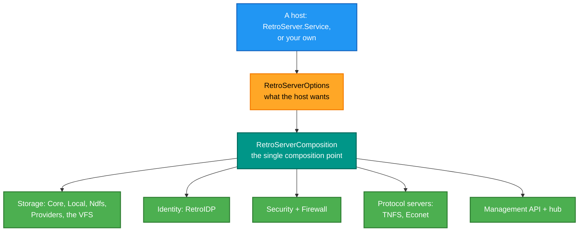

# RetroIO.Server

## What it is

The **composition root** for a RetroFS server. Two types: `RetroServerComposition`, the single place a server is
assembled, and `RetroServerOptions`, what the host asks for.

## Why you need it

A RetroIO server is a dozen parts — storage, a VFS, identity, security, a firewall, one or more protocol
servers, the management API — and the order and lifetime of their registrations matter. Left to each host to do,
that wiring diverges, and then two hosts of the same server behave differently for reasons nobody can find.

"**The single composition point**" is how the code describes it, and that is the value: one file to read to know
what a server *is*, and one place a mistake can be.

It is deliberately tiny. Composition is not behaviour — the work is in the packages being composed. A large
composition root is a sign that logic has leaked into the wiring.

## What you can use it for

- Standing up a complete RetroFS server with one call.
- Asking for only the parts you want, through `RetroServerOptions`.
- Reading one short file to find out what a server consists of.

## Prerequisites

| Requirement | Needed for | Notes |
|---|---|---|
| .NET SDK as pinned in `global.json` | Everything | |
| The packages being composed | Whatever you enable | Storage, identity, security, the protocol servers |
| A host | Running it | `RetroIO.Server.Hosting`, or your own |

## What it composes

## Contents

| Type | Role |
|---|---|
| `RetroServerComposition` | The single composition point for a RetroFS server |
| `RetroServerOptions` | What a host wants from `AddRetroServer` |

## Related

- [`RetroIO.Server.Core`](../RetroIO.Server.Core/README.md) — the filesystem backend abstraction and the
  protocol helpers.
- [`RetroIO.Server.Hosting`](../RetroIO.Server.Hosting/README.md) — configuration loading, bootstrap and
  hosting extensions.
- `RetroServer.Service` in the RetroServer repo — the app that hosts all of this.
