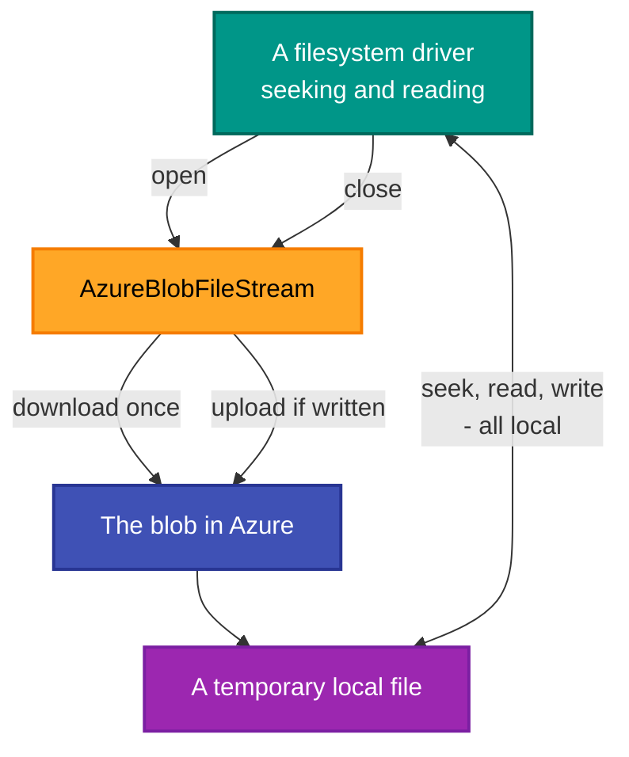

# RetroIO.Storage.Azure

## What it is

Azure Blob Storage as a RetroIO volume. A backend, a volume provider, and a stream that uploads on
close.

## Why you need it

So that the images do not have to be on the machine doing the work. A disk-image corpus is large,
several people may want the same one, and a server running somewhere else needs to reach it.

Directories are the part worth knowing about: blob storage has none. It has names with slashes in them.
`AzureBlobFileSystemBackend` **simulates** directories over that flat namespace, which is what lets code
written for a real filesystem work unchanged.

`AzureBlobFileStream` uses a **temporary local file** for the actual read and write work and uploads when
the stream closes. That is a deliberate trade: it means a random-access filesystem driver — which seeks
constantly — works over blob storage at all, at the cost of the file being local for the duration.

## What you can use it for

- Mounting an Azure container as a volume, so images on it behave like images on disk.
- Serving a remote corpus from a server that has no local copy.
- Sharing one set of images between machines without copying them about.

## Prerequisites

| Requirement | Needed for | Notes |
|---|---|---|
| .NET SDK as pinned in `global.json` | Everything | |
| `RetroIO.Storage.Core` | The contracts | |
| An Azure storage account and container | Anything real | |
| Credentials in `AzureBlobOptions` | Connecting | |
| Temporary local disk space | Any open stream | A file is staged locally while open |

## How a read and a write work

The consequence to plan for: **a large image is fetched in full** before a driver can read its directory.
Blob storage is not a seekable device, so this package trades bandwidth for compatibility.

## Contents

| Type | Role |
|---|---|
| `AzureBlobVolumeProvider` | Mounts a container as a RetroFS volume |
| `AzureBlobFileSystemBackend` | `IFileSystemBackend` over blobs, with directories simulated |
| `AzureBlobFileStream` | Staged locally, uploaded on close |
| `AzureBlobOptions` | Account, container and credentials |
