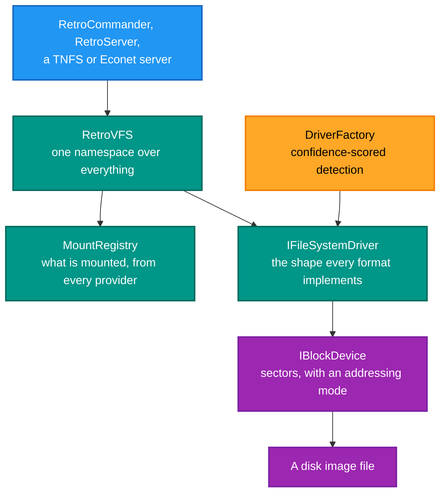
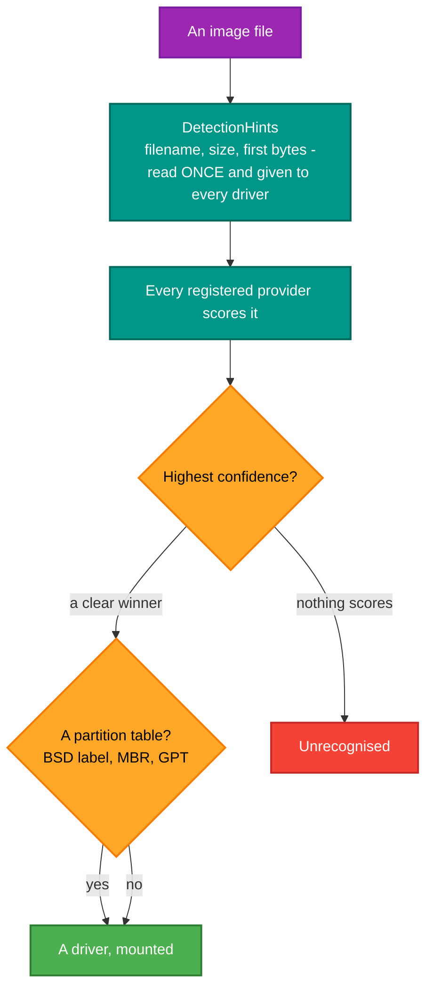

# RetroIO.Storage.Core

## What it is

The storage abstractions — the interfaces and shared machinery every filesystem driver implements, plus
the virtual filesystem (**RetroVFS**) that presents all of them through one namespace, and the
detection that works out what an unknown image actually is.

## Why you need it

A D64 and a FAT12 floppy have nothing in common on disk. They have everything in common to a **caller**:
list a directory, open a file, read it, write it. `IFileSystemDriver` is that shared shape, and it is
what lets a file manager support thirty formats without thirty code paths.

Three problems this package solves that are easy to underestimate:

- **What is this file?** Nobody types "this is a DragonDOS VDK". `DiskImageDetector` works it out, and
  `DriverFactory` scores drivers by confidence rather than taking the first that says yes — because
  several formats are headerless and "might be" is the honest answer a driver should give.
- **Not every filesystem can do everything.** CBM DOS has no subdirectories; FAT has no CBM file types.
  `DriverCapabilities` and `FileSystemCapabilities` make that explicit, so a copy between two
  filesystems knows what it cannot carry — and `IExtendedAttributeSupport` is how the lost metadata is
  preserved rather than dropped.
- **Paths are an attack surface.** `PathNormalizer` implements RFC 3986 relative-reference resolution
  and dot-segment normalisation specifically to stop directory traversal, and `ISecurityContext` says
  who is asking.

## What you can use it for

- Writing a driver for a new format: implement `IFileSystemDriver` and a provider, and every RetroIO
  app supports it.
- **Mounting anything under one namespace**: `RetroVFS` with `MountRegistry`, across disk images,
  native directories and TNFS servers at once.
- Detecting a format and its partitions in **one call** (`DiskImageDetector`).
- Reading partitioned images: BSD disk labels, MBR and GPT (`PartitionDetector`).
- Describing a volume for a UI: `VolumeInfo` with titled sections, and `VolumeAllocationMap` for a
  "one pixel per unit" usage strip.
- Extending the VFS with archive support — `ZipFsPlugin` reads ZIP, JAR and APK read-only through
  `IExtFsPlugin`.
- Persisting what was mounted: `UnifiedMountConfigStore` saves every provider's mounts to one JSON file.

## Prerequisites

| Requirement | Notes |
|---|---|
| .NET SDK as pinned in `global.json` | |
| No other RetroIO package | This is the bottom of the storage stack |
| A disk image | For anything beyond the abstractions |

## The shape of it

## Identifying an unknown image

**`DetectionHints` reads the file once** and hands the same bytes to every driver. That matters: without
it, thirty providers each open and read the image, which on a large file is thirty times the I/O for the
same answer.

## Contents

| Area | Types |
|---|---|
| The driver contract | `IFileSystemDriver`, `IFileSystemDriverProvider`, `IFileSystemDriverFactory`, `IBlockFileSystem` |
| Block access | `IBlockDevice`, `BlockAddress`, `BlockAddressMode`, `BlockDeviceInfo` |
| Capabilities | `DriverCapabilities`, `FileSystemCapabilities`, `IExtendedAttributeSupport` |
| Detection | `DiskImageDetector`, `DiskImageAnalysisResult`, `DetectionHints` |
| Partitions | `PartitionDetector`, `PartitionMetadata`, `PartitionTableType`, `IPartitionProvider` |
| The VFS | `RetroVFS`, `VfsCore`, `VfsResolver`, `VfsDentryCache`, `VfsMetadataCache`, `VfsPluginRegistry` |
| Plugins | `IExtFsPlugin`, `ZipFsPlugin` |
| Mounting | `IVolumeProvider`, `MountInfo`, `MountRegistry`, `UnifiedMountConfig`, `UnifiedMountConfigStore` |
| Naming and safety | `UrnIdentifier`, `UrnContext`, `PathNormalizer`, `PathCleaner`, `FileSystemScheme` |
| Security | `ISecurityContext`, `AnonymousSecurityContext`, `UserSecurityContext`, `SystemSecurityContext` |
| Metadata | `FileMetadata`, `DirectoryEntry`, `PropertyDescriptor`, `IFileSystemMetadataDescriptor` |
| Describing a volume | `VolumeInfo`, `VolumeInfoSection`, `VolumeInfoField`, `VolumeAllocationMap`, `IVolumeInfoProvider`, `VolumeInfoBuilder` |

## Two details worth knowing

**`IVolumeInfoProvider` is optional.** `VolumeInfoBuilder` uses a driver's own rich description when it
implements the interface, and assembles a generic one from what every driver must expose when it does
not. Callers must handle both — a driver without it is not broken.

**URNs are the addressing scheme.** `urn:retrofs:` plus a `FileSystemScheme` (`bsd:///path`,
`d64:///path`) names a filesystem explicitly when detection should not be trusted to guess.
