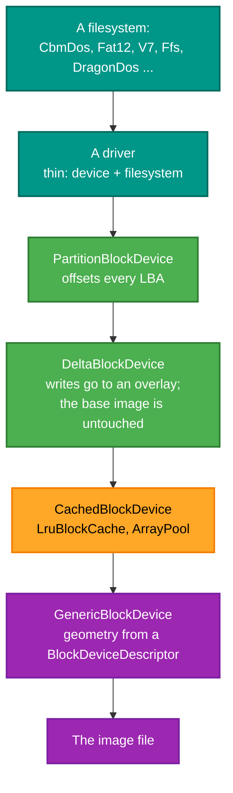
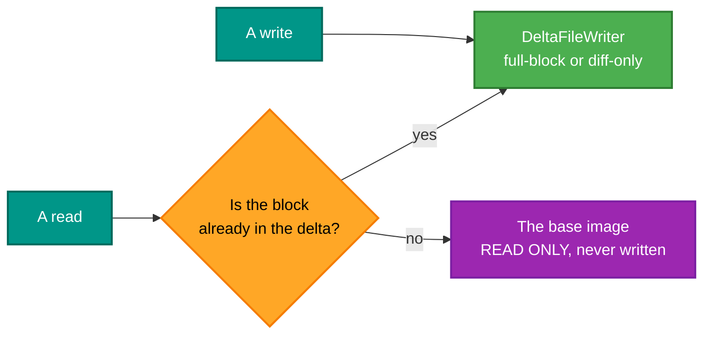

# RetroIO.Storage.Local

## What it is

**The format drivers.** The largest package in RetroIO, and the one that knows a D64 from a DragonDOS
VDK from a SunOS FFS partition. Every filesystem and container RetroIO can read or write is implemented
here, over a block-device layer with caching, partitioning and copy-on-write overlays.

## Why you need it

This is the actual work. A format is documented in a manual that is thirty years old, contradicts itself
in two places, and omits the thing you need; the implementation that matches real images is the only
useful artefact. Doing it once, here, is why a file manager, a TNFS server and an Econet server all read
the same thirty formats.

Two design decisions shape the whole package, and both were corrections:

- **Geometry is data, not code.** There were once separate `D64Device`, `D71Device`, `D81Device` and PC
  floppy classes that differed only in numbers. `BlockDeviceDescriptor` plus `GenericBlockDevice`
  replaced all of them: track/sector with zone bit recording, CHS, or plain LBA, described rather than
  coded.
- **A driver is a thin composition.** `V7Driver` is "GenericBlockDevice + V7FileSystem" and nearly
  nothing else. The filesystems deliberately do **not** implement `IBlockFileSystem`, to avoid a circular
  dependency — the driver is what joins the two halves.

## What you can use it for

- Reading and writing vintage disk images — the table below is the real list.
- **Never touching the original**: `DeltaBlockDevice` overlays a delta file, so every write goes to the
  overlay and the base image is preserved byte for byte.
- Making **blank, valid** images: `CbmImageFactory` produces c1541-valid D64/D71/D81 by formatting
  through the real `Format` path; `PcImageFactory` does the same for FAT.
- Reading a partition out of a larger image: BSD disk labels, MBR, GPT and **Sun VTOC**.
- Caching for speed: `LruBlockCache` uses `ArrayPool` for zero-copy, with selectable write strategy.
- Remembering mounts across restarts (`MountConfigStore`, to `~/.retrofs/mounts.json` or
  `%APPDATA%\RetroFS\mounts.json`).

## Prerequisites

| Requirement | Needed for | Notes |
|---|---|---|
| .NET SDK as pinned in `global.json` | Everything | |
| `RetroIO.Storage.Core` | The contracts | |
| `eng\setup-test-data.ps1` run | The tests | Creates the image-corpus junction |
| The corpus at `Documents\RetroFS\test-images` | The Dragon and PC tests | Those images exist **only** there |

## The formats

| Family | Driver | Filesystem | Read / write |
|---|---|---|---|
| Commodore disk | `CommodoreDiskDriver` | `CbmDosFileSystem` (2.x, 3.0, 10.0) | read/write — D64, D71, D81 |
| Commodore tape archive | `T64Driver` | container, no track/sector | read |
| Commodore tape signal | `TapDriver` | one blob, presented as `TAPE.RAW` | read |
| Commodore cartridge | `CrtDriver` | each CHIP packet as an entry | read |
| Commodore program | `ProgramFileDriver` | PRG (load address + bytes), P00 (`C64File` wrapper) | read |
| Dragon 32/64 | `DragonVdkDriver`, `DragonDskDriver` | `DragonDosFileSystem` | read |
| Tandy CoCo | — | `DecbFileSystem` | read |
| PC | `PcFloppyDriver` | `Fat12FileSystem`, `Fat16FileSystem`, `Fat32FileSystem` | read/write, subdirectories at any depth |
| UNIX V7 (1979) | `V7Driver` | `V7FileSystem` | read |
| 4.2BSD / SunOS | `FfsDriver` | `FfsFileSystem` | read |
| 2.11BSD | — | `BsdInode`, `BsdDirectoryEntry`, `BsdDiskLabel` | read |

PC floppy sizes: 360 KB, 720 KB, 1.2 MB, 1.44 MB, 2.88 MB, plus arbitrary FAT partitions.
`PcHddPreset` carries the classic IBM fixed BIOS drive-type geometries (all 17 sectors per track).

## The block-device stack

Each wrapper is optional and composable — that is the point. A read-only mount of one partition of a
cached image is three wrappers and no special case.

## Writing without risking the original

## Partition tables

| Manager | Format | Where the label lives |
|---|---|---|
| `BsdPartitionManager` | BSD disk label | sector 1 |
| `SunPartitionManager` | Sun VTOC | **sector 0** — unlike BSD |
| `MbrPartitionManager` | MBR | sector 0 |
| `PartitionDetectionService` | detects BSD, MBR and GPT | |

`BsdEndianHelper` handles **PDP-11 middle-endian** 32-bit values (high word first, each word
little-endian) as well as big-endian for SunOS and SPARC. That is not a quirk to work around; it is what
the bytes are.

## Tests

`src/RetroIO.Storage.Local/tests` — run against **real disk images**, which is the only test that means
anything for a format driver. A synthetic image proves the code reads what the code wrote.
