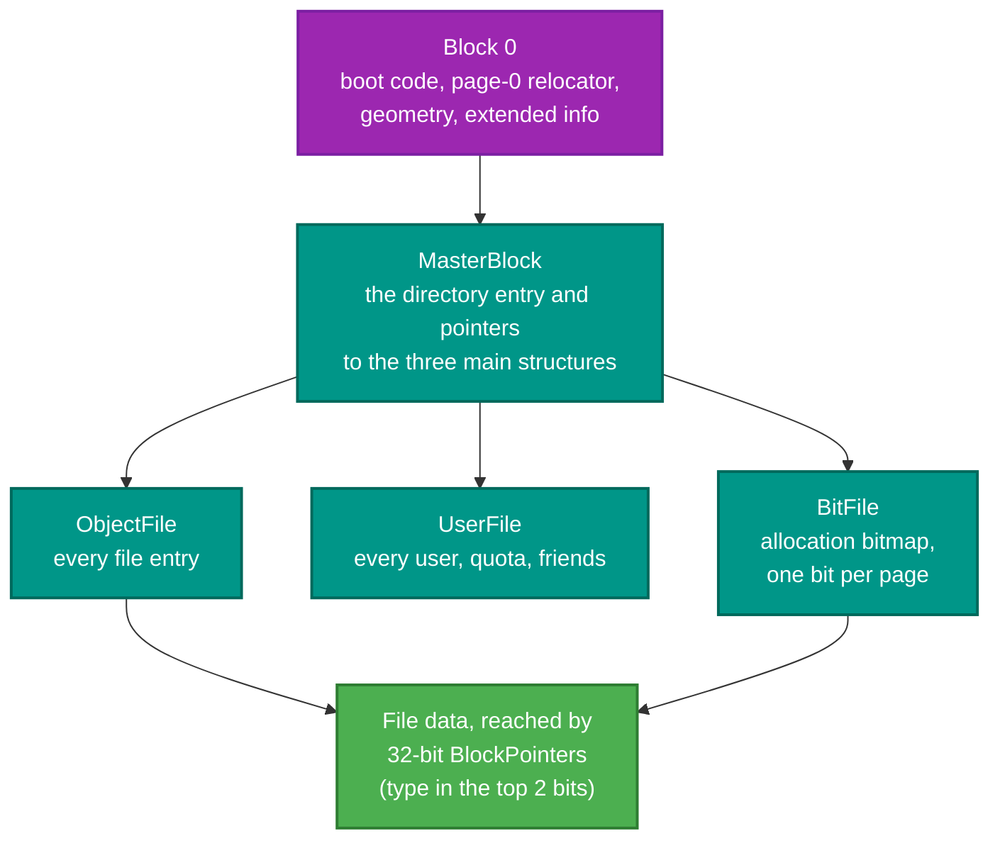
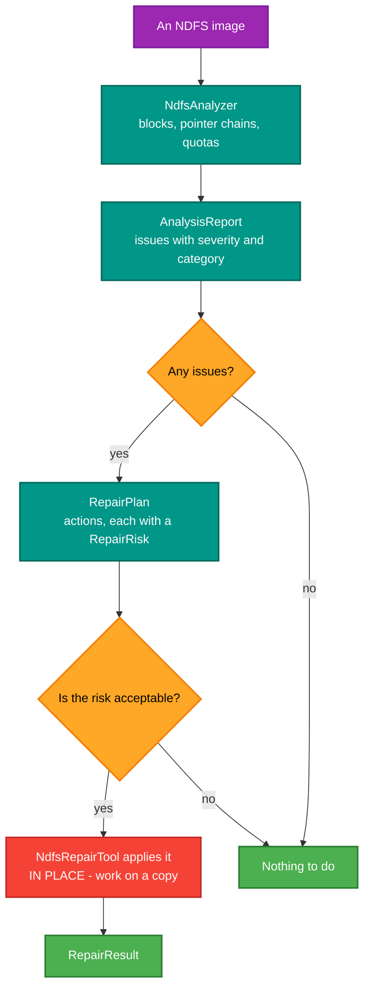

# RetroIO.Storage.Ndfs

## What it is

**NDFS** — the Norsk Data filesystem that SINTRAN III boots from and keeps its files in. A driver for
it, plus the things only this filesystem needs: users and quotas, a three-tier permission model, the
boot sector, a deep analyser, an automated repair tool, an image creator, and the SINTRAN
initial-command buffer.

## Why you need it

If you want to do anything with a real ND-100 or ND-500 disk image — read a file off it, add a user,
find out why SINTRAN will not boot — this is the package. Nothing else reads NDFS.

It is larger than the other storage drivers because NDFS is not just a filesystem. It carries the
system's **users**, with quotas and a friend list; its **access control**, which is three-tier rather
than owner/group/other; and its **boot code**, which is machine-specific page-0 relocator and not a
generic boot block. A driver that only listed files would be almost useless for the work people
actually have.

The analyser and repair tool exist because these images are thirty years old and many are damaged.
Knowing *that* an image is broken is not enough — you need to know which pointer chain, which block,
which quota, and whether fixing it is safe. Hence `AnalysisReport` with severity and category, and
`RepairPlan` with a `RepairRisk` per action.

## What you can use it for

- Reading and writing files on an NDFS image, through the ordinary `IFileSystemDriver` surface.
- **Managing users**: `UserEntry` with quota and usage, and up to eight friends each (`UserFriend`).
- Enforcing NDFS permissions properly: `AccessControl` implements OWN / FRIEND / PUBLIC with friend
  resolution.
- **Diagnosing a damaged image**: `NdfsAnalyzer` walks block usage, pointer chains and quota tracking
  and reports inconsistencies with a severity and a category.
- **Repairing one**: `NdfsRepairTool` produces a plan of actions, each with a stated risk, rather than
  changing things silently.
- **Creating one**: `NdfsImageCreator` with templates (`NdfsImageTemplate`) sized accurately, including
  initial users.
- Identifying the **boot** arrangement: format, controller family from the IOX/IOXT instructions,
  medium addressing, and the 9-word geometry block a real page-0 relocator embeds.
- Reading and writing the **SINTRAN initial-command buffer** — the commands SINTRAN runs at every
  restart, exactly as `@LIST-INITIAL-COMMANDS` prints them.
- **Not losing NDFS metadata** when copying to a filesystem that has no room for it: a `.xat` JSON
  sidecar, through `IExtendedAttributeSupport`.

## Prerequisites

| Requirement | Needed for | Notes |
|---|---|---|
| .NET SDK as pinned in `global.json` | Everything | |
| `RetroIO.Storage.Core` | The contracts | |
| `RetroIO.Storage.Local` | `GenericBlockDevice` | The driver is a thin composition over it |
| An NDFS image | Anything real | |
| **A copy of the image** | Anything that writes | `repair` and `set-initial-commands` write **in place** |
| The research notes | The boot and buffer internals | `DISC-BOOT-SECTOR-ANATOMY.md`, via the `DOC` junction |

## What is on an NDFS volume

## Analyse, then repair — in that order

The [`ndfs-analyzer`](../../tools/RetroIO.Tools.NdfsAnalyzer/README.md) tool is this pipeline on a
command line.

## The three-tier permission model

NDFS does not have owner/group/other. It has:

| Tier | Who |
|---|---|
| **OWN** | The file's owner |
| **FRIEND** | A user on the owner's friend list — up to eight, each with its own permissions |
| **PUBLIC** | Everybody else |

`AccessControl` resolves a request through those tiers; `FileAccessType` and `FileOperationType` are
what it is asked about.

## Contents

| Area | Types |
|---|---|
| Driver | `NdfsDriver`, `NdfsDriverProvider`, `NdfsFileSystem`, `INdfsFileSystem`, `NdfsFileHandle` |
| Geometry | `NdfsBlockDeviceDescriptor`, `NdfsControllerType` |
| On-disk structures | `MasterBlock`, `ObjectFile`, `ObjectEntry`, `UserFile`, `UserEntry`, `UserFriend`, `BitFile`, `BlockPointer` |
| Boot | `NdfsBootCode`, `NdfsBootLoader`, `NdfsBootFormat`, `NdfsBootControllerType`, `NdfsBootMediaAddressing`, `NdfsBootGeometry` |
| Access control | `AccessControl`, `AccessPermissions`, `FileAccessType`, `FileOperationType`, `FileOperation` |
| Analysis | `NdfsAnalyzer`, `AnalysisReport`, `AnalysisIssue`, `IssueSeverity`, `IssueCategory`, `BlockInfo`, `PointerInfo`, `BlockType` |
| Repair | `NdfsRepairTool`, `RepairPlan`, `RepairAction`, `RepairActionType`, `RepairRisk`, `RepairResult` |
| Creation | `NdfsImageCreator`, `NdfsImageCreationOptions`, `NdfsImageTemplate`, `NdfsUserCreationInfo` |
| SINTRAN initial commands | `SintranInitialCommands`, `SintranInitialCommandBuffer` |
| Metadata preservation | `NdfsPropertyBagKeys`, `NdfsPropertyBagSerializer`, `NdfsXatSerializer` |
| Other | `FileTypes`, `NdDateTime`, `NdfsObjectBlocks`, `ObjectBlockInfo`, `ChecksumValidationState` |

## The initial-command buffer is not a file

Worth stating because it surprises everyone: the SINTRAN initial-command buffer **has no file form**. It
lives at the kernel symbol `INIBU` inside the SINTRAN command segment, whose disk image is held in the
segment file. Reading it means walking the segment table; that pipeline is the device-independent half in
`SintranInitialCommands`, with the device-bound read and write entry points on the filesystem.

Related: the [`ndfs-password`](../../tools/RetroIO.Tools.NdfsPassword/README.md) tool, for the passwords
in the user file.
