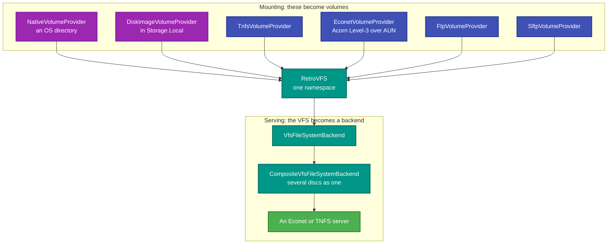

# RetroIO.Storage.Providers

## What it is

**Volume providers**: the things that can be mounted. A disk image is one kind; so is a native OS
directory, a TNFS server, an Econet file server, an FTP site and an SFTP host. Each implements
`IVolumeProvider`, so all of them appear in the same namespace.

## Why you need it

Because "where are the files?" has more than one answer, and a file manager should not care. Once a
TNFS server and a D64 image are both mounted volumes, copying between them is the same operation as
copying within one.

The less obvious value is the **reverse** direction: `VfsFileSystemBackend` and
`CompositeVfsFileSystemBackend` let the VFS be the backend for a *server*. So an Econet file server can
serve several mounted discs — one of them a real directory, another a disk image, a third a remote TNFS
share — as one filesystem to a BBC Micro that knows nothing about any of it.

## What you can use it for

- Mounting a **native directory** and treating it as a retro volume (`NativeVolumeProvider`).
- Mounting a **remote** filesystem: TNFS, Econet/AUN, FTP or SFTP.
- **Serving** from the VFS: present mounted volumes to a protocol server through `IFileSystemBackend`.
- Composing several discs into one backend for the Econet file server
  (`CompositeVfsFileSystemBackend`) — which is how one server mixes local and remote discs.
- Copying between any two of the above, with extended attributes preserved where the target cannot hold
  them natively.

## Prerequisites

| Requirement | Needed for | Notes |
|---|---|---|
| .NET SDK as pinned in `global.json` | Everything | |
| `RetroIO.Storage.Core` | `IVolumeProvider`, the mount registry | |
| `RetroIO.Protocols.Tnfs` | `TnfsVolumeProvider` | |
| `RetroIO.Protocols.Econet` | `EconetVolumeProvider` | |
| A reachable server | Any remote provider | FTP, SFTP, TNFS or AUN |
| Credentials | FTP, SFTP, and Econet `*I AM` | |

## Both directions

Note the symmetry, and that it is the useful part: RetroIO can be a **client** of TNFS and Econet, and a
**server** of them, over the same mounted volumes.

## Contents

| Type | Role |
|---|---|
| `NativeVolumeProvider` | An OS directory, passthrough, on Windows/Linux/macOS |
| `TnfsVolumeProvider` | A TNFS server as a volume |
| `EconetVolumeProvider` | An Acorn Level-3 file server over UDP AUN |
| `FtpVolumeProvider` | FTP (RFC 959) |
| `SftpVolumeProvider` | SFTP over SSH (RFC 4251). Checks the server's host key, see below |
| `SftpHostKeyPolicy` | Decides whether to trust the host key an SFTP server presents |
| `VfsFileSystemBackend` | The VFS presented as an `IFileSystemBackend` for a server |
| `CompositeVfsFileSystemBackend` | Several VFS-mounted discs presented to the Econet server as one |
| `DiscMount` | One disc within such a composition |

### SFTP host keys

An SFTP mount **refuses a server whose host key it does not know**. Without that check anyone who can
intercept the connection could pose as the server and read the password or the files. Give the mount one
of these, as query values on the `sftp://` URI:

| Option | Effect |
|---|---|
| `hostKey=SHA256:...` | Pin the key. The fingerprint is the one `ssh-keygen -lf` prints. Several, separated by commas, are allowed |
| `hostKeyCheck=accept-new` | Trust a host the first time you see it and remember its key |
| `hostKeyCheck=off` | No check at all. Only for a network you fully control |
| `knownHosts=<path>` | The file where remembered keys live. The default is `.retroio/sftp-known-hosts` in your user profile folder |

A server whose key **changes** is always refused, whatever the mode, and the file is never overwritten.
The refusal message tells you the fingerprint the server presented and what to add.
