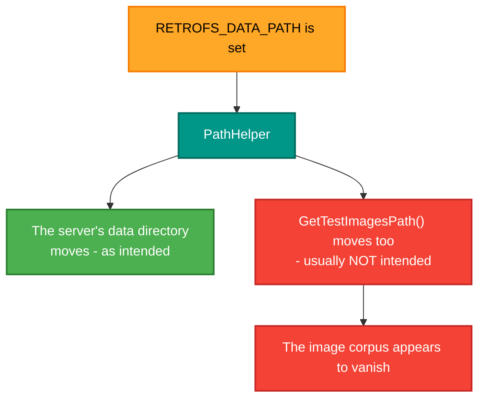

# RetroIO.Storage.Utilities

## What it is

Four small helpers the storage packages and the tools share: where user data lives, a JSON server log,
a console box renderer, and the test-images setup.

## Why you need it

Each of these is trivial and each was wrong in several places before it was in one.

**`PathHelper`** is the important one. "Where does RetroFS keep its data?" has a different answer on
every platform — `Documents\RetroFS` on Windows, XDG directories on Linux and macOS — and a tool that
hard-codes one of them works on one machine. It is also the thing `RETROFS_DATA_PATH` relocates, which
matters more than it looks: that variable moves the **image corpus** too, so setting it for a server test
makes the corpus appear to vanish for everything else.

**`ConsoleBox`** exists because aligning a Unicode box by hand does not survive a line of content that is
one character too long. It pads or truncates every line to the configured inner width, so the right
border lines up with the top and bottom — which is the difference between output that looks finished and
output that looks broken.

## What you can use it for

- Finding or creating the user-data directory on any platform (`PathHelper`).
- Writing an append-only server log that rotates, in JSON Lines — one object per line, so it can be read
  by a program as easily as by a person (`RetroFsServerJsonLog`).
- Drawing aligned boxes in console output (`ConsoleBox`).
- Creating the standard test-images folder structure (`TestImagesSetup`).

## Prerequisites

| Requirement | Notes |
|---|---|
| .NET SDK as pinned in `global.json` | |
| No other RetroIO package | |

## Contents

| Type | Role |
|---|---|
| `PathHelper` | Per-platform user-data paths: `Documents\RetroFS` on Windows, XDG elsewhere |
| `RetroFsServerJsonLog` | Append-only JSON Lines log at `{dataPath}/logs/retrofs-server.jsonl`, rotating at 10 MB |
| `ConsoleBox` | Fixed-width Unicode boxes, with every line padded or truncated so the borders align |
| `TestImagesSetup` | Creates the standard test-images folder in the user's data directory |

## The `RETROFS_DATA_PATH` trap

Clear the variable before testing anything that reads the corpus. This is recorded as a trap in the
manual test documents for the same reason.
