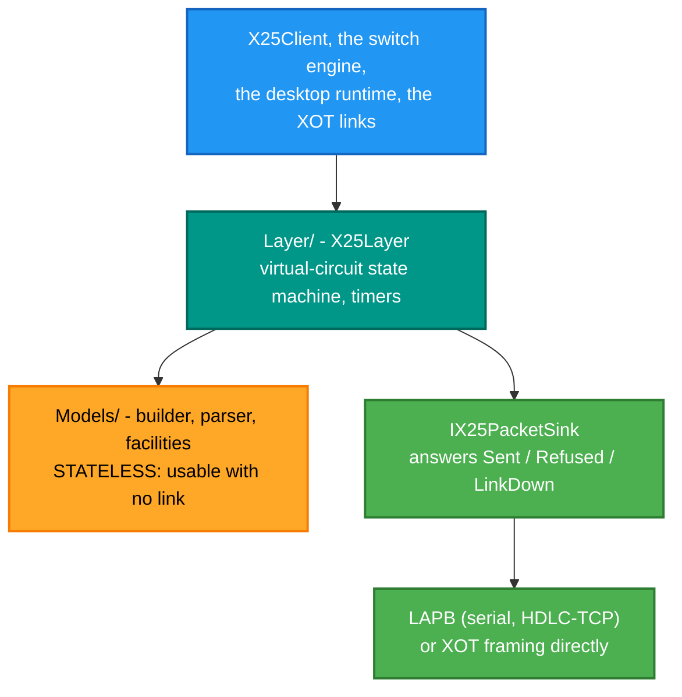
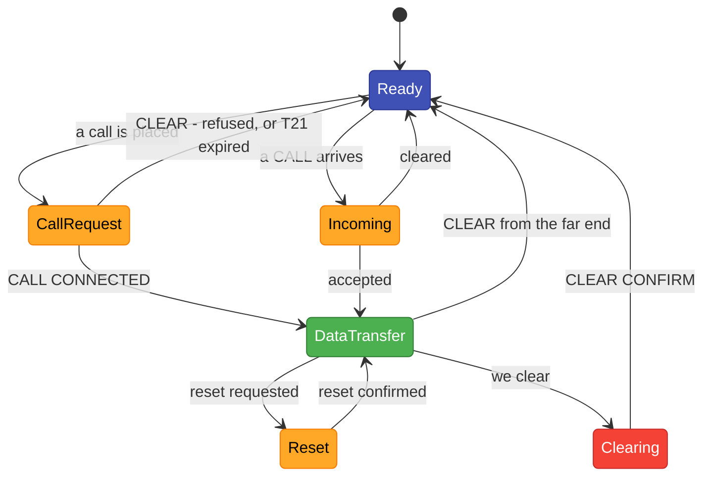

# RetroIO.X25

## What it is

X.25 itself — the packet layer, layer 3. Virtual circuits, call set-up and clearing, data transfer
with flow control, facility negotiation, interrupts, reset and restart. It turns a reliable frame
pipe into **many independent conversations** over one link, each with its own logical channel number,
sequence numbers and window.

## Why you need it

A link carries frames; an application wants a **call**. Between the two is a great deal of
bookkeeping: allocating a logical channel, encoding an X.121 address, negotiating packet and window
sizes, keeping separate send and receive sequence numbers per circuit, stopping the sender when the
receiver's window closes, recovering one circuit with a reset without disturbing the others, and
restarting the link without losing track of what existed.

Getting any of that subtly wrong produces a network that *mostly* works, which is the worst kind —
so this is the one place in RetroIO allowed to hold X.25 packet-layer state, and every consumer
builds on it rather than beside it.

## What you can use it for

- Placing and answering calls, with the cause and diagnostic codes the specification defines.
- Many circuits on one link — which is what makes a switch possible rather than a cable.
- **Encoding and decoding packets with no link at all**: `Models/` is stateless, which is exactly
  how the shared conformance vectors are run.
- Permanent virtual circuits, never cleared, reset by a restart.
- Driving a complete call, reset and restart sequence in a unit test in microseconds — the engine
  owns no clock and no threads.

## Prerequisites

| Requirement | Notes |
|---|---|
| .NET SDK as pinned in `global.json` | |
| **Zero dependencies** | No transport, no framing, no logging framework |
| The specifications | The X.25 specification texts, kept outside the repository. Read the clause; do not cite it from memory |

## Where it sits

A circuit's life:

**The sink contract is the detail worth knowing**: it answers `Sent`, `Refused` or `LinkDown` —
never a byte count — and every state change that assumed a send is rolled back when the send did not
happen. That is what makes a blocked link safe rather than silently desynchronised.

---

The one X.25 packet layer for every RetroIO stack. The desktop runtime, `X25Client`, the
switch and the XOT links all build on this project, and nothing else may carry X.25
packet-layer state. Zero dependencies. Namespaces are unchanged from where the code came
from (`RetroIO.Protocols.X25.Models` for the stateless codec, `RetroIO.Protocols.X25.PacketLayer`
for the engine), so consumers did not move.

Everything it replaces sits in `DeleteMe/` folders under namespaces ending `.DeleteMe`
(`src/RetroIO.Protocols.X25/src/DeleteMe`). Nothing new may
reference those.

## Contents

- `Models/` - `X25PacketBuilder`, `X25PacketParser`, `X25Packet`, `X25PacketTypeIdentifier`:
  stateless encode and decode. `X25Facilities`: the facility field per X.25 clause 7.1 - class
  walk, the 0x00 marker, the 0xFF extension prefix, range-checked packet and window sizes,
  byte-for-byte pass-through of everything else.
- `Layer/` - `X25Layer`, the virtual-circuit state machine; `X25Vc`; `X25Config` (validated at
  construction); `X25Diagnostic` and `X25Cause` (Annex E and Tables 5-7/5-8/5-9, with the
  clause text on every constant); the seam in `X25LayerSeam` (`IX25PacketSink`, the event
  delegates).

## What the engine does (ITU-T X.25 10/96)

Driven by the caller, single-threaded: `ProcessPacket` for every packet from the link,
`Tick(nowMs)` for time. The sink below answers `Sent` / `Refused` / `LinkDown`, never a byte
count, and every state change that assumed a send is rolled back when it did not happen.

- P(S) checked against V(R), P(R) against the window; violations reset the circuit with
  diagnostics 1 / 2 (4.4.1.3). RR, RNR and REJ only in data transfer; a REJ resets with 37
  (no packet retransmission facility).
- RNR is cleared by an RR or a reset, never by a data packet's piggybacked P(R) (4.4.1.6).
- Call, clear, reset and restart collisions per 4.1.6 / 4.1.9 / 4.4.3.3 / 4.1.2: nothing
  crosses, both sides consider the procedure complete, the application is told once.
- T20 / T21 / T22 / T23 per Table D.2: retransmission, then a Clear Request or a give-up with
  diagnostics 52 / 49 / 51 / 50. No call set-up while a Restart Request is unanswered (4.1.1):
  the call is held and sent on the confirmation.
- Facilities requested in every Call Request; the Call Connected's values applied after a
  Table 6-2 check; incoming requests accepted and echoed; packet size enforced both ways.
- Annex C Tables C.1-C.4 on every received packet: DIAG (a DCE sends a Diagnostic packet, a
  DTE counts), DISCARD, or ERROR (Clear with 20-26 "invalid for state pN", Reset with 27).
- Interrupts (4.4.2): one outstanding per direction, confirmed on receipt, policed with 43.
- Complete packet sequences (4.3.4 / 4.3.5): `SendMessage` segments with the M bit and queues
  behind the window; `MessageReceived` delivers a reassembled sequence once; the Q bit must not
  change inside a sequence (83). The D bit is carried, not honoured.
- Permanent virtual circuits (`AddPvc`), never cleared, reset by a restart (4.1.1).
- A DTE sends cause 0 (or bit 8 set) in Clear, Reset and Restart (Tables 5-7/5-8/5-9 note a).
- A DTE picks its channels from the top of the range, a DCE from the bottom (Annex A note 6).

Events: `IncomingCall` (with call user data), `CallConnected`, `DataReceived` (per packet),
`MessageReceived` (per sequence), `Cleared` (once per call, whoever ended it), `Reset`,
`RestartOccurred`, `RestartTimedOut`, `InterruptReceived`, `InterruptConfirmed`,
`DiagnosticReceived`, `WindowOpened`. Counters: `SendFailures`, `ProcedureErrors`,
`UnexpectedPackets`, `CallTimeouts`, `ResetTimeouts`, `ClearTimeouts`, `RestartTimeouts`,
`DiagnosticsSent`, `DiagnosticsReceived`.

## Specification and tests

Text: the specification set kept outside the repository (X.25 10/96, X.3, X.28, X.29, X.75, RFC 1613, RFC 1662,
ISO 13239). Read the clause; do not cite it from memory - the skill `x25-stack` lists the
traps in the extracted text.

Tests, in `src/tests/RetroIO.Protocols.X25.Tests`: `X25VectorTests` runs the conformance vectors
in `src/tests/x25-vectors/x25-vectors.json` (shared with the C emulator; a `knownFail` vector must
keep failing until someone flips it on purpose); `X25PacketLayerRuleTests` has one group per
rule of the plan (R1-R21); `X25LayerTests` and `X25ClientInteropTests` run two engines back
to back and over XOT.

Created 2026-09-06 as Phase B1 of the X.25 one-stack plan in the migration notes; Phase B
(the rules above) completed the same day.
