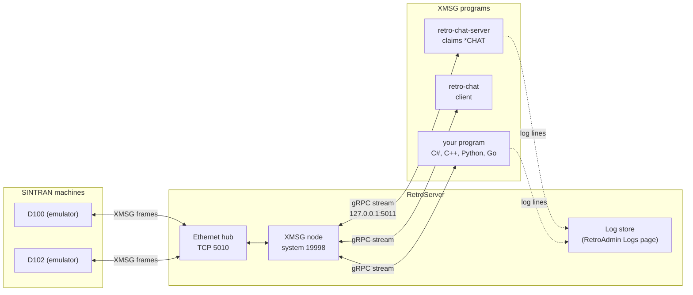
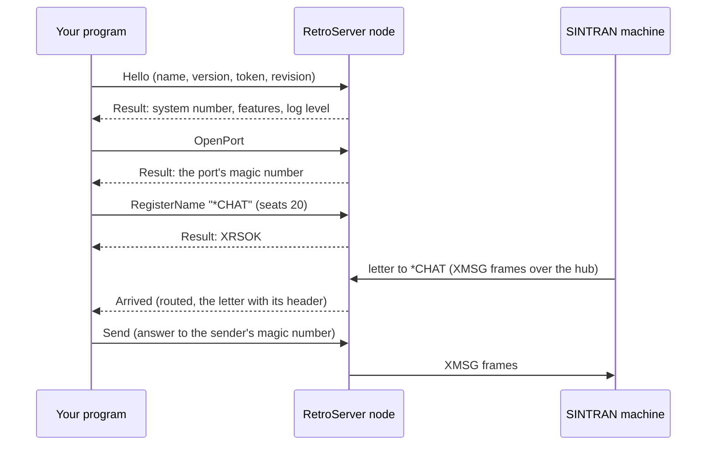

# XMSG programs and RetroServer

How to write a program that talks XMSG through RetroServer: a server that SINTRAN machines reach by name, or a client
that uses such a server. Written for developers.

## Contents

| Page | What it covers |
|---|---|
| This page | What an XMSG program is, why you would write one, and how the parts fit together |
| [Building programs](programs-guide.md) | A server and a client step by step, the settings on both sides, the token, how to test |
| [Protocol reference](protocol-reference.md) | Every message on the connection, field by field, and every number a program needs |
| [Logging](logging.md) | Sending log lines to RetroServer, choosing what is kept, and reading them back |
| [Versioning and extending](versioning.md) | How the connection changes without breaking programs, and how to add a message |

## What an XMSG program is

XMSG is the messaging system of Norsk Data's SINTRAN III and COSMOS. On a SINTRAN machine a program opens a **port**
(a mailbox with an address, called a **magic number**), may claim a **name** for it, and sends and receives
messages. Other machines find a server by its name.

**RetroServer is an XMSG machine.** It has its own system number, joins the XMSG network (the Ethernet hub, later
HDLC lines too), and runs the low-level work: acknowledgements, sequence numbers, resends.

**An XMSG program connects to RetroServer** and makes the same calls a SINTRAN task makes: open a port, claim a name,
send, receive. Its ports and names live on RetroServer, so to a SINTRAN machine the program looks like a task on
RetroServer. The program never sees an XMSG frame.

- A **server program** claims a name, for example `*CHAT`, and answers whoever writes to it.
- A **client program** sends a letter to a name and talks to the server that answers.

Both use the same connection and the same calls. Only the calls they choose differ.

An emulator (nd100x, RetroCore) is never an XMSG program. It is an XMSG machine of its own and reaches RetroServer
over the hub or a line.

## Why you would write one

- **Offer a service to SINTRAN users** without writing it in PLANC or FORTRAN on the ND: a chat, a file service, a
  bridge to something modern. The SINTRAN side reaches it by name, as it would reach a server on another ND.
- **Use an ND service from a modern program**: a client program can send letters to servers on the SINTRAN machines.
- **Keep it out of RetroServer.** A program runs in its own process. If it crashes, RetroServer and every other
  program keep running. It can be written in any language gRPC supports.
- **Write it once.** The hard parts of XMSG (acknowledgements, sequence state, recovery) are done once, in
  RetroServer's node.

## How it works, in one picture

## What you need

| Thing | Where |
|---|---|
| The connection's definition | `RetroIO.Protocols.Xmsg.Plugins.Contracts/src/xmsg_plugin.proto` (also inside the NuGet package, under `proto/`) |
| The C# library | `RetroIO.Protocols.Xmsg.Plugins.Client` |
| Two complete sample programs | `samples/RetroIO.Samples.ChatServer` and `samples/RetroIO.Samples.ChatClient` |
| RetroServer with its XMSG node switched on | `xmsgnode-config.json` in RetroServer's data folder |

**Other languages.** The connection is gRPC over HTTP/2, defined by the `.proto` file. gRPC has official libraries
for C++, Python, Go, Java, Rust and more: run that language's protobuf tool on the file and you have the messages and
the call. **Plain C has no official gRPC library**; use C++, or a third-party C library at your own risk. The
[protocol reference](protocol-reference.md) lists every number you would otherwise have to dig out of the C# code.
